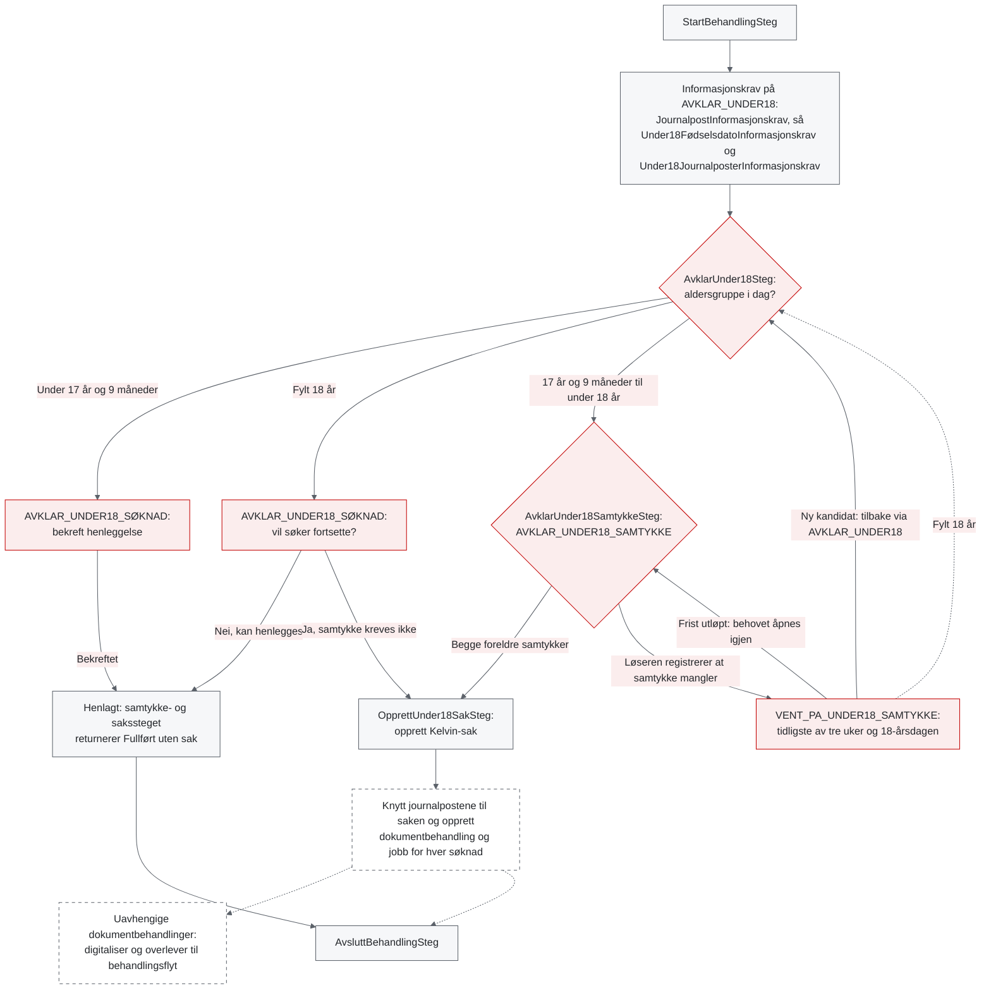
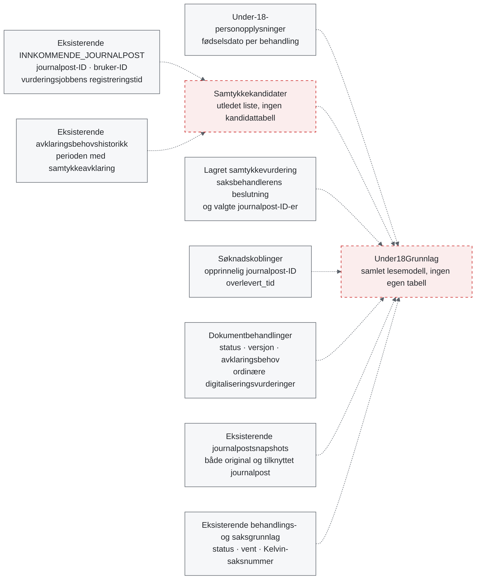
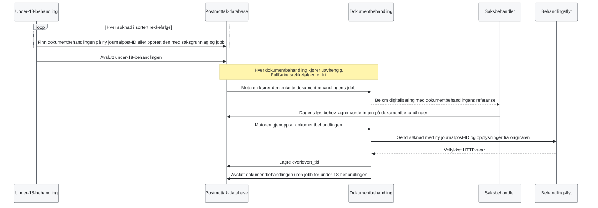
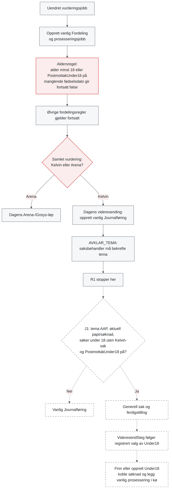

# Under-18-flyt: avklaringer og implementeringsplan

Avklart 12. november 2026, med oppdateringer til og med 25. november.
Dokumentet samler kravavklaringene og viser ønsket funksjonalitet, status og planen videre.

Den 18. november ble løsningen endret til å gjenbruke vanlige
`DokumentHåndtering`-behandlinger for digitalisering og overlevering.
Under-18-behandlingen oppretter én dokumentbehandling per søknad.
Dette erstatter forslaget om digitalisering inne i under-18-behandlingen.

Den 19. november ble kravet om sekvensiell fullføring fjernet.
Alle dokumentbehandlingene og jobbene opprettes uten å vente på digitalisering
eller overlevering. Flere søknader kan vente på digitalisering samtidig og
overleveres i ulik rekkefølge. Under-18-behandlingen avsluttes når alle
dokumentbehandlingene og jobbene er opprettet. Eget koordineringssteg,
dokumentbehandlingsvent og gjenopptaksjobber fra dokumentbehandlingene utgår.
Samtykkevent og den daglige aldersjobben beholdes.

Den 24. november ble journalføringen flyttet ut av under-18-behandlingen.
Aktuelle papirsøknader går først gjennom Journalføring. Saksbehandler avklarer
temaet. Ved tema AAP journalfører Journalføring søknaden på generell sak og
ferdigstiller den. Først etterpå oppretter eller oppdaterer løsningen
under-18-behandlingen. Den samler fortsatt søknader, avklarer samtykke og
oppretter Kelvin-sak og dokumentbehandlinger.
Planen erstatter dermed forslaget om direkte journalføring i `Under18SøknadsJournalfører`.

Den 24. november ble også kandidatoversikten forenklet. Vi beholder dagens
registrering i `INNKOMMENDE_JOURNALPOST` fra vurderingsjobben. Kandidatlisten er
et hjelpemiddel, ikke en komplett mottaksoversikt. Tidlig Kafka-registrering,
mottaksrekkefølge og et separat mottaks-/varslingsspor utgår, sammen med M1–M3.
Vi oppretter ingen `JOURNALPOST_MOTTAK`-tabell.

Den 25. november ble inngangen endret til å bruke vanlig Fordeling.
`PostmottakUnder18` styrer aldersunntaket i `Aldersregel`, ikke vurderingsjobben.
Direkte opprettelse av Journalføring fra vurderingsjobben og en egen rutemarkør utgår.
Togglen brukes til engangsaktivering. Før aktivering følger dokumentene vanlig flyt,
og postmottak oppretter ingen Under18-behandlinger. Etter aktivering blir togglen stående på.

Den 25. november ble også den egne overleveringsjobben fjernet fra J1.
`VideresendSteg` finner eller oppretter Under18 etter vellykket ferdigstilling i Joark,
kobler søknaden og legger vanlig prosessering i kø.
Journalføring-behandlingen trenger ikke ha status `AVSLUTTET` før dette skjer.

Utgangspunktet er diagrammet i
[image-2026-11-11_8-30-51.png](image-2026-11-11_8-30-51.png).
Diagrammet må vise at saksbehandler først bekrefter tema AAP i Journalføring.
Journalføring setter deretter søknaden på generell sak og ferdigstiller den.
Under-18-behandlingen knytter den ferdigstilte journalposten til Kelvin-saken senere.

## Omfang og inngang

- Vi lager en egen behandlingstype i postmottak.
- Flyten gjelder bare papirsøknader. Digitale søknader er sperret for personer under 18 år.
- Brevkode er tilstrekkelig for å identifisere en søknad.
- Alder vurderes på tidspunktet vi behandler dokumentet, ikke på søknadsdato eller mottaksdato.
- I under-18-løpet er manglende fødselsdato en feilsituasjon. Kast exception og la jobben feile.
  Den vanlige aldersregelen i Fordeling beholder dagens `false`-resultat ved manglende fødselsdato,
  uansett toggle. Den skal ikke stoppe ordinær dokumentfordeling med en ny exception.
- Har søker allerede en Kelvin-sak ved mottak, følger søknaden vanlig flyt.
  Dette gjelder også søkere under 17 år og 9 måneder.
- Leveransen omfatter backend og nødvendige kontrakter. Frontend inngår ikke.

## Journalføring på generell sak

- En papirsøknad som kan gå til under-18-flyten, starter i en vanlig
  Fordeling-behandling. Når fordelingsreglene velger Kelvin, opprettes vanlig
  Journalføring, ikke en under-18-behandling.
- Saksbehandler bekrefter at temaet er AAP. Først da velger Journalføring
  generell sak for en aktuell under-18-papirsøknad uten Kelvin-sak, dersom
  `PostmottakUnder18` er på, og ferdigstiller søknaden på tema AAP.
- Etter vellykket ferdigstilling finner eller oppretter `VideresendSteg`
  under-18-behandlingen, kobler søknaden og legger en vanlig
  `ProsesserBehandlingJobbUtfører` i kø. Vi bruker samme mønster som for
  DokumentHåndtering, uten en egen overleveringsjobb. Journalposten skal være
  ferdigstilt i Joark, men Journalføring-behandlingen trenger ikke ha status
  `AVSLUTTET`. En journalpost med annet tema starter ikke en under-18-behandling.
- Journalføring bruker dagens retry-regler. Den skal ikke opprette en
  under-18-behandling hvis ferdigstillingen feiler. Et retry etter vellykket
  ferdigstilling skal kunne opprette behandlingen uten å journalføre på nytt.
- Dette gjelder også søknader som senere skal henlegges fordi søker er for ung.

## Alder og henleggelse

| Alder når steget kjører | Oppførsel |
| --- | --- |
| Under 17 år og 9 måneder | Informer saksbehandler om at søknaden henlegges fordi søker er for ung. Saksbehandler må bekrefte. |
| Fra og med 17 år og 9 måneder, men under 18 år | Avklar samtykke fra begge foreldre. |
| Fylt 18 år før Kelvin-saken er opprettet | Samtykkekravet faller bort. Ta behandlingen automatisk av samtykkevent, også hvis saksbehandler har satt den manuelt på vent i denne delen av flyten. Saksbehandler må spørre søker om hen fortsatt ønsker å søke AAP og registrere svaret i det felles avklaringsbehovet `AVKLAR_UNDER18_SØKNAD`. Ikke opprett Kelvin-sak før søker har bekreftet at hen vil fortsette. Vil søker ikke fortsette, svarer saksbehandler at behandlingen kan henlegges, og den avsluttes som ved annen henleggelse. Fødselsdagen avslutter ikke behandlingen. |

Alder må sjekkes på nytt før henleggelsessteget kjører. Har søker nådd 17 år og
9 måneder, skal vi ikke lenger foreslå henleggelse, men gå til samtykkeavklaring.

Ved bekreftet henleggelse avsluttes hele under-18-behandlingen. Dette gjelder både
når søker er for ung, og når søker etter fylte 18 år ikke vil fortsette. Det opprettes ingen
Kelvin-sak, og søknadene overleveres ikke. Løsningen sender ikke brev eller oppretter
andre oppgaver i forbindelse med henleggelsen.

Nye søknader etter avsluttet behandling vurderes på nytt ut fra aktuell alder.

## Samtykke

- Begge foreldre må ha samtykket.
- Innhentingen skjer manuelt utenfor flyten. Løsningen skal be saksbehandler innhente samtykke.
- Ett avklaringsbehov kan dekke både innhenting og vurdering.
  Frontend skal kunne skille mellom disse oppgavene ut fra løsnings-DTO-en og behandlingens tilstand.
- Saksbehandler vurderer samtykke manuelt, også når det følger med søknaden.
- Det er tilstrekkelig at saksbehandler bekrefter at begge foreldrene har samtykket.
- Vi krever ingen begrunnelse, heller ikke når samtykke mangler.
- Vi lagrer en liste over journalpost-ID-er som dokumenterer samtykke.
  Listen kan være tom i første versjon. Det skal være mulig å gjøre den obligatorisk senere.
- Listen må støtte flere journalposter. Søknad og samtykke kan også ligge i samme journalpost.

## Vent

Når saksbehandler svarer at samtykke mangler, opprettes et eget ventebehov.
Standardfristen defineres i ventebehovet og er tre uker.
Fristen settes til det tidligste av tre uker og søkerens 18-årsdag.

Ved utløpt frist åpnes samtykkeoppgaven igjen, med mindre samtykkekravet har falt bort
fordi søker har fylt 18 år. Da oppheves venten, men behandlingen går ikke automatisk videre
til saksopprettelse. Saksbehandler må spørre søker om hen fortsatt vil søke AAP og registrere svaret.
Saksbehandler kan igjen svare at samtykke mangler og få en ny automatisk ventefrist,
eller bruke vanlig manuell vent. Det er ingen fast grense for antall runder.

Manuelt satt vent beholdes ved nye journalposter. Når søker fyller 18 år før
Kelvin-saken er opprettet, oppheves også en aktiv manuell vent automatisk,
selv om fristen er senere. Dette gjelder vent mens saksbehandler avklarer henleggelse
eller samtykke. Fødselsdagen opphever ikke vent på en dokumentbehandling etter
saksopprettelse, og løser ikke et manuelt avklaringsbehov eller oppretter en Kelvin-sak.
Saksbehandler må først spørre søker om hen fortsatt vil søke AAP og registrere svaret.
Nye journalposter kan fortsatt vises som kandidater mens behandlingen står på vent.

## Nye journalposter og kandidater til samtykke

- Kandidatlisten utledes fra vurderingsjobbens registreringer i
  `INNKOMMENDE_JOURNALPOST`, uten en egen kandidattabell. Vinduet starter når
  samtykkeavklaringen opprettes. Vi bruker registreringstidspunktet, ikke første
  Kafka-mottak eller Joarks mottaksdato.
- Automatisk vekking bygger på dagens varsling fra vurderingsjobben og er ikke
  garantert for alle nye dokumenter. En kandidat registrert etter at venten ble
  opprettet, kan ta behandlingen av automatisk samtykkevent.
- En forsinket vurderingsjobb kan derfor vekke en nyere vent selv om dokumentet
  kom tidligere. Dokumenter med allerede åpen Journalføring trenger ikke vises
  som nye kandidater eller vekke behandlingen.
- Manuelt satt vent beholdes, med mindre søker har fylt 18 år før Kelvin-saken
  er opprettet. Fødselsdagen opphever da samtykkevent og manuell vent i denne delen av flyten.
- Kandidatlisten er et hjelpemiddel og trenger ikke inneholde alle mottatte dokumenter.
  Saksbehandler kan registrere samtykkereferanser også utenfor kandidatlisten.
  Vi tolker ikke en kandidat automatisk som samtykke.
- Saksbehandler må vurdere om journalposten inneholder nødvendig samtykke.
  Hvis ikke, kan behandlingen settes på vent igjen.
- Det er tilstrekkelig å håndtere nye hendelser. Vi trenger ikke hente inn historiske dokumenter.
- Gjentatte hendelser for en allerede registrert journalpost gir ikke en ny
  registreringstid og skal ikke ta behandlingen av vent på nytt.
- Hendelser om andre temaer eller bare status `JOURNALFOERT` trenger ikke ta behandlingen av vent.
- Andre dokumenttyper enn søknader følger vanlig flyt. De kan også vises som
  kandidater og vekke behandlingen gjennom vurderingsjobben.

Samtykkekravet er uendret: saksbehandler må bekrefte begge foreldrenes samtykke.
Hvis et dokument ikke utløser automatisk vekking, kommer oppgaven tilbake ved
utløpt automatisk ventefrist. Manuell vent følger fortsatt sin egen frist.

## Flere søknader i samme under-18-behandling

Flere papirsøknader fra samme søker samles i én åpen under-18-behandling frem til
Kelvin-saken er opprettet. Dette gjelder også når behandlingen ikke står på vent,
for eksempel mens en samtykke- eller henleggelsesoppgave er åpen.

Hver søknad går gjennom Journalføring og må få tema AAP før den ferdigstilles på
generell sak og legges til under-18-behandlingen. Søknader fra samme søker skal
samles i én åpen under-18-behandling. Én samtykkevurdering dekker de innsamlede
søknadene. Etter saksopprettelse og tilknytning får hver søknad sin egen
`DokumentHåndtering`-behandling, som beskrevet nedenfor.

Når Kelvin-saksnummeret foreligger, stenges innsamlingen, og nye søknader følger vanlig flyt.
En søknad som allerede er i Journalføring når innsamlingen stenges, må likevel
følges opp. Hvis den allerede er ferdigstilt på generell sak, feiler `VideresendSteg`
med en tydelig driftsfeil for manuell oppfølging. Steget oppretter ikke en ny samling.
Under-18-behandlingen avsluttes ikke da. Den fullfører tilknytning av de innsamlede
dokumentene og oppretter dokumentbehandlingene med prosesseringsjobber før den avsluttes.
Digitalisering og overlevering fortsetter uavhengig i dokumentbehandlingene.

## Opprettelse av Kelvin-sak

Når samtykke er godkjent, eller søker har fylt 18 år og saksbehandler har registrert
at søker fortsatt ønsker å søke AAP:

1. Opprett Kelvin-sak.
2. Knytt journalpostene med søknadene i behandlingen til saken.
3. Knytt også journalpostene i den registrerte samtykkelisten til saken.
4. Fortsett med digitalisering og overlevering av søknadene.

Fagsaken på den ferdigstilte journalposten endres ikke direkte.
Som avklart 13. november brukes dokarkivs
`/rest/journalpostapi/v1/journalpost/{kildeJournalpostId}/knyttTilAnnenSak`,
som returnerer `nyJournalpostId`.
Tilknytningen ligger i Joark. Når vi trenger den nye journalpost-ID-en for en bestemt
kildejournalpost, slår vi opp i SAF i stedet for å lagre koblingen i postmottak.
Det er den nye journalpost-ID-en som skal brukes ved overlevering til behandlingsflyt.

Hvis en Kelvin-sak uventet har blitt opprettet mens behandlingen står på vent,
skal vi logge på `ERROR`-nivå og kaste exception slik at jobben feiler.
Vi skal ikke automatisk bruke den uventede saken og fortsette.

## Digitalisering, overlevering og rekkefølge

- Hver søknad må digitaliseres og overleveres separat.
- Dokumentbehandlingene opprettes etter mottatt-tidspunkt i Joark, eldste først.
- Når klokkeslett mangler, brukes mottaksdato klokken 00:00.
  Ved like tidspunkt avgjør kildejournalpost-ID-en rekkefølgen.
- Flere søknader kan vente på digitalisering samtidig og overleveres i ulik rekkefølge.
- Vellykket HTTP-kall til behandlingsflyt bekrefter overleveringen for den enkelte søknaden.
  Vi trenger ikke vente på at behandlingsflyt har ferdigbehandlet hendelsen.
- Sorteringen ved opprettelse garanterer ikke kjøre- eller fullføringsrekkefølge.
  Senere søknader i vanlig flyt trenger heller ikke vente på disse.

Vi bruker eksisterende `DokumentHåndtering` med `DigitaliserDokumentSteg`,
`DigitaliserDokumentLøser` og `OverleverTilFagsystemSteg`.
Hver søknad får en egen dokumentbehandling med referanse, versjon, vurderinger og avklaringsbehov.
Under-18-behandlingen lagrer søknadene og journalpost-ID-ene saksbehandler har valgt som samtykke.
Dokumentbehandlingen finnes på søknadens nye journalpost-ID.
Samtykkedokumenter får ikke egne dokumentbehandlinger, med mindre journalposten også inneholder
en innsamlet søknad.

Under-18-behandlingen avsluttes når alle innsamlede søknader har fått
dokumentbehandling og prosesseringsjobb. Den venter ikke på dokumentbehandlingenes
status eller overlevering. Hver dokumentbehandling håndterer egne oppgaver, vent og feil.

## Feature toggle og produksjon

`PostmottakUnder18` er av i hvert miljø til hele forløpet er klart. Vi slår den på én gang
per miljø og forutsetter at den ikke slås av igjen.

Fordeling bruker togglen for aldersunntaket. Journalføring bruker samme toggle når
`AvklarSakSteg` velger generell sak for en Under18-søknad. Før aktivering velges ikke
dette løpet, heller ikke når et tidligere fordelingsresultat sender dokumentet til Kelvin.

Fram til PG registrerer `AvklarSakSteg` i `Under18Repository` hvilken Journalføring som
valgte Under18. I PG flyttes valget til `Saksvurdering`. Ved et nytt forsøk
følger `VideresendSteg` det registrerte valget uten å vurdere alderen på nytt.
Har søknaden fått en Kelvin-sak før kobling, feiler jobben for manuell oppfølging.
En manuelt valgt generell sak starter ikke Under18.
De påfølgende Under18-jobbene trenger ingen egen togglekontroll.
Vi planlegger ikke for stopp, vent eller omkjøring som følge av deaktivering.

## Diagrammer

Diagrammene viser målbildet for flyten og datamodellen.

### Under-18-behandlingen

Under-18-behandlingen starter etter at Journalføring har ferdigstilt søknaden.

### Mottak og journalføring

Mottak, Journalføring og Under18 er separate forløp.

```mermaid
%%{init: {"theme":"base","themeVariables":{"primaryColor":"#F6F7F9","primaryTextColor":"#23262A","primaryBorderColor":"#5B6169","lineColor":"#5B6169","secondaryColor":"#FBEDED","tertiaryColor":"#F6F7F9","background":"#FFFFFF"}}}%%
flowchart LR
    joark["Joark: relevant hendelse<br/>status MOTTATT"] --> kafka["JoarkKafkaHandler"]
    kafka --> åpen{"Åpen Journalføring?"}
    åpen -->|"Ja"| gjenoppta["Gjenoppta eksisterende Journalføring<br/>ingen egen kandidatvarsling"]
    åpen -->|"Nei"| vurder["Vurderingsjobben registrerer<br/>INNKOMMENDE_JOURNALPOST"]
    vurder --> fordeling["Vanlig Fordeling:<br/>Aldersregel bruker PostmottakUnder18"]
    fordeling --> system{"Fordelingsreglene velger Kelvin?"}
    system -->|"Ja"| journalføring["Opprett vanlig Journalføring"]
    system -->|"Nei"| ordinær["Dagens Arena-/Gosys-løp"]
    journalføring --> tema{"AVKLAR_TEMA"}
    tema -->|"Ikke AAP"| ordinærJournalføring["Fortsett vanlig Journalføring"]
    tema -->|"AAP"| under18valg{"Toggle på og aktuell papirsøknad?<br/>Søker under 18 uten Kelvin-sak<br/>eller papirsøknad til åpen samling"}
    under18valg -->|"Nei"| ordinærJournalføring
    under18valg -->|"Ja"| generell["Velg generell sak<br/>ferdigstill i Dokarkiv"]
    generell --> fullført{"Journalført?"}
    fullført -->|"Nei"| retry["Retry Journalføring<br/>ingen Under18-behandling ennå"]
    fullført -->|"Ja"| videresend["VideresendSteg"]
    videresend --> aktuell{"Valgte Journalføring Under18?"}
    aktuell -->|"Nei"| ordinærSlutt["Avslutt vanlig Journalføring"]
    aktuell -->|"Ja"| under18{"Kelvin-sak opprettet i mellomtiden?"}
    under18 -->|"Nei"| koble["Finn eller opprett Under18,<br/>koble søknad og legg vanlig prosessering i kø"]
    under18 -->|"Ja"| sen["Jobben feiler<br/>manuell oppfølging"]
    koble --> prosesser["ProsesserBehandlingJobbUtfører"]
    prosesser --> krav["Under18JournalposterInformasjonskrav<br/>og alder-/samtykkeavklaring"]
    krav --> sak["Opprett Kelvin-sak,<br/>tilknytninger og dokumentbehandlinger"]
    sak --> dokument["Uavhengige DokumentHåndtering-behandlinger"]
    dokument --> ferdig["Digitaliser og overlever"]
    classDef default fill:#F6F7F9,stroke:#5B6169,color:#23262A
    classDef valg fill:#FBEDED,stroke:#C30000,color:#23262A
    classDef uavklart fill:#FFFFFF,stroke:#5B6169,stroke-dasharray:5 5,color:#23262A
    class åpen,system,tema,under18valg,fullført,under18 valg
    class sen uavklart
```

### Datamodellen

Kolonner og tabeller er forslag. PK er primærnøkkel, FK fremmednøkkel og UK unik nøkkel.
`INNKOMMENDE_JOURNALPOST` beholder dagens mottakshistorikk fra vurderingsjobben.
R1 legger ikke til en egen rutemarkør eller nye mottaksfelter.
Diagrammet viser ikke alle eksisterende kolonner i denne tabellen.

```mermaid
%%{init: {"theme":"base","themeVariables":{"primaryColor":"#FBEDED","primaryTextColor":"#23262A","primaryBorderColor":"#C30000","lineColor":"#5B6169","tertiaryColor":"#F6F7F9","attributeBackgroundColorOdd":"#F6F7F9","attributeBackgroundColorEven":"#FFFFFF","background":"#FFFFFF"}}}%%
erDiagram
    BEHANDLING {
        bigint id PK
        varchar type "Journalføring, Under18 eller DokumentHåndtering"
        bigint journalpost_id "Fast Joark-ID for hver behandling"
        varchar status
    }
    UNDER18_PERSONOPPLYSNING {
        bigint id PK
        bigint behandling_id FK,UK "Én rad per under-18-behandling"
        date fødselsdato
        timestamp opprettet_tid
    }
    UNDER18_SOKNAD {
        bigint id PK
        bigint behandling_id FK "Under-18-behandlingens ID"
        bigint kilde_journalpost_id UK "Joark-ID"
        timestamp overlevert_tid "Settes etter vellykket overlevering"
    }
    INNKOMMENDE_JOURNALPOST {
        bigint id PK
        bigint journalpost_id UK "Joark-ID, én rad per journalpost"
        varchar status "Dagens evalueringsstatus"
        varchar bruker_id "Eksisterende personident"
        timestamp opprettet_tid "Registrering i vurderingsjobben"
    }
    UNDER18_SAMTYKKEVURDERING {
        bigint id PK
        boolean begge_foreldre_samtykket
        bigint[] samtykke_journalpost_ider "Joark-ID-er, tom liste tillatt"
        timestamp opprettet_tid
    }
    UNDER18_SAMTYKKE_GRUNNLAG {
        bigint id PK
        bigint behandling_id FK
        bigint samtykkevurdering_id FK
        boolean aktiv
        timestamp opprettet_tid
    }
    DIGITALISERINGSAVKLARING {
        bigint id PK "Eksisterende vurderingstabell"
    }
    DIGITALISERINGSVURDERING_GRUNNLAG {
        bigint id PK "Eksisterende koblingstabell"
        bigint behandling_id FK "Dokumentbehandlingens ID"
        bigint digitaliseringsavklaring_id FK
        boolean aktiv
    }

    BEHANDLING ||--|| UNDER18_PERSONOPPLYSNING : "har fødselsdato"
    BEHANDLING ||..o{ UNDER18_SOKNAD : "under-18 via behandling_id"
    BEHANDLING ||..o{ UNDER18_SAMTYKKE_GRUNNLAG : "har samtykkehistorikk"
    UNDER18_SAMTYKKEVURDERING ||..o{ UNDER18_SAMTYKKE_GRUNNLAG : "pekes på av"
    BEHANDLING ||..o{ DIGITALISERINGSVURDERING_GRUNNLAG : "dokumentbehandlingens vurderingshistorikk"
    DIGITALISERINGSAVKLARING ||..o{ DIGITALISERINGSVURDERING_GRUNNLAG : "pekes på av"
```

### Kandidater og lesemodell

Diagrammet skiller lagrede opplysninger, utledede kandidater og lesemodellen.

### Dokumentbehandlingene

Hver dokumentbehandling kjører uavhengig etter at under-18-behandlingen er avsluttet.

## Implementert

✅ betyr implementert og merget på `main`.

| Status | Arbeid | PR eller kode |
| --- | --- | --- |
| ✅ Merget | Gjenbrukbare rutiner for manuell digitalisering og overlevering. | #967 |
| ✅ Merget | SAF-oppslag av tilknyttede journalposter med `GJENBRUK`, inkludert testendepunkt. | #968 |
| ✅ Merget | Dokarkiv-klient for `knyttTilAnnenSak`, med returnert ny journalpost-ID og testendepunkt. | #969 |
| ✅ Merget | Behandlingstype Under18 med steg, avklaringsbehov og registreringer. | #974 |
| ✅ Merget | In-memory-basert alders-, søknads- og samtykkeavklaring med løsere og automatisk samtykkevent, inkludert evaluering av samtykkevurdering. | #975 |
| ✅ Merget | Tilbakeføring til tidligste steg med endret informasjonskrav. | #976 |
| ✅ Merget | Styrbar klokke og tilbakeføring når aldersgruppen endres ved gjenopptak. | #978 |
| ✅ Merget | Ventebehovsevaluatorer for frist og definisjon. | #980 |
| ✅ Merget | Journalpostmetadata i digitaliseringsgrunnlaget, inkludert brevkode og papir/digital. | #983 |
| ✅ Merget | Lagring av siste vellykkede kjøring og input for informasjonskrav. | #984 |
| ✅ Merget | Kandidatoppdatering på søknadssteget, tilbakeføring ved nye kandidater og samtykkevent som vekkes av vurderingsjobben. | #979 |
| ✅ Merget | Styrbare, stabile mottaksdatoer i SAF-fakes og tester av kandidatforløpet. | #979 |
| ✅ Merget | V1: Kontroll av kandidatens aktuelle personkobling i SAF mot søkerens identer fra PDL, inkludert historisk ident. Ugyldig personkobling gir eksplisitt feil. | #989 |
| ✅ Merget | V2: Validering av samtykkereferanser før lagring. Ukjente journalposter og ugyldig personkobling gir `UgyldigForespørselException`; aktiv vurdering og vent bevares ved avvisning. Tom liste og gyldige referanser utenfor kandidatlisten godtas. | #988 |

I #979 utledes mottakshistorikken fra vurderingsjobbens registrering, og kandidatvinduet
starter når samtykkeavklaringen opprettes. Dette beholdes i første versjon,
med begrensningene beskrevet under «Nye journalposter og kandidater til samtykke».

## Lagring og testing

| Repository | Data og bruk |
| --- | --- |
| Eksisterende repositorier | Behandlinger, personer, journalpostsnapshots, saksgrunnlag, avklaringsbehov, digitalisering og jobber. |
| `InnkommendeJournalpostRepository` | Innkommende journalposter, regelresultater og dagens mottakshistorikk fra vurderingsjobben. Brukes uendret i R1, uten egen rutemarkør. |
| `Under18Repository` | Person- og aldersopplysninger, søknadsavklaring, søknader, samtykkevurderinger og bekreftet overlevering. |

Hvert repository eier sine egne tabeller. Nye data får in-memory-implementasjoner i
`lib-test` sammen med koden som skriver og bruker dem. Eksisterende Postgres-tabeller
gjenbrukes gjennom sine repositorier. Nye oppslag innføres sammen med forløpet som trenger dem.

For kandidatoppslag gjenbruker vi dagens `INNKOMMENDE_JOURNALPOST`, personidenter
og registreringstid. Vi innfører ikke tidlig mottaksregistrering, en ny mottatt-status,
mottaksrekkefølge, personkobling eller venterundetabell.
R1 endrer ikke mottaksregistreringen eller kandidatoppslaget.

Informasjonskravene ligger på `AvklarUnder18Steg`. `JournalpostInformasjonskrav`
oppdaterer hovedjournalposten. `Under18JournalposterInformasjonskrav` melder `ENDRET`
ved nye kandidater, også når en annen behandling allerede har lagret dem. Forrige
kandidatliste ligger i input som allerede lagres av `InformasjonskravRepository`.
Kravet validerer nå alle kandidaters aktuelle personkobling uten å lagre kandidatjournalpostene.
Kandidat- og samtykkeløsertestene bruker in-memory-repositorier og SAF-/PDL-fakes, uten ekte database.

Hver PR testes gjennom den aktuelle Kafka-topologien, motoren, løseren eller API-et,
med ekte registreringer og fakes. Et eksisterende manuelt avklaringsbehov kan være
leveransens stoppunkt. Tilknytninger og dokumentkoblinger gjenbrukes ved retry.
Svarer ikke Dokarkiv, feiler jobben. Neste kjøring starter med samme SAF-oppslag.
In-memory-repositoriene gir kjørbare forløp med fakes, men følger ikke
databasetransaksjoner og overlever ikke restart. PG sikrer varig lagring og
verifiserer transaksjoner, rollback og samtidighet i Postgres før aktivering.

## Neste PR-er

ID-ene er arbeidsnavn. Avhengighetene angir hva som må være merget først.
V1 og V2 er merget i henholdsvis #989 og #988. R1 er under review i #990.
A1 kan utvikles uavhengig av resten av journalføringsløpet.
M1, M2 og M3 utgår etter forenklingen av kandidatoversikten og automatisk vekking.

| PR | Funksjonell leveranse | Avhenger av | Kontroll |
| --- | --- | --- | --- |
| R1 | Innfør `PostmottakUnder18`, av i dev og prod, og la togglen styre aldersunntaket i `Aldersregel`. Behold vanlig Fordeling og vurderingsjobben uendret. Øvrige fordelingsregler avgjør fortsatt Kelvin eller Arena. Ingen egen rutemarkør eller Under18-behandling opprettes i R1. | #979 | Med togglen av beholdes dagens aldersregel. Med togglen på kan en aktuell under-18-papirsøknad gå via vanlig Fordeling til Journalføring og stoppe ved `AVKLAR_TEMA`. Andre regler, mottaksregistrering og kandidatvarsling bevares. |
| J1 | `AvklarSakSteg` velger generell sak og registrerer Under18-valget midlertidig i `Under18Repository`. Etter ferdigstilling finner eller oppretter `VideresendSteg` Under18, kobler søknaden og legger vanlig prosessering i kø. | R1, #989, #988 og avklaringene nedenfor | Ingen Under18 før aktivering eller ved feilet ferdigstilling. To søknader kan dele behandling. Retry gir ingen duplikater. Ny Kelvin-sak før kobling krever manuell oppfølging. |
| S1 | Opprett Kelvin-saken i `OpprettUnder18SakSteg`. Knytt journalpostene til saken og opprett én vanlig dokumentbehandling med saksgrunnlag, snapshot og jobb per søknad i neste steg. | J1 | Digitalisering og overlevering bruker den tilknyttede journalposten. Ved retry gjenbrukes saken, bekreftede tilknytninger og dokumentbehandlinger. |
| L1 | Koble Under18-lesemodellen til et GET-API som viser søknader, nye journalposter, dokumentbehandlinger, status, behov, vent og feil. | S1 | Riktige koblinger og fremdrift etter overgangen til Under18 og digitalisering; stabil historikk og behandlingsversjon ved GET. |
| O1 | Lagre bekreftet overlevering etter vellykket kall og vis tidspunktet i API-et fra L1. | L1 | Vellykket sending vises som bekreftet; overleveringsvurdering og feilet sending vises med sine faktiske tilstander. |
| A1 | Registrer en daglig aldersjobb med oppslag og ventelogikk som gjenopptar aktive Under18-behandlinger ved fylte 18 år før saksopprettelse. | #978 | Styrbar klokke, idempotent jobbinnlegging, opphevet automatisk/manuell vent og nytt søknadssvar før saksopprettelse. |
| PG | Lag Flyway-migrasjonen for alle nye Under18-tabeller, inkludert samlinger og søknadskoblinger fra J1. Implementer Postgres-lagringen i `Under18Repository`. Videreutvikle #972 med datamodellen fra forløpene over. | Alle PR-ene over | Samme forløp mot Postgres, restart, rollback, savepoints og samtidighet. |

Kandidatoppslag og varsling beholder dagens løsning fra #979.
R1 endrer aldersregelen uten å endre når mottakshistorikken registreres.

S1 bruker motorens savepoint ved starten av `OpprettUnder18DokumentbehandlingerSteg`.
Hvis Dokarkiv feiler der, fortsetter neste forsøk med det lagrede Kelvin-saksnummeret.

## Detaljer og tester for kommende PR-er

### Aldersunntak i Fordeling: R1

R1 innfører `PostmottakUnder18` og kobler den til `Aldersregel`.
Med togglen av gjelder dagens alderskrav. Med togglen på passerer personer under 18
aldersregelen når fødselsdatoen er kjent. Manglende fødselsdato gir fortsatt `false`,
slik at et dokument til en eksisterende Kelvin-sak kan fordeles etter de vanlige overstyringene.

Digitale søknader er sperret for personer under 18 år før de når postmottak.
Vi bygger på denne forutsetningen og legger ikke til en egen papir-/digitalsjekk i aldersregelen.
`SøknadRegel` og de øvrige fordelingsreglene gjelder fortsatt i prod.
Under-18-flyten gjelder fortsatt bare papirsøknader.

Vurderingsjobben oppretter fortsatt Fordeling som i dag.
Fordeling velger Kelvin eller Arena med det eksisterende regelsettet.
Ved Kelvin oppretter dagens videresending en vanlig Journalføring-behandling.
Papirsøknaden stopper ved saksbehandlerens temaavklaring.
Valg av generell sak og opprettelse av Under18 etter tema AAP kommer i J1.
R1 oppretter ingen Under18-behandling eller Kelvin-sak.

#### Hva R1 gjør

Diagrammet viser vanlig Fordeling, med det nye aldersunntaket markert.
Vurderingsjobben, Journalføringsflyten og mottaksregistreringen brukes uendret i R1.

Et eksisterende fordelingsresultat gjenbrukes som i dag.
Det erstatter ikke togglekontrollen ved valg av generell sak for Under18 i J1.
`Aldersregel` er aktiv i prod, men ikke i dev eller test. Testene må derfor
dekke regelen direkte, ikke bare stole på en flyttest med dev-regler.
Togglen aktiveres ikke i dev eller prod før hele forløpet, inkludert J1 og PG, er klart.

#### Filer og tester i R1

Unleash-avhengigheten kobles i regelens eksisterende `medDataInnhenting`.
Fødselsdato hentes med dagens gateway. `RegelInput` og `AvklarFordelingSteg`
endres ikke, og R1 trenger ingen nye papir-/digitalfelter.

| Fil | Endring |
| --- | --- |
| [FeatureToggle.kt](flyt/src/main/kotlin/no/nav/aap/unleash/FeatureToggle.kt) | Legg `PostmottakUnder18` til i `PostmottakFeature`. Opprett tilsvarende toggle i Unleash, avslått i dev og prod. |
| [Aldersregel.kt](flyt/src/main/kotlin/no/nav/aap/fordeler/regler/Aldersregel.kt) | La togglen styre aldersunntaket. Behold `false` ved manglende fødselsdato, uansett toggle. Kommenter forutsetningen om at digitale søknader under 18 er sperret. Koble Unleash i `medDataInnhenting`. |
| [FakeUnleash.kt](lib-test/src/main/kotlin/no/nav/aap/postmottak/test/FakeUnleash.kt) | Støtt den nye enum-verdien i begge `isEnabled`-variantene. Standardverdien er av; rutingstestene styrer togglen eksplisitt. |
| [AldersregelTest.kt](flyt/src/test/kotlin/no/nav/aap/fordeler/regler/AldersregelTest.kt) | Test på/av, alder under og fra 18 år og `false` ved manglende fødselsdato med togglen både på og av. Nye tilfeller bruker styrbare fakes. |
| [AvklarFordelingStegTest.kt](flyt/src/test/kotlin/no/nav/aap/postmottak/forretningsflyt/steg/fordeling/AvklarFordelingStegTest.kt) | Kjør eksisterende tester for øvrige regler og lagrede fordelingsresultater. Ingen testinput endres i R1. |
| [Flyttest.kt](flyt/src/test/kotlin/no/nav/aap/postmottak/flyt/Flyttest.kt) | Verifiser vanlig mottak → Fordeling → Journalføring med stopp ved `AVKLAR_TEMA`. Denne testen erstatter ikke direkte testing av den prod-aktive aldersregelen. |

[VurderRelevantDokumentForAAPJobbUtfører.kt](flyt/src/main/kotlin/no/nav/aap/postmottak/mottak/VurderRelevantDokumentForAAPJobbUtfører.kt),
[KafkaStreams.kt](flyt/src/main/kotlin/no/nav/aap/postmottak/mottak/KafkaStreams.kt),
jobbenes type-strenger og
[ProsesseringsJobber.kt](flyt/src/main/kotlin/no/nav/aap/postmottak/prosessering/ProsesseringsJobber.kt) trenger ingen
endring: vi bruker samme vurderingsjobb og samme prosesseringsjobb som i dag.
Ingen endring i [kontrakt](kontrakt/), stegrekkefølge eller
[AvklarTemaSteg](flyt/src/main/kotlin/no/nav/aap/postmottak/forretningsflyt/steg/journalføring/AvklarTemaSteg.kt)
er planlagt i R1.
[AvklarSakSteg](flyt/src/main/kotlin/no/nav/aap/postmottak/forretningsflyt/steg/journalføring/AvklarSakSteg.kt)
og [VideresendSteg](flyt/src/main/kotlin/no/nav/aap/postmottak/forretningsflyt/steg/journalføring/VideresendSteg.kt)
røres først i J1.

R1 krever ingen ny rutemarkør, mottaksmodell, repository-metode eller migrering.
Eksisterende lagring av regelresultatet beholdes. PG gjelder fortsatt varig
lagring av under-18-dataene som brukes i de senere leveransene.

Behold vurderingsjobbens registreringstid som grunnlag for kandidater og
automatisk vekking. Vi garanterer ikke komplett kandidatoversikt eller rekkefølge
mellom faktisk dokumentmottak og opprettelse av vent. Et forsinket dokument kan
vekke en nyere vent. Hendelser med allerede åpen Journalføring følger dagens løp
uten et eget kandidatspor.

V1 (#989) kontrollerer allerede at en kandidat fortsatt tilhører søkeren. V2 (#988) validerer
samtykkereferanser uavhengig av om de står i kandidatlisten. Historiske identer
godtas når de tilhører samme person.

Kandidatregistrering og varsling fra vurderingsjobben endres ikke i R1.
Kandidatene brukes først når det finnes en Under18-behandling.

Behold de eksisterende testene for kandidatvalidering og gyldige og ugyldige
samtykkereferanser, inkludert gyldige referanser utenfor kandidatlisten.
Behold også tester for duplikater, kandidatvarsling og utløpt ventefrist.
Tester av forsinkede jobber skal tillate at registrering etter en ny vent vekker den.

### Overgang til Under18 og dataintegritet: J1, S1 og PG

Vi forventer rundt 200 behandlinger i året og bruker ingen egen personlås.
`VideresendSteg` gjenbruker en åpen samling. Hvis to jobber forsøker å opprette
hver sin, skal en unik indeks i PG avvise det andre forsøket slik at motoren kan prøve igjen.
Når vi kobler søknaden, sjekker vi at samlingen er åpen. Denne sjekken ser
allerede committede endringer; den får ikke en samtidig henleggelse til å vente.
`VideresendSteg` registrerer søknaden og legger prosessering i kø; det kjører ikke
Under18-flyten direkte. Den vanlige prosesseringsjobben tar Under18-behandlingslåsen
når den kjører.

En Under18-behandling kan samle flere søknader, men hver kildejournalpost registreres
bare én gang og tilhører én slik behandling. Hver søknad har høyst én dokumentbehandling,
som tilhører denne søknaden og gjenbrukes ved retry. Samtykkegrunnlaget har høyst én
aktiv vurdering. Flere treff i SAF for samme kildejournalpost og Kelvin-sak gir feil.
En journalpost som er både søknad
og samtykke, tilknyttes én gang.
Sakssteget leser hovedsøknaden. Dokumentsteget leser de registrerte søknadene og de valgte
samtykkejournalpostene og kontrollerer at de tilhører søkeren før tilknytning.
For hver søknad slår steget opp `DokumentHåndtering` på den nye journalpost-ID-en.
Hvis behandlingen finnes, oppretter steget verken en ny behandling eller en ny jobb.

S1 oppretter dokumentbehandlingen med Kelvin-saksgrunnlag,
SAF-snapshot av den nye journalposten og første jobb. Dokumentflyten har ingen
informasjonskrav som henter snapshotet. PG sikrer at disse lagres i én transaksjon,
og at rollback ikke etterlater en delvis opprettet dokumentbehandling. PG sikrer
at `VideresendSteg` lagrer Under18-behandlingen, søknadskoblingen og den vanlige
prosesseringsjobben i én transaksjon.
Bruk lagret Kelvin-sak ved retry. Hvis Kelvin har opprettet saken, men svaret gikk
tapt før saksnummeret ble lagret, kan postmottak ikke skille den fra en ekstern sak.
Jobben stopper da for manuell oppfølging i stedet for å knytte dokumenter til feil sak.

Test parallelle overganger fra Journalføring, overgang samtidig med saksopprettelse
og retry av begge operasjoner. Test rollback mot Postgres i PG.

### Les i SAF før tilknytning: S1 og PG

Før hvert kall til `knyttTilAnnenSak` slår steget opp `tilknyttedeJournalposter(..., GJENBRUK)`
i SAF. Steget bruker ikke jobbens forsøksnummer og lagrer ingen forsøksmarkør.
Et treff må være en annen journalpost med riktig fagsak-ID, `fagsaksystem = KELVIN`,
`sakstype = FAGSAK` og samme sett med dokument-ID-er som kilden.

- Ett treff: bruk journalpost-ID-en fra SAF uten å skrive til Dokarkiv.
- Ingen treff etter et fullstendig oppslag: kall `knyttTilAnnenSak` og bruk ID-en fra svaret.
- Flere treff, ufullstendig svar eller feil fra SAF: la jobben feile uten å skrive.

Svarer ikke Dokarkiv, feiler jobben. Neste kjøring starter med samme leseoppslag.
Test at steget gjenbruker en synlig tilknytning også når svaret fra Dokarkiv gikk tapt.
Hvis en tilknytning ennå ikke er synlig i SAF, kan et nytt kall lage en duplikat.
Avklar leseforsinkelsen før aktivering. PG tester restart og rollback etter at Dokarkiv har svart.

### Dokumentbehandling og tilgang: S1, L1 og O1

S1 sorterer søknadene etter mottakstid på originalen. Deretter bruker hver
dokumentbehandling den tilknyttede journalposten som sitt vanlige grunnlag for
digitalisering, datovalidering og overlevering. Verken dokumentflyten eller
digitaliserings-API-et trenger å vite at søknaden kom fra Under18.

Kontroller tilgang til hver journalpost og dokumentbehandling som vises.
Digitalisering bruker dokumentbehandlingens egen referanse og versjon. Tilgang til
Under18-behandlingen alene gir ikke tilgang til de andre dokumentene eller behandlingene.
O1 viser overleveringen som bekreftet etter et vellykket HTTP-kall, ikke bare fordi
dokumentbehandlingen er avsluttet.

Test at originalens mottakstid avgjør rekkefølgen, og at dokumentbehandlingen bruker
den tilknyttede journalposten. Test manglende kobling og
tilgang til den konkrete journalposten, og avvis en utdatert behandlingsversjon.
Test to dokumentbehandlinger som fullføres i motsatt rekkefølge, en feilet
dokumentbehandling som ikke blokkerer den andre og avslutning uten bekreftet overlevering.

### Aldersovergang: A1

Ved fylte 18 år før saksopprettelse avbrytes det utdaterte samtykkebehovet, og
søknadsbehovet opprettes eller gjenåpnes for spørsmålet om søker vil fortsette.
En tidligere henleggelsesbekreftelse er ikke et svar på dette spørsmålet.
Oppryddingen skjer før søknadssteget stopper og bevarer at hvert steg bare
oppdaterer sitt eget manuelle avklaringsbehov.

Test aldersjobben både med automatisk vent, manuell vent og uten aktiv vent.
Kontroller at tidligere svar ikke fører til henleggelse eller saksopprettelse,
og at vent på dokumentbehandlinger etter saksopprettelse er uendret.

### Sletting: PG

Nye repositorier støtter idempotent sletting eller nulling av personopplysningene
de eier. Koble dette til et faktisk sletteløp, og avklar levetiden for
mottakshistorikk som deles mellom behandlinger. Test gjentatt sletting og at
personopplysningene faktisk er fjernet.

## Avklaringer før J1 og S1

| Situasjon | Avklaring |
| --- | --- |
| Kelvin-sak oppstår etter Fordeling | Kontroller aktuell sakssituasjon i Journalføring før valg av generell sak. Fordelingsresultatet avgjør ikke alene om en Under18-behandling skal opprettes. |
| Samlingen stenges mellom oppslag og kobling | Hvis stengingen er synlig når søknaden kobles, feiler jobben med beskjed om manuell oppfølging. Vi lagrer ikke hvilken samling Journalføring så ved valg av generell sak. |
| Gjenfinning av tilknytning | Bekreft gjenbruk av dokument-ID-er og når tilknytningen er synlig i SAF. |
| Forutsetninger for tilknytning | Avklar obligatoriske felt, tillatte kildestatuser og håndtering av samtykkedokumenter som behandles ordinært eller ligger på en annen fagsak. |

En uventet ekstern Kelvin-sak mens samlingen er åpen gir `ERROR` og jobbfeil.
Ved feil fra Dokarkiv feiler jobben. Hver kjøring leser fra SAF før den skriver.

## Postgres og aktivering

J1 bruker bare in-memory-lagring for de nye Under18-dataene. Flyway-migrasjonen
kommer i siste steg (PG), sammen med Postgres-implementasjonen.

I PG legger vi et boolsk felt på `Saksvurdering` og en tilsvarende kolonne på
`SAKSNUMMER_AVKLARING` (`NOT NULL DEFAULT FALSE`). `AvklarSakSteg` setter feltet bare når
det velger generell sak for Under18. `VideresendSteg` leser feltet fra den lagrede
saksvurderingen. Da fjerner vi `registrerUnder18Journalføring` og `erUnder18Journalføring`
uten å lage en egen tabell for valget. Test at valget overlever en ny kjøring etter
18-årsdagen, og at eksisterende vurderinger og manuelt valgt generell sak ikke starter Under18.

Under18-tabellene skal vise hvilken behandling som samler søknadene for en person, om samlingen er åpen,
og hvilken behandling hver kildejournalpost tilhører. Tillat høyst én åpen samling
per person og én kobling per kildejournalpost.
Alle nye tabeller får primærnøkler og bruker SQL som støttes av Postgres 16.
Produksjonsimplementasjonene registreres i `PostgresRepositoryRegistry`, og
integrasjonstestene bruker dem. Enhetstestene beholder in-memory-repositoriene.
Test parallelle overganger fra Journalføring, overgang samtidig med saksopprettelse og videreføring av dagens
kandidatregistrering og ventefrister.

R1 definerer `PostmottakUnder18`. Testene dekker både påslått og avslått toggle.
Den nye rutingen er av i dev og prod frem til forløpet er klart for aktivering.
Før aktivering verifiserer vi at en aktuell papirsøknad følger vanlig flyt uten
å opprette en Under18-behandling.

Etter PG prøves hele forløpet med syntetiske dokumenter i dev.
Prod aktiveres når forretningsavklaringene, konsumentstøtten, tilgangene og driftsrutinene
er på plass. Deretter blir togglen stående på.
