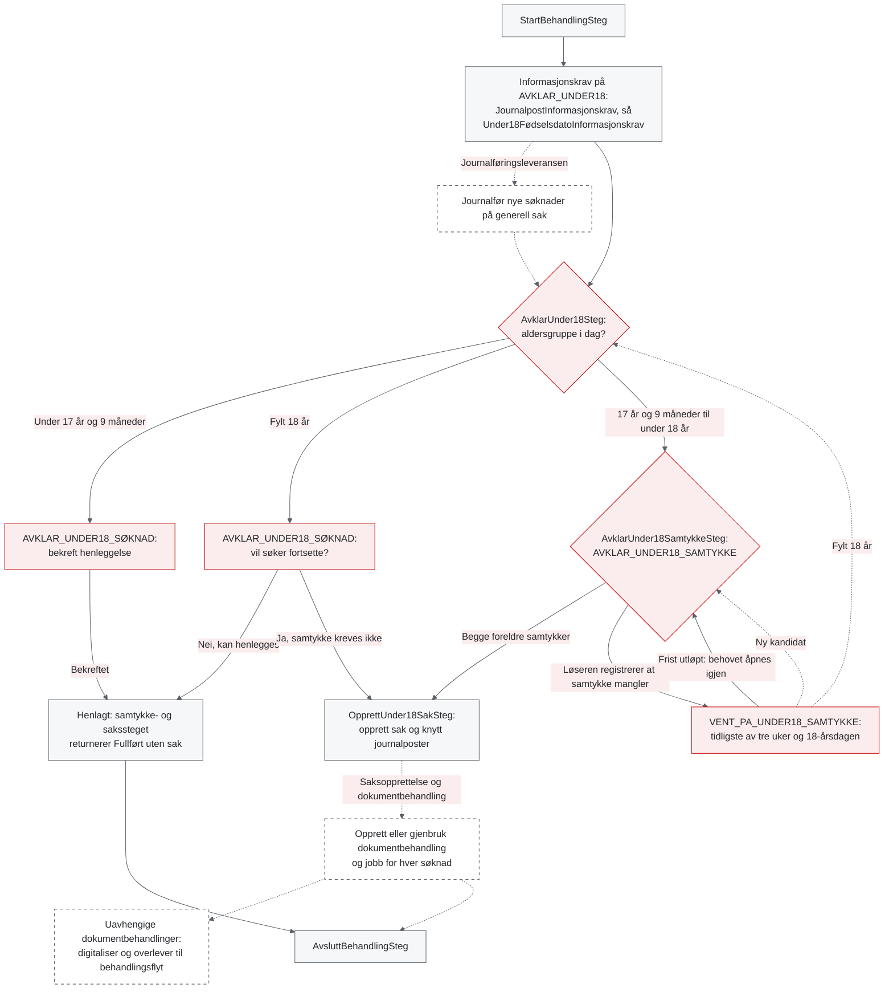
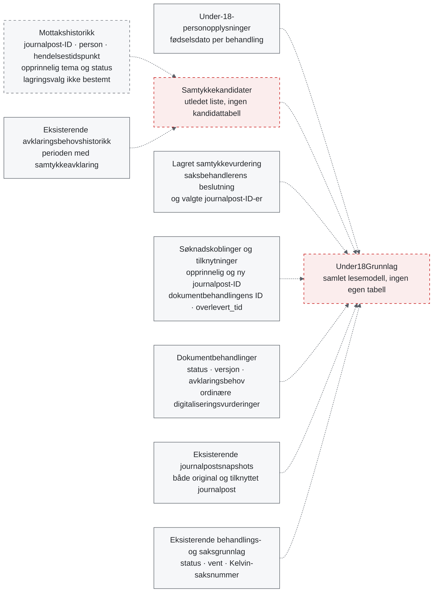

# Under-18-flyt: avklaringer og implementeringsplan

Avklart 12. november 2026, med oppdateringer til og med 19. november. Dokumentet samler svarene fra kravavklaringen.
Det beskriver ønsket funksjonalitet, ikke dagens implementering.

Den 18. november ble løsningen endret til å gjenbruke vanlige
`DokumentHåndtering`-behandlinger for digitalisering og overlevering.
Under-18-behandlingen oppretter én dokumentbehandling per søknad.
Dette erstatter forslaget om digitalisering inne i under-18-behandlingen.

Den 19. november ble kravet om sekvensiell fullføring fjernet.
Alle dokumentbehandlingene og jobbene opprettes uten å vente på digitalisering
eller overlevering. Flere søknader kan vente på digitalisering samtidig og
overleveres i ulik rekkefølge. Under-18-behandlingen avsluttes når alle
dokumentbehandlingene og jobbene er opprettet. Eget koordineringssteg,
dokumentbehandlingsvent og gjenopptaksjobber fra dokumentbehandlingene utgår.
Samtykkevent og den daglige aldersjobben beholdes.

Utgangspunktet er diagrammet i
[image-2026-11-11_8-30-51.png](image-2026-11-11_8-30-51.png).
Diagrammets siste steg korrigeres: søknaden skal først journalføres på generell sak
med tema AAP, og senere knyttes til Kelvin-saken. Tema settes altså til AAP ved
første journalføring, ikke ved slutten av flyten.

## Omfang og inngang

- Vi lager en egen behandlingstype i postmottak.
- Flyten gjelder bare papirsøknader. Digitale søknader er sperret for personer under 18 år.
- Brevkode er tilstrekkelig for å identifisere en søknad.
- Alder vurderes på tidspunktet vi behandler dokumentet, ikke på søknadsdato eller mottaksdato.
- Manglende fødselsdato er en feilsituasjon. Kast exception og la jobben feile.
- Har søker allerede en Kelvin-sak ved mottak, følger søknaden vanlig flyt.
  Dette gjelder også søkere under 17 år og 9 måneder.
- Leveransen omfatter backend og nødvendige kontrakter. Frontend inngår ikke.

## Journalføring på generell sak

- Søknadene ferdigstilles automatisk på generell sak med tema AAP før manuell avklaring.
- Dette gjelder også søknader som skal henlegges fordi søker er for ung.
- Hvis automatisk journalføring feiler, skal jobben feile.
  Vi innfører ikke en egen manuell journalføringsoppgave for dette i første versjon.

## Alder og henleggelse

| Alder når steget kjører | Oppførsel |
| --- | --- |
| Under 17 år og 9 måneder | Informer saksbehandler om at søknaden henlegges fordi søker er for ung. Saksbehandler må bekrefte. |
| Fra og med 17 år og 9 måneder, men under 18 år | Avklar samtykke fra begge foreldre. |
| Fylt 18 år før Kelvin-saken er opprettet | Samtykkekravet faller bort. Ta behandlingen automatisk av samtykkevent, også hvis saksbehandler har satt den manuelt på vent i denne delen av flyten. Saksbehandler må spørre søker om hen fortsatt ønsker å søke AAP og registrere svaret i det felles avklaringsbehovet `AVKLAR_UNDER18_SØKNAD`. Ikke opprett Kelvin-sak før søker har bekreftet at hen vil fortsette. Vil søker ikke fortsette, svarer saksbehandler at behandlingen kan henlegges, og den avsluttes som ved annen henleggelse. Fødselsdagen avslutter ikke behandlingen. |

Alder må sjekkes på nytt før henleggelsessteget kjører. Har søker nådd 17 år og
9 måneder, skal vi ikke lenger foreslå henleggelse, men gå til samtykkeavklaring.

Ved bekreftet henleggelse avsluttes hele under-18-behandlingen. Dette gjelder både
når søker er for ung, og når søker etter fylte 18 år ikke vil fortsette. Det opprettes ingen
Kelvin-sak, og søknadene overleveres ikke. Løsningen sender ikke brev eller oppretter
andre oppgaver i forbindelse med henleggelsen.

Nye søknader etter avsluttet behandling vurderes på nytt ut fra aktuell alder.

## Samtykke

- Begge foreldre må ha samtykket.
- Innhentingen skjer manuelt utenfor flyten. Løsningen skal be saksbehandler innhente samtykke.
- Ett avklaringsbehov kan dekke både innhenting og vurdering.
  Frontend skal kunne skille mellom disse oppgavene ut fra løsnings-DTO-en og behandlingens tilstand.
- Saksbehandler vurderer samtykke manuelt, også når det følger med søknaden.
- Det er tilstrekkelig at saksbehandler bekrefter at begge foreldrene har samtykket.
- Vi krever ingen begrunnelse, heller ikke når samtykke mangler.
- Vi lagrer en liste over journalpost-ID-er som dokumenterer samtykke.
  Listen kan være tom i første versjon. Det skal være mulig å gjøre den obligatorisk senere.
- Listen må støtte flere journalposter. Søknad og samtykke kan også ligge i samme journalpost.

## Vent

Når saksbehandler svarer at samtykke mangler, opprettes et eget ventebehov.
Standardfristen defineres i ventebehovet og er tre uker.
Fristen settes til det tidligste av tre uker og søkerens 18-årsdag.

Ved utløpt frist åpnes samtykkeoppgaven igjen, med mindre samtykkekravet har falt bort
fordi søker har fylt 18 år. Da oppheves venten, men behandlingen går ikke automatisk videre
til saksopprettelse. Saksbehandler må spørre søker om hen fortsatt vil søke AAP og registrere svaret.
Saksbehandler kan igjen svare at samtykke mangler og få en ny automatisk ventefrist,
eller bruke vanlig manuell vent. Det er ingen fast grense for antall runder.

Manuelt satt vent beholdes ved nye journalposter. Når søker fyller 18 år før
Kelvin-saken er opprettet, oppheves også en aktiv manuell vent automatisk,
selv om fristen er senere. Dette gjelder vent mens saksbehandler avklarer henleggelse
eller samtykke. Fødselsdagen opphever ikke vent på en dokumentbehandling etter
saksopprettelse, og løser ikke et manuelt avklaringsbehov eller oppretter en Kelvin-sak.
Saksbehandler må først spørre søker om hen fortsatt vil søke AAP og registrere svaret.
Nye journalposter kan fortsatt vises som kandidater mens behandlingen står på vent.

## Nye journalposter og kandidater til samtykke

- En ny journalpost på samme søker med tema AAP og status `MOTTATT` skal ta
  under-18-behandlingen av automatisk samtykkevent. Manuelt satt vent beholdes,
  med mindre søker har fylt 18 år før Kelvin-saken er opprettet. Fødselsdagen
  opphever da samtykkevent og manuell vent i denne delen av flyten.
- Journalposten vises som en kandidat til samtykke. Kandidatlisten utledes fra
  mottakshistorikken, uten en egen kandidattabell. Vi tolker ikke kandidaten automatisk som samtykke.
- Saksbehandler må vurdere om journalposten inneholder nødvendig samtykke.
  Hvis ikke, kan behandlingen settes på vent igjen.
- Det er tilstrekkelig å håndtere nye hendelser. Vi trenger ikke hente inn historiske dokumenter.
- Gjentatte hendelser for samme journalpost skal ikke ta behandlingen av vent på nytt.
- Hendelser om andre temaer eller bare status `JOURNALFOERT` trenger ikke ta behandlingen av vent.
- Andre dokumenttyper enn søknader følger vanlig flyt i tillegg til å vises som kandidater
  og ta under-18-behandlingen av automatisk samtykkevent.

## Flere søknader i samme under-18-behandling

Flere papirsøknader fra samme søker samles i én åpen under-18-behandling frem til
Kelvin-saken er opprettet. Dette gjelder også når behandlingen ikke står på vent,
for eksempel mens en samtykke- eller henleggelsesoppgave er åpen.

De ekstra søknadene journalføres på generell sak og legges til behandlingen,
uten separat Fordeling eller Journalføring. Én samtykkevurdering dekker de innsamlede søknadene.
Etter saksopprettelse og tilknytning får hver søknad sin egen
`DokumentHåndtering`-behandling, som beskrevet nedenfor.

Når Kelvin-saksnummeret foreligger, stenges innsamlingen, og nye søknader følger vanlig flyt.
Under-18-behandlingen avsluttes ikke da. Den fullfører tilknytning av de innsamlede
dokumentene og oppretter dokumentbehandlingene med prosesseringsjobber før den avsluttes.
Digitalisering og overlevering fortsetter uavhengig i dokumentbehandlingene.

## Opprettelse av Kelvin-sak

Når samtykke er godkjent, eller søker har fylt 18 år og saksbehandler har registrert
at søker fortsatt ønsker å søke AAP:

1. Opprett Kelvin-sak.
2. Knytt journalpostene med søknadene i behandlingen til saken.
3. Knytt også journalpostene i den registrerte samtykkelisten til saken.
4. Fortsett med digitalisering og overlevering av søknadene.

Fagsaken på den ferdigstilte journalposten endres ikke direkte.
Som avklart 13. november brukes dokarkivs
`/rest/journalpostapi/v1/journalpost/{kildeJournalpostId}/knyttTilAnnenSak`,
som returnerer `nyJournalpostId`.
Vi må lagre koblingen fra kildejournalpost til den nye journalposten på Kelvin-saken.
Det er den nye journalpost-ID-en som skal brukes ved overlevering til behandlingsflyt.

Hvis en Kelvin-sak uventet har blitt opprettet mens behandlingen står på vent,
skal vi logge på `ERROR`-nivå og kaste exception slik at jobben feiler.
Vi skal ikke automatisk bruke den uventede saken og fortsette.

## Digitalisering, overlevering og rekkefølge

- Hver søknad må digitaliseres og overleveres separat.
- Dokumentbehandlingene opprettes etter mottatt-tidspunkt i Joark, eldste først.
- Når klokkeslett mangler, brukes mottaksdato klokken 00:00.
  Ved like tidspunkt avgjør kildejournalpost-ID-en rekkefølgen.
- Flere søknader kan vente på digitalisering samtidig og overleveres i ulik rekkefølge.
- Vellykket HTTP-kall til behandlingsflyt bekrefter overleveringen for den enkelte søknaden.
  Vi trenger ikke vente på at behandlingsflyt har ferdigbehandlet hendelsen.
- Sorteringen ved opprettelse garanterer ikke kjøre- eller fullføringsrekkefølge.
  Senere søknader i vanlig flyt trenger heller ikke vente på disse.

Vi bruker eksisterende `DokumentHåndtering` med `DigitaliserDokumentSteg`,
`DigitaliserDokumentLøser` og `OverleverTilFagsystemSteg`.
Hver søknad får en egen dokumentbehandling med referanse, versjon, vurderinger og avklaringsbehov.
Under-18-behandlingen lagrer samtykkevurderingen og koblingen til søknadene og dokumentbehandlingene.
Samtykkedokumenter får ikke egne dokumentbehandlinger, med mindre journalposten også inneholder
en innsamlet søknad.

Under-18-behandlingen avsluttes når alle innsamlede søknader har fått
dokumentbehandling og prosesseringsjobb. Den venter ikke på dokumentbehandlingenes
status eller overlevering. Hver dokumentbehandling håndterer egne oppgaver, vent og feil.

## Feature toggle og produksjon

Koden til den nye flyten kan legges i produksjon før rutingen aktiveres.
En feature toggle styrer bare om nye under-18-behandlinger opprettes.
Vi skal minimere hvor togglen brukes, ikke spre sjekker gjennom stegene.

Eksisterende under-18-behandlinger fortsetter selv om togglen slås av.
De mottar fortsatt kandidater og samler nye papirsøknader frem til Kelvin-saken
er opprettet.

## Løsningsforslag

Dette er et teknisk forslag basert på kravene over og dagens kode.
Nye klasse-, tabell- og enum-navn nedenfor er arbeidsnavn, ikke ferdige kontrakter.

### Ansvarsdeling mot dokarkiv

Forslaget bruker oppdelingen mellom `JournalføringService`, `DokarkivGateway` og
`DokarkivGatewayKlient` som nå finnes på `main`.
Refaktoreringen endrer ikke hovedflyten eller datamodellen, men hvor nye operasjoner
og tester plasseres:

- `JournalføringService` beholder beriking av journalføringsopplysninger og maskinell ferdigstilling.
  Den skal ikke få nye HTTP-kall eller request-/response-DTO-er.
- `DokarkivGateway` utvides med `knyttTilAnnenSak(...): JournalpostId`.
  Gatewayen returnerer en verditype, ikke dokarkivs rå respons.
- `DokarkivGatewayKlient` implementerer HTTP-kallet, definerer de nye request-/response-DTO-ene
  og oversetter responsens `nyJournalpostId` til `JournalpostId`.
- Under-18-steget kontrollerer eksisterende tilknytninger, kaller gatewayene og lagrer resultatet lokalt.
  HTTP-detaljer testes i klientmodulen, mens forretningsforløpet kan testes med en fake `DokarkivGateway`.

### Anbefalt oppdeling

Behold én under-18-behandling som lagrer samtykkevurderingen og samler søknadene.
Behandlingen lagres i eksisterende `BEHANDLING` med `type = Under18`, gjennom
`BehandlingRepository.opprettBehandling`. Vi trenger ingen egen behandlingstabell.
Behold den første søknaden som behandlingens faste hovedjournalpost.
Registrer journalpost-ID-ene for alle søknadene, også hovedjournalposten, på behandlingen i `UNDER18_SOKNAD`.
Selve journalpost- og dokumentdataene lagres i eksisterende tabeller.
Vi endrer ikke betydningen av `BEHANDLING.JOURNALPOST_ID` eller den generelle flytmotoren.

Flyten får tre egne forretningssteg:

1. `AvklarUnder18Steg` håndterer alder, henleggelse og spørsmålet om videre søknad
   etter fylte 18 år gjennom `AVKLAR_UNDER18_SØKNAD`. Steget har informasjonskravene
   `JournalpostInformasjonskrav` og `Under18FødselsdatoInformasjonskrav`, i den rekkefølgen.
   Fødselsdatoinformasjonskravet deklarerer at det avhenger av journalpostinformasjonskravet.
   Flytbyggeren kontrollerer at journalpostinformasjonskravet står først i samme liste
   over informasjonskrav. Fødselsdatoinformasjonskravet
   leser den lagrede journalposten, henter fødselsdatoen fra PDL og lagrer den på behandlingen.
   Stegene gjør ingen gateway-kall og leser fødselsdatoen
   fra `Under18Repository`. Journalføringsleveransen skal også journalføre nye søknader på generell sak,
   og får `Under18JournalposterInformasjonskrav` for relevante journalpostopplysninger.
2. `AvklarUnder18SamtykkeSteg` håndterer samtykkeavklaringen. Samtykkeløseren
   oppretter automatisk vent når samtykke mangler; steget håndterer ikke vent.
   Ved fylte 18 år før saksopprettelse skal behandlingen tilbake til avklaringen om
   videre søknad etter at samtykke- og eventuell manuell vent er opphevet.
   Kelvin-sak opprettes ikke før svaret er registrert.
3. `OpprettUnder18SakSteg` oppretter Kelvin-sak, knytter journalpostene til saken
   og bruker `Under18DokumentbehandlingService` til å opprette eller gjenbruke
   dokumentbehandling og prosesseringsjobb for hver søknad, i sortert rekkefølge.
   Steget fullfører når alle er opprettet, uten å vente på digitalisering eller overlevering.
   Ved henleggelse gjør steget ingenting.

Dokumentbehandlingene følger dagens stegrekkefølge i `Dokumentflyt`:
`START_BEHANDLING → DIGITALISER_DOKUMENT → OVERLEVER_TIL_FAGSYSTEM → IVERKSETTES`.
De trenger ingen ny behandlingstype. For en papirsøknad blir
`DIGITALISER_DOKUMENT` normalt en manuell oppgave i dokumentbehandlingen, ikke i under-18-behandlingen.
Det trengs noen tilpasninger for å bruke opplysninger fra den opprinnelige journalposten
og registrere vellykket overlevering.
Dokumentbehandlinger som ikke er knyttet til en under-18-behandling, skal fungere som før.

Legg `StartBehandlingSteg` først og `AvsluttBehandlingSteg` sist, som i
[Dokumentflyt.kt:11-17](flyt/src/main/kotlin/no/nav/aap/postmottak/forretningsflyt/behandlingstyper/Dokumentflyt.kt#L11-L17).
Bekreftet henleggelse registreres gjennom avklaringsbehovet.
De etterfølgende stegene leser bekreftelsen og aldersvurderingen og returnerer
`Fullført` ved henleggelse, slik at motoren avslutter behandlingen på vanlig måte.



Heltrukne linjer viser det som er implementert i dag. Stiplede linjer og bokser er planlagt
i PR-en som står på linjen. `OpprettUnder18SakSteg` feiler fortsatt med vilje når
behandlingen ikke er henlagt. Søknadsbehovet dekker både henleggelse for en for ung søker
og spørsmålet om videre søknad etter fylte 18 år. Når søkeren har fylt 18 år, krever
samtykkesteget ikke samtykke og returnerer `Fullført`.

Diagrammet viser to separate behandlinger, ikke et hopp mellom flyter i samme motorjobb.
Under-18-behandlingen og dokumentbehandlingen har hver sin prosesseringsjobb og behandlingslås.
Under-18-behandlingen avsluttes etter at dokumentbehandlingene og jobbene er opprettet.
Den venter ikke på dokumentbehandlingene og gjenopptas ikke når de avsluttes.
Manuell vent i samtykke- og henleggelsesdelen respekteres frem til 18-årsdagen.
Etter fødselsdagen må saksbehandler fortsatt registrere at søker vil fortsette
før flyten oppretter en Kelvin-sak. Vent på en dokumentbehandling etter
saksopprettelse følger de vanlige reglene også etter 18-årsdagen.

### Hvorfor gjenbruke hele dokumentbehandlingen?

[DigitaliserDokumentSteg.kt:63-74](flyt/src/main/kotlin/no/nav/aap/postmottak/forretningsflyt/steg/dokumentflyt/DigitaliserDokumentSteg.kt#L63-L74)
leser både digitaliseringsvurdering og journalpost via behandling-ID.
[JournalpostRepositoryImpl.kt:98-111](repository/src/main/kotlin/no/nav/aap/postmottak/repository/journalpost/JournalpostRepositoryImpl.kt#L98-L111)
slår da opp den faste hovedjournalposten.
Å bytte bare `journalpostId` i `FlytKontekst` er derfor ikke nok til å behandle neste søknad.

Med en egen dokumentbehandling per søknad trenger vi ikke å bytte hovedjournalpost
på under-18-behandlingen. Dokumentbehandlingen får den nye journalpost-ID-en som fast hovedjournalpost.
Da kan vi gjenbruke digitaliseringsbehovet, løseren, vurderingshistorikken,
versjonskontrollen, dokumentvisningen og overleveringssteget.

[VideresendSteg.kt:88-98](flyt/src/main/kotlin/no/nav/aap/postmottak/forretningsflyt/steg/journalføring/VideresendSteg.kt#L88-L98)
viser eksisterende opprettelse av `DokumentHåndtering`, kopiering av grunnlag og jobbinnlegging.
Dokumentbehandlingstjenesten følger samme transaksjonsmønster, men kobler hver dokumentbehandling
til riktig søknad og overfører bare grunnlaget den trenger.
Den skal ikke kalle `VideresendSteg` med en konstruert kontekst.

Den eksisterende fellesfunksjonaliteten `ManuellDigitalisering` og
`DokumentOverleveringService` beholdes og brukes gjennom dagens løser og overleveringssteg.
Vi trenger ikke en ny under-18-løser eller en parallell vurderingstabell.
Ny logikk begrenses til opprettelse og koblingen mellom originalen, den nye
journalposten og dokumentbehandlingen. Detaljene står i
[Opprettelse og prosessering av dokumentbehandlinger](#opprettelse-og-prosessering-av-dokumentbehandlinger).

### Mottak og ruting

Legg rutingen til `Under18MottakService`, som brukes fra
[VurderRelevantDokumentForAAPJobbUtfører.kt:136-138](flyt/src/main/kotlin/no/nav/aap/postmottak/mottak/VurderRelevantDokumentForAAPJobbUtfører.kt#L136-L138)
før en ny Fordeling-behandling opprettes.
Behold dagens håndtering av manglende ident, organisasjoner og ugyldige journalposter.

Service-metoden følger denne rekkefølgen for papirsøknader:

1. Finn personen med eksisterende `PersonService`, som håndterer identer fra PDL.
2. Sjekk om journalposten allerede tilhører en under-18-behandling.
   I så fall skal det ikke opprettes en ordinær behandling ved en gjentatt hendelse.
3. Finn en eksisterende under-18-behandling som fortsatt samler søknader.
   Legg søknaden til denne uten å sjekke togglen.
4. Hvis ingen slik behandling finnes: hent aktuell alder og Kelvin-saker.
   Har personen Kelvin-sak, eller er personen fylt 18 år, brukes vanlig flyt.
5. Bare når en ny under-18-behandling skal opprettes, sjekkes togglen
   `PostmottakUnder18`. Er den av, brukes dagens ruting uendret.
6. Lagre journalpostsnapshot og opprett en vanlig `BEHANDLING` med `type = Under18`.
   Registrer journalpost-ID-en for den første søknaden på behandlingen.
   Legg inn en `flyt.prosesserBehandling`-jobb med behandlingens faste hovedjournalpost som `sakId`.

Bruk eksisterende `Journalpost.erPapir()` og `Journalpost.erSøknad()` fremfor nye,
parallelle definisjoner av papirsøknader. Manglende fødselsdato skal gi exception,
ikke en antakelse om alder eller overgang til vanlig flyt.
Alderskontrollen i den nye flyten skal gjelde i alle miljøer.
Ikke la den arve dagens prod/dev-bryter på fordelingsregelen `Aldersregel`.

Nye kandidater må også fanges opp når journalposten har en åpen
Journalføring-behandling. Dagens
[KafkaStreams.kt:112-130](flyt/src/main/kotlin/no/nav/aap/postmottak/mottak/KafkaStreams.kt#L112-L130)
sender slike hendelser direkte til denne behandlingen, uten å kjøre vurderingsjobben.
Det er derfor ikke nok å håndtere nye kandidater bare i vurderingsjobben.

Kafka-mottaket registrerer mottakshendelsen, finner aktuell under-18-behandling på
personen og legger inn `ProsesserBehandlingJobbUtfører`.
Jobben bruker behandlingens faste hovedjournalpost som `sakId`, ikke den nye kandidatens ID.
Dette gjøres også når journalposten har en åpen Journalføring-behandling.
Dagens ordinære mottaksgrener fortsetter ved siden av. Nye SAF- og PDL-oppslag for
kandidatvarsling må ikke blokkere ordinær mottaksbehandling ved en midlertidig feil.
Kafka-mottaket avslutter ikke samtykkevent og kjører ingen flytsteg.

For en hittil ukjent journalpost må mottaket finne personen før det kan slå opp
under-18-behandlingen. Gjenbruk lokal personkobling der den finnes, og nødvendige
SAF-/PDL-oppslag ellers. Feil i oppslagene må kunne forsøkes på nytt uten at hendelsen
mistes eller gjentatte hendelser tar behandlingen av vent på nytt.

`Under18JournalposterInformasjonskrav` må oppdatere opplysningene både ved
`AvklarUnder18Steg` og mens behandlingen står på `AvklarUnder18SamtykkeSteg`.
Det henter og oppdaterer relevante journalpostopplysninger gjennom eksisterende
gatewayer og journalpostlagring. Kandidatlisten utledes fra mottakshistorikken
og perioden med samtykkeavklaring, uten en egen kandidattabell.
En trigger utenfor flyten bruker kandidatgrunnlaget til å avslutte automatisk samtykkevent
ved et nytt dokument. Manuell vent beholdes ved nye dokumenter, men oppheves
sammen med automatisk vent når søker fyller 18 år før Kelvin-saken er opprettet.
Informasjonskravet oppdaterer opplysninger; stegene oppretter eller avslutter ikke vent.
Kandidatgrunnlaget må være oppdatert før triggeren vurderer vent. Denne koblingen
gjenstår i mottaksintegrasjonen.

Dagens motor oppdaterer faktagrunnlaget og kjører steget før den stopper på åpne
avklaringsbehov i `AVKLARINGSPUNKT`. Registrering av informasjonskravet og
tilbakeføring må sikre at nye søknader blir journalført før ny manuell avklaring,
også mens behandlingen står på samtykkesteget. Test dette gjennom motoren.
Gjenbruk eksisterende jobber hvis de gir sikker registrering og retry.
Del person- og behandlingsoppslag med rutingservicen, og la mottak og prosessering
tåle at vurderingsjobben og prosesseringsjobben kjører i ulik rekkefølge.

Velg transaksjonsgrense og retry-mekanisme i mottaksintegrasjonen. En feil i kandidatsporet skal
ikke miste hendelsen eller hindre ordinær behandling. Hvis eksisterende jobber ikke
gir begge garantiene, må mottaksintegrasjonen innføre en egnet jobb. Feil skal ikke skjules ved
å hoppe over kandidaten.

```mermaid
%%{init: {"theme":"base","themeVariables":{"primaryColor":"#F6F7F9","primaryTextColor":"#23262A","primaryBorderColor":"#5B6169","lineColor":"#5B6169","secondaryColor":"#FBEDED","tertiaryColor":"#F6F7F9","background":"#FFFFFF"}}}%%
flowchart LR
    joark["Joark: ny AAP-hendelse<br/>status MOTTATT"] --> kafka["JoarkKafkaHandler"]
    kafka --> observasjon["Lagre mottakshendelse<br/>og finn personens under-18-behandling"]
    kafka --> vanlig["Eksisterende mottaksgrener"]
    observasjon -->|"Aktuell behandling finnes"| trigger["Trigger utenfor flyten:<br/>vurder nye kandidater og avslutt automatisk vent"]
    trigger --> prosesser["ProsesserBehandlingJobbUtfører"]
    vanlig --> vurder["VurderRelevantDokumentForAAP"]
    vurder --> rute{"Papirsøknad til under-18?"}
    rute -->|"Ja"| samle["Opprett eller legg til i<br/>under-18-behandling"]
    rute -->|"Nei"| ordinær["Vanlig flyt, uendret"]
    samle --> prosesser
    prosesser --> krav["Under18JournalposterInformasjonskrav:<br/>oppdater relevante journalpostopplysninger"]
    krav --> avklar["Under-18-steg:<br/>avklar søknad og samtykke"]
    avklar -->|"Avklart"| steg["Videre under-18-steg"]
    avklar -->|"Fortsatt uavklart eller manuelt på vent"| stopp["Stopp på avklaringsbehov"]
    avklar -->|"Journalføring"| journalforing["JournalføringService"]
    journalforing --> dokarkivgateway["DokarkivGateway"]
    steg -->|"Tilknytning"| dokarkivgateway
    dokarkivgateway --> dokarkivklient["DokarkivGatewayKlient"]
    dokarkivklient --> dokarkiv["Dokarkiv"]
    steg --> behandlingsflytgateway["BehandlingsflytGateway"]
    behandlingsflytgateway --> behandlingsflyt["Behandlingsflyt"]
    steg --> opprett["Opprett dokumentbehandling og jobb for hver søknad"]
    opprett --> dokumentjobb["Egen prosesseringsjobb<br/>for hver dokumentbehandling"]
    dokumentjobb --> dokumentflyt["Dagens digitalisering og overlevering"]
    dokumentflyt --> behandlingsflytgateway
    dokumentflyt --> ferdig["Lagre overleveringstidspunkt<br/>og avslutt dokumentbehandlingen"]
    steg --> hendelse["Stopp-/slutthendelse<br/>til oppgave og statistikk"]
    classDef default fill:#F6F7F9,stroke:#5B6169,color:#23262A
    classDef valg fill:#FBEDED,stroke:#C30000,color:#23262A
    class rute,avklar valg
```



Mottakshistorikken må bevare at journalposten hadde status `MOTTATT` da hendelsen kom.
SAF kan vise `JOURNALFOERT` når informasjonskravet senere kjører, fordi vanlig flyt allerede
har journalført dokumentet. Dette skal ikke forveksles med å abonnere på hendelser
som bare har status `JOURNALFOERT`.

Kandidatlisten utledes fra personens mottakshistorikk og behandlingens
avklaringsbehovshistorikk. Ta med journalposter som først ble mottatt med tema AAP
og status `MOTTATT` mens samtykke ble avklart i behandlingen, også under automatisk vent.
Bruk tidspunktet for mottakshendelsen, ikke når informasjonskravet kjører.
Gjentatte hendelser skal ikke flytte dette tidspunktet eller gjøre et gammelt dokument
til en ny kandidat. Oppslaget skal gi én kandidat per journalpost og bruke personens
identer gjennom eksisterende personhåndtering.
Saksbehandlerens valgte samtykkedokumenter lagres fortsatt i samtykkevurderingen,
uavhengig av den utledede kandidatlisten.

### Datamodell

Gjenbruk `BEHANDLING` for identitet, type, status og versjon, og `STEG_HISTORIKK` for
fremdrift. Person finnes gjennom behandlingens hovedjournalpost.
Det skal verken opprettes en `UNDER18_BEHANDLING`-tabell eller lagres en parallell fase.
Innsamling er åpen så lenge behandlingen er i avklaringsdelen og ingen Kelvin-sak
er opprettet. Dette utledes av eksisterende behandlings- og saksgrunnlag under lås.

Gjenbruk `SaksnummerRepository` for saksvurderingen og Kelvin-saksnummeret,
og avklaringsbehovene med historikk for henleggelsesbekreftelse og vent.
`Under18Grunnlag` er en samlet lesemodell, ikke en ny behandlingstabell.

Nye tabeller bak `Under18Repository` begrenses til fødselsdato, søknadskoblinger,
tilknytninger, eventuelle tilknytningsforsøk, observasjoner og vurderinger som ikke
allerede dekkes. Alle får primærnøkkel og refererer til
eksisterende behandling der dataene er behandlingsspesifikke.
Eksisterende journalpostsnapshots gjenbrukes. Journalpost-ID-er peker på Joark-ID,
ikke den interne ID-en til en snapshotrad i `JOURNALPOST`.

Fødselsdatoen lagres i `UNDER18_PERSONOPPLYSNING`, med én rad per behandling.
`Under18Repository` eier tabellen. Den skal ikke legges på `PERSON`, som eies av
`PersonRepository`. Alderen regnes ut fra fødselsdatoen når steget kjører.

`UNDER18_SOKNAD` kobler under-18-behandlingen til søknadene og dokumentbehandlingene.
Tabellen lagrer dokumentbehandlingens ID og overleveringstidspunkt per søknad.
Den skal ikke inneholde kopier av journalpostdata, dokumentbehandlingens status eller digitaliseringsvurderinger.
Hent mottatt-tidspunkt, kanal, journalstatus og dokumenter gjennom eksisterende
`JournalpostRepository`, med søknadens journalpost-ID.
Tilknytning til Kelvin-saken leses fra `UNDER18_JOURNALPOST_TILKNYTNING`,
ikke fra en egen tilknytningsstatus i søknadskoblingen.
En søknad uten overleveringstidspunkt har ingen lokalt bekreftet overlevering.
Søknaden er ferdig behandlet først når overleveringstidspunktet er lagret
og dokumentbehandlingen har status `AVSLUTTET`.
Dette er informasjon til lesemodellen, ikke et vilkår for å avslutte under-18-behandlingen
eller starte andre dokumentbehandlinger.

| Tabell | Ansvar og sentrale felt |
| --- | --- |
| `UNDER18_PERSONOPPLYSNING` | Fødselsdato per under-18-behandling. Én rad per behandling med primærnøkkel, unik `behandling_id`, fødselsdato og opprettelsestidspunkt. Alderen lagres ikke. |
| `UNDER18_SOKNAD` | Kobler under-18-behandlingen, søknaden og dokumentbehandlingen. Lagrer primærnøkkel, under-18-behandlingens ID, kildejournalpost-ID, valgfri unik `dokumentbehandling_id` og tidspunkt for vellykket overlevering. Ingen kopier av journalpostdata, dokumentbehandlingens status eller vurderinger. |
| `UNDER18_JOURNALPOST_TILKNYTNING` | Én uforanderlig kobling per behandling og `kildeJournalpostId`, med Kelvin-saksnummer og returnert `nyJournalpostId`. Brukes for både søknader og registrerte samtykkejournalposter. |
| Tilknytningsforsøk, eventuelt `UNDER18_TILKNYTNINGSFORSOK` | Varig registrering før et Dokarkiv-kall. Lagrer behandling, kildejournalpost, målsak og dokument-ID-ene i forespørselen, slik at et forsøk med ukjent utfall kan gjenfinnes eller stoppes uten et nytt skrivekall. Endelig lagringsform velges i tilknytningsleveransen. |
| `UNDER18_JOURNALPOST_OBSERVASJON` | Første relevante mottakshendelse per journalpost, med hendelsestidspunkt, tema, status og kobling til person når identiteten er avklart. Brukes til å utlede kandidater og sikre at samme journalpost ikke tar behandlingen av vent flere ganger, uavhengig av ordinær behandling. |
| `UNDER18_SAMTYKKEVURDERING` og `UNDER18_SAMTYKKE_GRUNNLAG` | Historiske vurderinger og aktiv vurdering etter repoets grunnlagsmønster. Vurderingen lagrer beslutningen og journalpost-ID-ene som dokumenterer samtykke. Vent lagres i avklaringsbehovshistorikken. |
| Eksisterende `DIGITALISERINGSAVKLARING` og `DIGITALISERINGSVURDERING_GRUNNLAG` | Dokumentbehandlingens digitaliseringsvurderinger og aktive grunnlag. Gjenbrukes uten nye under-18-tabeller for digitalisering. |

#### Datamodellen visuelt

Diagrammet viser et konkret forslag til kolonner og koblinger.
Hver tabell har sin egen boks, også grunnlags- og vurderingstabellene.
`BEHANDLING`, `PERSON`, `DIGITALISERINGSAVKLARING` og
`DIGITALISERINGSVURDERING_GRUNNLAG` finnes allerede.
De øvrige tabellene er foreslåtte nye tabeller.
Den samme `BEHANDLING`-tabellen lagrer både under-18-behandlingen og dokumentbehandlingene.
Kolonnenavn og typer er arbeidsforslag, ikke en ferdig migrasjon.
Registreringen av tilknytningsforsøk er ikke med i diagrammet. Den må lagres varig
før skrivekallet, enten i en egen tabell eller med en annen løsning i tilknytningsleveransen.

`PK` betyr primærnøkkel, `FK` fremmednøkkel og `UK` unik nøkkel.
Kråkefot betyr flere rader, sirkel betyr at koblingen er valgfri.
Stiplede linjer viser fremmednøkler. De tilknyttede radene har egne primærnøkler,
uavhengig av raden de viser til.
Journalpost-ID-er er Joark-ID-er, ikke fremmednøkler til snapshots i `JOURNALPOST`,
og har derfor ingen relasjonslinjer til den tabellen.

```mermaid
%%{init: {"theme":"base","themeVariables":{"primaryColor":"#FBEDED","primaryTextColor":"#23262A","primaryBorderColor":"#C30000","lineColor":"#5B6169","tertiaryColor":"#F6F7F9","attributeBackgroundColorOdd":"#F6F7F9","attributeBackgroundColorEven":"#FFFFFF","background":"#FFFFFF"}}}%%
erDiagram
    BEHANDLING {
        bigint id PK
        varchar type "Under18 eller DokumentHåndtering"
        bigint journalpost_id "Fast Joark-ID for hver behandling"
        varchar status
    }
    PERSON {
        bigint id PK
    }
    UNDER18_PERSONOPPLYSNING {
        bigint id PK
        bigint behandling_id FK,UK "Én rad per under-18-behandling"
        date fødselsdato
        timestamp opprettet_tid
    }
    UNDER18_SOKNAD {
        bigint id PK
        bigint behandling_id FK "Under-18-behandlingens ID"
        bigint kilde_journalpost_id UK "Joark-ID"
        bigint dokumentbehandling_id FK,UK "ID til dokumentbehandlingen, kan være NULL"
        timestamp overlevert_tid "Settes etter vellykket overlevering"
    }
    UNDER18_JOURNALPOST_TILKNYTNING {
        bigint id PK
        bigint behandling_id FK "Unik sammen med kilde_journalpost_id"
        bigint kilde_journalpost_id "Joark-ID"
        varchar kelvin_saksnummer "Uforanderlig, ikke FK til en saksvurderingsrad"
        bigint ny_journalpost_id "Uforanderlig, returnert Joark-ID"
        timestamp opprettet_tid
    }
    UNDER18_JOURNALPOST_OBSERVASJON {
        bigint id PK "Ny tabell bare hvis eksisterende lagring ikke dekker behovet"
        bigint journalpost_id UK "Joark-ID"
        bigint person_id FK "Kan være NULL før personen er identifisert"
        timestamp hendelsestidspunkt "Første relevante mottakshendelse"
        varchar tema "AAP ved mottak"
        varchar journalstatus "MOTTATT ved mottak"
        timestamp opprettet_tid "Tidspunkt for lokal registrering"
    }
    UNDER18_SAMTYKKEVURDERING {
        bigint id PK
        boolean begge_foreldre_samtykket
        bigint[] samtykke_journalpost_ider "Joark-ID-er, tom liste tillatt"
        timestamp opprettet_tid
    }
    UNDER18_SAMTYKKE_GRUNNLAG {
        bigint id PK
        bigint behandling_id FK
        bigint samtykkevurdering_id FK
        boolean aktiv
        timestamp opprettet_tid
    }
    DIGITALISERINGSAVKLARING {
        bigint id PK "Eksisterende vurderingstabell"
    }
    DIGITALISERINGSVURDERING_GRUNNLAG {
        bigint id PK "Eksisterende koblingstabell"
        bigint behandling_id FK "Dokumentbehandlingens ID"
        bigint digitaliseringsavklaring_id FK
        boolean aktiv
    }

    BEHANDLING ||--|| UNDER18_PERSONOPPLYSNING : "har fødselsdato"
    BEHANDLING ||..o{ UNDER18_SOKNAD : "under-18 via behandling_id"
    BEHANDLING |o..o| UNDER18_SOKNAD : "dokumentbehandling via dokumentbehandling_id"
    BEHANDLING ||..o{ UNDER18_JOURNALPOST_TILKNYTNING : "har tilknytninger"
    PERSON |o..o{ UNDER18_JOURNALPOST_OBSERVASJON : "identifiserer mottak"
    BEHANDLING ||..o{ UNDER18_SAMTYKKE_GRUNNLAG : "har samtykkehistorikk"
    UNDER18_SAMTYKKEVURDERING ||..o{ UNDER18_SAMTYKKE_GRUNNLAG : "pekes på av"
    BEHANDLING ||..o{ DIGITALISERINGSVURDERING_GRUNNLAG : "dokumentbehandlingens vurderingshistorikk"
    DIGITALISERINGSAVKLARING ||..o{ DIGITALISERINGSVURDERING_GRUNNLAG : "pekes på av"
```



For hver grunnlagsrad peker vurdering-ID-en på innholdet i vurderingen.
Behandling-ID bestemmer hvilken behandling vurderingen gjelder for:
under-18-behandlingen for samtykke og dokumentbehandlingen for digitalisering.
`UNDER18_SOKNAD.dokumentbehandling_id` kobler dem.
Ved ny vurdering beholdes de gamle radene, forrige grunnlagsrad gjøres inaktiv,
og en ny grunnlagsrad opprettes som aktiv.

Følgende unikhetskrav kommer i tillegg til relasjonene i diagrammet:

- `UNDER18_SOKNAD.kilde_journalpost_id` er unik, slik at samme søknad ikke samles i to behandlinger.
- `UNDER18_SOKNAD.dokumentbehandling_id` er unik når den er satt. Én dokumentbehandling gjelder én søknad.
- Dokumentbehandlingens ID settes én gang. En ny kjøring bruker samme dokumentbehandling.
  Det skal ikke opprettes en ny fordi en jobb har feilet.
- Tilknytninger er unike på `(behandling_id, kilde_journalpost_id)`.
- Mottakshistorikken har én første relevant hendelse per journalpost.
- Samtykkegrunnlaget har høyst én aktiv rad per behandling.
- Eksisterende digitaliseringsgrunnlag har høyst én aktiv vurdering per dokumentbehandling,
  som i dagens lagringsmønster.

En under-18-behandling kan ha flere uferdige dokumentbehandlinger samtidig.
Bruk under-18-behandlingens lås ved opprettelse og gjenbruk koblingen ved retry.
En unik indeks på `behandling_id` i `UNDER18_SOKNAD` ville vært feil, fordi en
under-18-behandling kan ha flere søknader og flere dokumentbehandlinger.
Repositoryet kontrollerer at dokumentbehandlingen har type `DokumentHåndtering`,
at den ikke har samme ID som under-18-behandlingen,
og at hovedjournalposten samsvarer med tilknytningens `ny_journalpost_id`.
Fremmednøkkelen alene kontrollerer ikke disse domenekravene.
`dokumentbehandling_id` er `NULL` før dokumentbehandlingen er opprettet.
`overlevert_tid` er `NULL` før overleveringen har lykkes.
`overlevert_tid` kan bare være satt når `dokumentbehandling_id` er satt.

Arrayen med samtykkejournalposter er et forslag til lagring av den avklarte listen.
Samtykkeløseren lagrer vurderingen og oppretter vent i samme transaksjon når
samtykke mangler. Samtykkesteget gjenåpner det manuelle behovet, men oppretter
ikke vent ved ny kjøring. Triggere utenfor flytstegene tar behandlingen av vent.
Grunnlagstabellene har ingen FK til avklaringsbehov eller endringshistorikken deres.
Dette hindrer ikke at samme dokument tar behandlingen av vent flere ganger.
Leveranse 2 håndterer duplikater uten ny tabell: triggerjobben tar behandlingen av
vent bare når journalposten er mottatt etter at venten sist ble opprettet.
Mottakshistorikken trenger ingen egen tabell. Den leses fra `INNKOMMENDE_JOURNALPOST`,
som har én rad per journalpost, `BRUKER_ID` og `OPPRETTET_TID`.

Koblingen til Kelvin lagres én gang per behandling og kildejournalpost,
også når samme journalpost er både søknad og samtykke.
En behandling kan ha flere tilknytningsrader fordi den kan samle flere journalposter.
Ved gjentatt kjøring gjenbrukes raden uten oppdatering. Forsøk på å lagre en annen
målsak eller ny journalpost-ID for samme behandling og kildejournalpost er en feil
og skal gi exception, ikke overskrive raden eller opprette en ny.
Tilknytningen skal ikke versjoneres eller ha en aktiv-markør.
Derfor trenger den ingen separat grunnlagstabell.
Journalpostdata kopieres ikke til søknadskoblingen.
Dokumentbehandlingens ID finnes i søknadskoblingen. Status og aktiv digitaliseringsvurdering
leses gjennom eksisterende behandlings- og vurderingsrepositoryer.
Det trengs ingen egen tabell for koblingen mellom behandlingene,
eller et ekstra digitaliseringsgrunnlag for under-18.

Det neste diagrammet skiller lagrede opplysninger fra utledede kandidater og
lesemodellen. Mottakshistorikk må finnes, men det er fortsatt uavklart om den
krever en ny tabell eller kan bygge på eksisterende lagring.



#### Hvilke filer leser og skriver dataene?

Tabellene viser foreslått bruk i under-18-flyten, ikke alle eksisterende brukere.
Repository-implementasjonene utfører SQL. Steg, løsere, mottak og API bruker
repository-grensesnittene gjennom `RepositoryProvider`.
Nye filer er lenket til [filoversikten](#foreslåtte-nye-filer), siden de ikke finnes ennå.

##### Nye koblinger og vurderinger

| Tabell | SQL-ansvar | Skrives fra, via repository | Leses fra, via repository |
| --- | --- | --- | --- |
| `UNDER18_PERSONOPPLYSNING` | [Under18RepositoryImpl.kt](#foreslåtte-nye-filer) | [Under18FødselsdatoInformasjonskrav.kt](#foreslåtte-nye-filer) lagrer fødselsdatoen etter at `JournalpostInformasjonskrav` har lagret journalposten. | `Under18Repository` henter fødselsdatoen for aldersvurdering i under-18-stegene. Alderen regnes ut ved bruk og lagres ikke. |
| `UNDER18_SOKNAD` | [Under18RepositoryImpl.kt](#foreslåtte-nye-filer) | [Under18MottakService.kt](#foreslåtte-nye-filer) legger til søknadene. [Under18DokumentbehandlingService.kt](#foreslåtte-nye-filer) kobler søknaden til dokumentbehandlingen i samme transaksjon som den opprettes. [OverleverTilFagsystemSteg.kt](flyt/src/main/kotlin/no/nav/aap/postmottak/forretningsflyt/steg/dokumentflyt/OverleverTilFagsystemSteg.kt) bruker tjenesten til å lagre overleveringstidspunkt etter vellykket sending. | Under-18-steg og informasjonskravet finner søknadene. Sakssteget gjenbruker koblingen ved retry. Dokumentbehandlingstjenesten finner under-18-behandlingen og kildejournalposten ut fra dokumentbehandlingens ID. Lesepunktet viser fremdriften. |
| `UNDER18_JOURNALPOST_TILKNYTNING` | [Under18RepositoryImpl.kt](#foreslåtte-nye-filer) | [OpprettUnder18SakSteg.kt](#foreslåtte-nye-filer) lagrer ny journalpost-ID fra dokarkiv eller entydig gjenfinning i SAF. | Samme steg gjenbruker tidligere tilknytninger. Dokumentbehandlingstjenesten leser ny journalpost-ID, kildejournalposten og Kelvin-saken ved oppstart og kontroll av dokumentbehandlingen. |
| Tilknytningsforsøk | Lagringsform velges i tilknytningsleveransen. | Registreres og committes før Dokarkiv-kallet. | Brukes ved ny kjøring til å skille et nytt kall fra et tidligere forsøk med ukjent utfall. |
| Mottakshistorikk, eventuelt `UNDER18_JOURNALPOST_OBSERVASJON` | Foreløpig [Under18RepositoryImpl.kt](#foreslåtte-nye-filer). Ved gjenbruk av eksisterende lagring brukes dens repository. | [KafkaStreams.kt](flyt/src/main/kotlin/no/nav/aap/postmottak/mottak/KafkaStreams.kt) registrerer første relevante mottakshendelse og koblingen til personen. | [Under18JournalposterInformasjonskrav.kt](#foreslåtte-nye-filer) finner relevante journalposter. Samtykkesteget bruker historikken til å skille nye kandidater fra dokumenter som allerede har tatt behandlingen av vent. Mottaket bruker historikken til å håndtere duplikate hendelser. |
| `UNDER18_SAMTYKKEVURDERING` og `UNDER18_SAMTYKKE_GRUNNLAG` | [Under18RepositoryImpl.kt](#foreslåtte-nye-filer) | [AvklarUnder18SamtykkeLøser.kt](#foreslåtte-nye-filer) lagrer beslutningen og valgte samtykkejournalposter. | Samtykkesteget avgjør om samtykkebehovet er tilstrekkelig avklart. [OpprettUnder18SakSteg.kt](#foreslåtte-nye-filer) leser hvilke samtykkedokumenter som skal tilknyttes. |

[Under18Api.kt](#foreslåtte-nye-filer) leser også disse opplysningene gjennom
repositoryene og setter sammen [Under18Grunnlag.kt](#foreslåtte-nye-filer).
Kandidatlisten beregnes fra mottaks- og avklaringsbehovshistorikken.
GET-kallet skal ikke oppdatere historikk, grunnlag eller behandlingsversjon.
[Under18GrunnlagDto.kt](#foreslåtte-nye-filer) representerer API-svaret og har ikke eget SQL-ansvar.

##### Eksisterende tabeller som gjenbrukes

| Tabell | SQL-ansvar | Skrives fra, via repository | Leses fra, via repository |
| --- | --- | --- | --- |
| `BEHANDLING` | [BehandlingRepositoryImpl.kt](repository/src/main/kotlin/no/nav/aap/postmottak/repository/behandling/BehandlingRepositoryImpl.kt), samt [TaSkriveLåsRepositoryImpl.kt](repository/src/main/kotlin/no/nav/aap/postmottak/repository/lås/TaSkriveLåsRepositoryImpl.kt) for versjon og lås. | Mottaket oppretter under-18-behandlingen. Dokumentbehandlingstjenesten oppretter dokumentbehandlingene. [FlytOrkestrator.kt](flyt/src/main/kotlin/no/nav/aap/postmottak/flyt/FlytOrkestrator.kt) oppdaterer status. [ProsesserBehandlingJobbUtfører.kt](flyt/src/main/kotlin/no/nav/aap/postmottak/prosessering/ProsesserBehandlingJobbUtfører.kt) låser og oppdaterer versjonen for behandlingen jobben gjelder. | Mottaket, flytmotoren, løsere, dokumentbehandlingstjenesten og lesepunktene leser identitet, status, hovedjournalpost og versjon. |
| `STEG_HISTORIKK` | [BehandlingRepositoryImpl.kt](repository/src/main/kotlin/no/nav/aap/postmottak/repository/behandling/BehandlingRepositoryImpl.kt) | [StegOrkestrator.kt](flyt/src/main/kotlin/no/nav/aap/postmottak/flyt/steg/StegOrkestrator.kt) registrerer kjøring og tilbakeføring av steg. | Flytmotoren leser historikken når behandlingen lastes. Mottaket bruker behandlingsoppslaget til å kontrollere om innsamling fortsatt er åpen. |
| `AVKLARINGSBEHOV` og `AVKLARINGSBEHOV_ENDRING` | [AvklaringsbehovRepositoryImpl.kt](repository/src/main/kotlin/no/nav/aap/postmottak/repository/avklaringsbehov/AvklaringsbehovRepositoryImpl.kt) | Motoren og orkestratoren lagrer behov og løsninger som i dag. Samtykkeløseren oppretter samtykkevent. Ventebehovevalueringen avslutter venten blant annet ved frist eller positiv vurdering, mens eksterne hendelser kan starte prosessering. Dokumentbehandlingens ordinære steg og løsere håndterer `DIGITALISER_DOKUMENT` og eventuell overleveringsavklaring. Ingen vent i under-18-behandlingen på dokumentbehandlingene. | Hver behandling leser sine egne behov ved prosessering. API-et kan lese dokumentbehandlingens fremdrift gjennom repositoryene. |
| `PERSON` og `PERSON_IDENT` | [PersonRepositoryImpl.kt](repository/src/main/kotlin/no/nav/aap/postmottak/repository/person/PersonRepositoryImpl.kt) | [PersonService.kt](flyt/src/main/kotlin/no/nav/aap/postmottak/faktagrunnlag/register/PersonService.kt) finner/oppretter personen med identer fra PDL. Mottaket og informasjonskravet bruker denne håndteringen. | Person- og behandlingsoppslag i mottaket, og lasting av journalpostsnapshots. |
| `JOURNALPOST`, `DOKUMENT` og `AVSENDERMOTTAKER` | [JournalpostRepositoryImpl.kt](repository/src/main/kotlin/no/nav/aap/postmottak/repository/journalpost/JournalpostRepositoryImpl.kt) | Mottak og informasjonskrav lagrer de opprinnelige journalpostene. Sakssteget lagrer SAF-snapshot av nye journalposter etter tilknytning. | Dokumentvisningen i dokumentbehandlingen bruker ny journalpost-ID. Dokumentbehandlingstjenesten finner opplysninger fra den opprinnelige journalposten til sortering ved opprettelse, datovalidering og overlevering. |
| `SAKSNUMMER_AVKLARING` og `SAKSVURDERING_GRUNNLAG` | [SaksnummerRepositoryImpl.kt](repository/src/main/kotlin/no/nav/aap/postmottak/repository/faktagrunnlag/SaksnummerRepositoryImpl.kt) | Sakssteget lagrer Kelvin-saksvurderingen på under-18-behandlingen. Dokumentbehandlingstjenesten overfører relevant saksvurdering til hver dokumentbehandling gjennom eksisterende repository. | Rutingservicen og under-18-behandlingen kontrollerer om innsamlingen er stengt. Dokumentbehandlingens løser og overleveringssteg leser dens egen saksvurdering. |
| `DIGITALISERINGSAVKLARING` og `DIGITALISERINGSVURDERING_GRUNNLAG` | [DigitaliseringsvurderingRepositoryImpl.kt](repository/src/main/kotlin/no/nav/aap/postmottak/repository/faktagrunnlag/DigitaliseringsvurderingRepositoryImpl.kt) | Dagens `DigitaliserDokumentLøser` og `DigitaliserDokumentSteg` lagrer vurdering per dokumentbehandling. | Dagens digitaliserings- og overleveringssteg og digitaliserings-API leser dokumentbehandlingens vurdering. |
| `OVERLEVERING_VURDERING` og `OVERLEVERING_GRUNNLAG` | [OverleveringVurderingRepositoryImpl.kt](repository/src/main/kotlin/no/nav/aap/postmottak/repository/faktagrunnlag/OverleveringVurderingRepositoryImpl.kt) | Dokumentbehandlingens eksisterende overleveringssteg og løser lagrer vurderingen om sending. | Overleveringssteget leser vurderingen. En positiv vurdering erstatter ikke `overlevert_tid`, som dokumenterer et faktisk vellykket kall. |
| `JOBB` | `FlytJobbRepository` fra motorbiblioteket | Mottak og løsere legger inn prosesseringsjobber som før. Dokumentbehandlingstjenesten legger inn første jobb for hver dokumentbehandling. Ingen jobb legges inn for under-18-behandlingen når dokumentbehandlingen avsluttes. | Motoren utfører jobbene. Hver jobb gjelder én bestemt behandling. |

[AvklarUnder18SøknadLøser.kt](#foreslåtte-nye-filer) må lagre hvilken situasjon
og hvilket svar saksbehandler har registrert. Velg en eksisterende lagringsform i repositoryleveransen;
en avsluttet behovshistorikk alene skiller ikke henleggelsesbekreftelse fra svar på
videre søknad. Hvis eksisterende lagring ikke dekker dette, avklar før en ny migrasjon.
Klientene mot SAF, dokarkiv og behandlingsflyt utfører eksterne kall, ikke SQL mot disse tabellene.

#### Oppslag og integritetskrav

Utvid `BehandlingRepository` med et målrettet oppslag på person, `type = Under18`
og gjeldende behandlingsstatus. Kontroller deretter steg og saksgrunnlag for å
avgjøre om behandlingen fortsatt samler søknader.
Det eksisterende `hentBehandlingerForPerson` krever et besøkt `AVKLARINGSPUNKT`
og er derfor ikke tilstrekkelig for å finne en nyopprettet behandling.

Bruk en databaselås per person for å hindre at to under-18-behandlinger opprettes samtidig.
Gjenta oppslaget mens låsen holdes, før behandlingen opprettes.
Alle steder som oppretter under-18-behandlinger, må bruke denne mekanismen.
Én partiell unik indeks kan ikke sikre dette, fordi personkoblingen og opplysninger
om innsamlingen ligger i flere eksisterende tabeller.
En unik nøkkel i søknadskoblingen hindrer at samme søknad får to under-18-behandlinger.

Tilknytningen skal være unik per behandling og kildejournalpost.
Kelvin-saksnummeret er lagret innhold, ikke en del av den unike nøkkelen.
En gjentatt lagring av samme kobling skal gjenbruke raden uten endringer;
avvik i målsak eller ny journalpost-ID skal gi exception.
Samme kildejournalpost kan inneholde både søknad og samtykke og skal da ikke tilknyttes to ganger.
Søknaden identifiseres fortsatt av kildejournalpost-ID-en i samlingen.
Behandlingens hovedjournalpost og kandidatenes referanser byttes ikke ut med den nye ID-en.
Dette gjelder under-18-behandlingen. Dokumentbehandlingen opprettes med den nye journalpost-ID-en.
Koblingen til søknaden, `BEHANDLING`-raden og første jobb lagres i samme transaksjon.
Oppslag fra dokumentbehandlingens ID til søknad må gi nøyaktig én rad
hvis dokumentbehandlingen tilhører under-18-flyten.

Det skal ikke opprettes en `UNDER18_SAMTYKKEKANDIDAT`-tabell.
Kandidatlisten er en del av lesemodellen, ikke lagrede koblinger per behandling.

Både mottaksregistrering og det å ta behandlingen av vent må tåle at samme jobb kjøres flere ganger.
Kjente, tidligere mottatte dokumenter skal ikke bli nye kandidater fordi de får en
ny Kafka-hendelse. Bruk eksisterende mottaksregistrering ved innføringen av observasjonene,
og skill hendelsestidspunkt fra tidspunktet informasjonskravet oppdateres.
En gjentatt hendelse eller et nytt jobbforsøk skal ikke avslutte en senere venterunde
på grunnlag av den samme journalposten.
Det skal ikke gjøres historisk dokumentinnhenting.

Ny migrasjon legges i `repository/src/main/resources/flyway/`.
Ved denne gjennomgangen er siste versjon `V1.80`, så `V1.81__under18_flyt.sql` er
et mulig navn. Kontroller neste ledige nummer ved implementering.
Bruk SQL som fungerer på Postgres 16.

### Samtykkerunder, vent og alder

Bruk to manuelle behov: `AVKLAR_UNDER18_SØKNAD` i `AvklarUnder18Steg`
og `AVKLAR_UNDER18_SAMTYKKE` i `AvklarUnder18SamtykkeSteg`.
Det første brukes både til å bekrefte henleggelse for en for ung søker og til å
registrere om søker vil fortsette etter fylte 18 år. Løsningen og grunnlaget må
skille situasjonene. Behovene skal ikke være åpne samtidig.
Et eget ventebehov `VENT_PA_UNDER18_SAMTYKKE` får standardfrist på tre uker i
[Definisjon.kt](kontrakt/src/main/kotlin/no/nav/aap/postmottak/kontrakt/avklaringsbehov/Definisjon.kt#L15)
og hører til samtykkesteget.
Nye behov får nye, ledige koder; historiske koder gjenbrukes ikke.

Bruk `AvklaringsbehovService.oppdaterAvklaringsbehov` til å opprette, gjenåpne
eller avbryte de manuelle behovene når aldersvurderingen og tidligere svar endres.
En tidligere bekreftelse på henleggelse er ikke et svar på om en 18-åring vil fortsette.
Samtykkeløseren lagrer vurderingen og oppretter automatisk vent når samtykke mangler.
Opplysninger fra andre systemer hentes av informasjonskrav, ikke av stegene.
Steget gjenåpner `AVKLAR_UNDER18_SAMTYKKE` når begge foreldre ikke har samtykket,
men oppretter eller avslutter ikke vent. Når fristen er ute, løser motoren ventepunktet,
og behovet er fortsatt åpent for en ny vurdering. Nye kandidater og aldersendringer
håndteres av triggere utenfor flytstegene. Ventepunktets historikk viser når vent ble opprettet.
Når saksbehandler registrerer et positivt svar, lagrer løseren vurderingen og
orkestratoren legger inn en prosesseringsjobb. `VentebehovEvaluererService`
avslutter en åpen samtykkevent som systembruker når jobben kjører, uten å vente
på fristen.

Beregn standardfristen gjennom ventebehovets `utledFrist(null)`, og avkort den ved
18-årsdagen. Slik ligger treukersfristen ett sted. Når søker fyller 18 år før
Kelvin-saken er opprettet, opphever en trigger utenfor flyten åpne samtykke- og
henleggelsesvent, også `MANUELT_SATT_PÅ_VENT` med en senere frist.
Det skal ikke oppheve vent på de selvstendige dokumentbehandlingene etter saksopprettelse.
Triggeren lukker bare venten; den registrerer ikke søkerens svar og oppretter ikke Kelvin-sak.
Gjenbruk eksisterende
[GjenopptaBehandlingJobbUtfører.kt:17-29](flyt/src/main/kotlin/no/nav/aap/postmottak/prosessering/GjenopptaBehandlingJobbUtfører.kt#L17-L29)
som utgangspunkt for en daglig alderskontroll. Dagens jobb tar bare behandlinger
av vent når en åpen frist har utløpt. Den må også finne aktive under-18-behandlinger
der søkeren har fylt 18 år og Kelvin-saken ennå ikke er opprettet, uavhengig av
om venten er automatisk, manuell eller fraværende. Legg inn prosesseringsjobben
idempotent. Gjenopptaksmekanismen opphever samtykke- og henleggelsesvent utenfor flytstegene,
og søknadssteget ber om saksbehandlers avklaring. En åpen manuell oppgave uten vent
må også oppdateres fra samtykke til spørsmålet om søker vil fortsette.

Gjenopptaksmekanismen vurderer alder, svarfrist og historikken utenfor flytstegene.
Ikke endre den generelle motorens frist- eller venteregler for dette unntaket.
Kjøringen skjer ved den daglige jobben, normalt klokken 07, ikke nødvendigvis ved midnatt.

Kafka-hendelsen må legge inn en prosesseringsjobb for den åpne under-18-behandlingen.
En spesifikk ventebehovevaluator vurderer om det har kommet en ny kandidat og
avslutter automatisk samtykkevent før flytstegene kjøres.
En tidligere negativ samtykkevurdering oppretter ikke samme vent på nytt,
fordi det er løseren, ikke steget, som oppretter vent ved et nytt svar.
Ikke stol på at `Fullført` automatisk fjerner vent: motorens regel gjør ikke dette
når behandlingen også har manuelle avklaringsbehov.

På 18-årsdagen, før Kelvin-saken er opprettet, tar den eksterne triggeren behandlingen
av samtykke- og henleggelsesvent, inkludert manuell vent.
Søknadssteget oppretter eller gjenåpner deretter et manuelt avklaringsbehov om søker vil fortsette.
Dette avklaringsbehovet stopper flyten til saksbehandler har registrert svaret.
Et ja gjør saksopprettelse mulig. Et nei betyr at saksbehandler bekrefter at
behandlingen kan henlegges; den avsluttes da på samme måte som ved henleggelse
fordi søker er for ung. Et manglende svar skal aldri føre til automatisk saksopprettelse.
Den gamle samtykkeoppgaven avbrytes, og det felles søknadsbehovet opprettes
eller gjenåpnes for spørsmålet om videre søknad. En tidligere henleggelsesbekreftelse
må ikke brukes som svar. Dermed står ikke en gammel oppgave åpen samtidig.
Fordi søknadssteget kommer før samtykkesteget, må flyten gå tilbake til søknadssteget
ved fylte 18 år, også når samtykkesteget har et åpent behov. Informasjonskravet
på søknadssteget melder `ENDRET` når aldersgruppen endres, også når fødselsdatoen
er uendret. Flyttesten i #978 simulerer gjenopptak, men produksjonstriggeren
som skal oppdage 18-årsdagen, gjenstår.
Etter saksopprettelse skal fødselsdagen ikke endre dokumentbehandlingenes vent eller behov.
En ny aldersvurdering må kunne avbryte et utdatert henleggelses- eller samtykkebehov.
En tidligere bekreftelse må ikke føre til henleggelse hvis søkeren nå har passert aldersgrensen.

### Samtidighet og idempotens

- Bruk person-ID fra `PersonService`, ikke fødselsnummer, for å finne behandlingen som samler søknadene.
  Hold en databaselås per person ved opprettelse, og gjenta oppslaget på eksisterende behandling.
- Ved endring av en eksisterende behandling brukes
  [TaSkriveLåsRepository.kt:7-12](flyt/src/main/kotlin/no/nav/aap/postmottak/journalpostogbehandling/lås/TaSkriveLåsRepository.kt#L7-L12),
  inkludert versjonsoppdatering. Når en ny mottakshendelse gir en kandidat i
  lesemodellen, skal `ProsesserBehandlingJobbUtfører` oppdatere behandlingsversjonen under lås, slik at en åpen
  frontend-visning blir utdatert. Dette krever ingen lagret kandidatkobling.
- Rutingservicen må kontrollere på nytt om innsamlingen er åpen etter at behandlingslåsen
  er tatt. Samme lås beskytter saksopprettelsen og avslutningen av innsamlingen.
  En samtidig ny søknad blir enten med i samlingen eller rutes ordinært etterpå, aldri begge deler.
- Ikke legg personlås inn i steg som allerede kjøres under behandlingslås.
  Låsrekkefølgen må være entydig mellom mottak og motor for å unngå deadlock.
- Behandlingens hovedjournalpost og motorens `sakId` skal være stabile.
  Under-18-behandlingen bruker den første kildejournalposten. Hver dokumentbehandling
  bruker sin nye journalpost-ID. Ingen av disse ID-ene skal byttes underveis.
- Hold under-18-behandlingens lås mens dokumentbehandlingene opprettes eller gjenbrukes.
  Dokumentbehandlingens motorjobb låser bare dokumentbehandlingen.
  Den skal ikke ta under-18-behandlingens lås eller legge inn en jobb for denne ved avslutning.
- Dokumentbehandlingens ID, behandlingsrad, saksgrunnlag og første prosesseringsjobb
  lagres i samme transaksjon. Ved retry brukes samme dokumentbehandling.
  En feilet jobb skal ikke føre til at en ny dokumentbehandling opprettes.
- Dokumentbehandlingens overleveringssteg lagrer overleveringstidspunktet først etter
  et vellykket HTTP-kall. Dette brukes til visning, ikke til koordinering av andre behandlinger.
- Hent aktuell status fra SAF før journalføring og tilknytning.
  Allerede utført operasjon skal kunne gjenkjennes ved retry.
- Lagre returnert `nyJournalpostId` og gjenbruk tilknytningen ved senere kjøringer.
  Ved avbrutt dokarkiv-kall eller manglende lokal kobling etter rollback verifiseres
  tilknytningen med et lesekall før operasjonen eventuelt forsøkes på nytt.
  Gjenbruk en eksisterende tilknytning. Ikke opprett en ny journalpost.
- Registrer tilknytningsforsøket varig før skrivekallet. En rad som først lagres
  i samme transaksjon som kallet, kan rulles tilbake og er ikke nok til å oppdage
  et tidligere forsøk.
- Lagre Kelvin-saksnummeret gjennom eksisterende `SaksnummerRepository` før senere
  steg bruker det. En annen sak oppdaget under vent skal gi `ERROR` og exception,
  men en allerede lagret sak fra denne flyten er forventet.
- Nye repositorier må også implementere repoets slettemekanisme for dataene de eier.

Unike nøkler alene gir ikke «exactly once» mot andre tjenester.
Motoren kan rulle tilbake lokale endringer etter at et HTTP-kall har lyktes.
Eksisterende
[BehandlingsflytKlient.kt:82-100](klienter/src/main/kotlin/no/nav/aap/postmottak/klient/behandlingsflyt/BehandlingsflytKlient.kt#L82-L100)
sender journalpost-ID som `InnsendingReferanse`.
Det er bekreftet 13. november at behandlingsflyt dedupliserer journalposter.
Ved avbrutt overleveringskall eller lokal rollback etter vellykket kall kan søknaden
derfor sendes på nytt med samme tilknyttede `nyJournalpostId`.
Gjenbruk den lagrede tilknytningen. Med en ny journalpost-ID vil mottakeren tolke
innsendingen som en annen journalpost.

### Opprettelse av sak og tilknytning i Joark

Gjenbruk `BehandlingsflytGateway.finnSaker` ved inngang og for å oppdage en uventet
Kelvin-sak mens behandlingen står på vent. Bruk `finnEllerOpprettSak` i saksopprettelsessteget.
Ikke legg dette kallet i løsningen på samtykkebehovet.
Bruk den eldste innsamlede søknadens mottaksdato når saken opprettes.

`sak/finnEllerOpprett` er idempotent, som avklart 13. november.
Ved avbrutt kall eller lokal rollback kan steget gjenta kallet med samme input og
lagre saksnummeret fra svaret. Dette krever ingen egen operasjonsreferanse.
En sak returnert ved et slikt nytt forsøk er ikke en uventet sak opprettet under vent.

Gjenbruk
[JournalføringService.kt:98-115](flyt/src/main/kotlin/no/nav/aap/postmottak/gateway/JournalføringService.kt#L98-L115)
for journalføring på generell sak og
[ferdigstillJournalpostMaskinelt:136-149](flyt/src/main/kotlin/no/nav/aap/postmottak/gateway/JournalføringService.kt#L136-L149)
for maskinell ferdigstilling. Tjenesten delegerer HTTP-operasjonene til `DokarkivGateway`.
Ikke bruk `førJournalpostPåFagsak` til å forsøke å endre fagsak på den ferdigstilte journalposten.

Legg til `knyttTilAnnenSak(...): JournalpostId` i
[DokarkivGateway.kt:11](flyt/src/main/kotlin/no/nav/aap/postmottak/gateway/DokarkivGateway.kt#L11).
HTTP-kallet og de nye request-/response-DTO-ene plasseres i
[DokarkivGatewayKlient.kt:35-55](klienter/src/main/kotlin/no/nav/aap/postmottak/klient/dokarkiv/DokarkivGatewayKlient.kt#L35-L55).
Klienten bruker dokarkiv-endepunktet:

```text
PUT {baseUri}/rest/journalpostapi/v1/journalpost/{kildeJournalpostId}/knyttTilAnnenSak
```

Kontrakten er kontrollert mot [swaggerdokoppslag.json](swaggerdokoppslag.json).
JSON-bodyen har feltene `bruker`, `dokumenter` (dokument-ID-er som `int64`),
`fagsakId`, `fagsaksystem`, `journalfoerendeEnhet`, `sakstype` og `tema`.
For Kelvin brukes `sakstype = FAGSAK`, `fagsaksystem = KELVIN` og `tema = AAP`.
Swagger-skjemaet angir ikke hvilke av request-feltene som er obligatoriske.

Dokarkiv returnerer HTTP `200` med `nyJournalpostId` som `int64`,
som klienten returnerer som `JournalpostId`.
Lagre resultatet som en kobling fra
kildejournalpost og Kelvin-sak til den nye journalposten.
Dette gjelder både søknadene og journalpostene som dokumenterer samtykke.
Hent og lagre SAF-snapshot av den nye journalposten før videre dokumentbehandling.
Bruk den nye ID-en for dokumenthenting på Kelvin-saken og i søknadshendelsen til behandlingsflyt.
Behold den opprinnelige ID-en for mottaksdeduplisering, søknadsrekkefølge og behandlingens hovedjournalpost.
Mottatt-tidspunktet til kildesøknaden skal ikke erstattes av opprettelsestidspunktet til den nye journalposten.

Den eksisterende `kopierJournalpost` bruker et annet endepunkt og erstatter ikke
`knyttTilAnnenSak`. Gjenbruk gatewayen og klienten, men ikke kopieringsoperasjonen.
`DokarkivGatewayKlient` er allerede registrert i
[DefaultGatewayProvider.kt:45-47](klienter/src/main/kotlin/no/nav/aap/postmottak/klient/DefaultGatewayProvider.kt#L45-L47).
Det trengs ingen ny klientregistrering eller parallell HTTP-klient.

Før første skrivekall registrerer vi forsøket med behandling, kildejournalpost,
målsak og de aktuelle dokument-ID-ene. Registreringen må være committet før kallet
sendes og tåle prosesskrasj, retry og rollback. En mulig løsning er separate jobber
med hver sin transaksjon. Tilknytningsleveransen må velge og teste transaksjonsgrensene og låsingen.
Det er ikke nok å lagre markeringen i transaksjonen som kan rulles tilbake etter kallet.
Bare kjøringen som oppretter den første registreringen, kan sende det første kallet.
En senere kjøring som finner registreringen uten en fullført kobling, må kontrollere
utfallet i stedet for å sende kallet på nytt.

Normalt får vi `nyJournalpostId`, som lagres i den uforanderlige koblingen.
Hvis kallet avbrytes, eller svaret ikke er lagret lokalt etterpå, bruker vi den
lagrede forsøksregistreringen til å kontrollere utfallet før et nytt skrivekall:

1. Slå opp `tilknyttedeJournalposter(dokumentInfoId: ..., tilknytning: GJENBRUK)`
   i SAF for dokument-ID-ene som inngikk i tilknytningsforsøket.
2. Finn en annen journalpost med riktig `sak.fagsakId`, `sak.fagsaksystem = KELVIN`
   og `sak.sakstype = FAGSAK`. Kontroller at den inneholder dokumentene som skulle tilknyttes.
3. Gir oppslagene én entydig match, lagre journalpost-ID-en og fortsett uten nytt skrivekall.
4. Feiler oppslaget, er svaret ufullstendig eller finnes flere matchende journalposter,
   skal jobben feile. Ikke velg en vilkårlig journalpost.
5. Et tomt resultat er ikke alene tilstrekkelig til å gjenta skrivekallet.
   Nytt tilknytningsforsøk krever at vi kan fastslå at den første operasjonen ikke lyktes.

Hvis prosessen stopper etter at forsøket er registrert, men før kallet er sendt,
kan tilstanden se lik ut som et avbrutt kall. Uten en garanti fra Dokarkiv eller SAF
skal jobben da stoppe for manuell avklaring. Dette kan gi en unødvendig stopp,
men hindrer et usikkert automatisk skriveforsøk. Registreringen skal også hindre
at samtidige jobber sender samme tilknytning to ganger.

Leseoperasjonen er beskrevet i
[SAF-skjemaet:154-165](saf-api-sdl%20%281%29.graphqls#L154-L165).
[`GJENBRUK`:1048-1052](saf-api-sdl%20%281%29.graphqls#L1048-L1052)
betyr at journalpostene deler samme dokumentinfo og underliggende dokumenter.
Dette gir et konkret leseoppslag, men skjemaene dokumenterer ikke hvor raskt
resultatet fra dokarkiv blir synlig i SAF, eller om et pågående kall fortsatt kan fullføre.
Et tomt resultat rett etter et avbrutt kall kan derfor ikke tolkes som bekreftet fravær.
Avklar når resultatet garantert er synlig i SAF og hvordan usikre utfall skal håndteres
før skrivekallet kan gjentas automatisk.
At dokarkiv bruker `PUT`, dokumenterer ikke alene at gjentakelse returnerer samme journalpost.

Knytt bare de journalpostene saksbehandler faktisk har registrert som samtykke,
ikke alle kandidatene. Hvis en slik journalpost allerede ligger på en annen fagsak,
må løsningen kontrollere om det er riktig å tilknytte eller kopiere den, ikke overskrive
den ordinære flytens resultat uten videre.

### Opprettelse og prosessering av dokumentbehandlinger

Løsningen består av én under-18-behandling og én ordinær dokumentbehandling
av type `DokumentHåndtering` per innsamlet søknad. Det skal ikke opprettes et eget
digitaliseringssteg, en egen digitaliseringsløser eller en ny digitaliseringskode
for under-18. Dokumentbehandlingen bruker `DIGITALISER_DOKUMENT` som i dag.

`OpprettUnder18SakSteg` bruker `Under18DokumentbehandlingService` til å opprette
eller gjenbruke dokumentbehandling og prosesseringsjobb for hver søknad etter tilknytning.
Tjenesten finner også den opprinnelige journalposten og registrerer overlevering
for lesemodellen. Det trengs ikke et eget koordineringssteg, ventepunkt eller
jobb som gjenopptar under-18-behandlingen når en dokumentbehandling avsluttes.

#### Identitet og ansvar

| Opplysning | Under-18-behandlingen | Dokumentbehandlingen |
| --- | --- | --- |
| Behandlingstype | Ny `Under18` | Eksisterende `DokumentHåndtering` |
| Fast hovedjournalpost | Første innsamlede kildejournalpost | `nyJournalpostId` for journalposten med søknaden |
| Motorens `sakId` | Under-18-behandlingens hovedjournalpost-ID | Dokumentbehandlingens hovedjournalpost-ID |
| Saksgrunnlag | Opprettet Kelvin-sak og felles samtykke | Relevant Kelvin-saksvurdering for akkurat denne søknaden |
| Manuelle oppgaver | Henleggelse og samtykke | Dagens digitalisering og eventuell overleveringsavklaring |
| Fremdrift | Avsluttes når alle dokumentbehandlingene og jobbene er opprettet | Har egne steg, behov, versjon og jobber, uavhengig av de andre søknadene |
| Digitaliseringsdata | Ingen egen vurdering | Lagres på dokumentbehandlingens ID i eksisterende vurderingstabeller |

Koblingen mellom behandlingene lagres i `UNDER18_SOKNAD`.
Vi skal ikke legge under-18-behandlingens ID inn i dokumentbehandlingens `FlytKontekst`
eller endre den generelle betydningen av en behandling.
Vi oppretter ikke nye Fordeling- eller Journalføring-behandlinger for de innsamlede søknadene.
Under-18-behandlingen har allerede journalført journalpostene med søknadene og knyttet dem til Kelvin-saken.

#### Slik opprettes dokumentbehandlingene

`OpprettUnder18SakSteg` kjøres i under-18-behandlingens motorjobb, mens dens behandlingslås holdes:

1. Hvis `AvklarUnder18Steg` har konkludert med henleggelse etter ny alderskontroll,
   kontroller at ingen dokumentbehandlinger er opprettet, og fullfør.
   En tidligere bekreftelse på henleggelse er ikke nok.
2. Ved manuell vent: ikke opprett dokumentbehandlingene eller avslutt under-18-behandlingen.
3. Kontroller at Kelvin-saken og tilknytningene er lagret. Sorter søknadene på
   originalens `mottattTid`, ellers `mottattDato.atStartOfDay()`, og deretter kildejournalpost-ID.
4. Opprett eller gjenbruk dokumentbehandling med kobling, saksgrunnlag og første
   prosesseringsjobb for hver søknad, som beskrevet nedenfor.
   Ikke vent på at en tidligere dokumentbehandling digitaliseres eller overleveres.
5. Når alle søknadene har fått dokumentbehandling og jobb, returner `Fullført`.
   Motoren avslutter under-18-behandlingen på vanlig måte.

Dokumentbehandlingene kan kjøre parallelt, vente på manuelle oppgaver samtidig
og overleveres i ulik rekkefølge. Feil eller vent i én dokumentbehandling
blokkerer ikke de andre.

#### Motorens jobbgrupper gir ikke fullføringsrekkefølge

Motorens jobbplukk grupperer på `(sak_id, behandling_id, type)`, ikke bare `sak_id`.
Felles `sakId` ville derfor ikke serialisert ulike dokumentbehandlinger.
En prosesseringsjobb fullføres også når behandlingen stopper på et manuelt
avklaringsbehov; en ferdig jobb betyr ikke at dokumentbehandlingen er ferdig.
Disse egenskapene er kontrollert i motorens `JobbRepository.plukkJobb`.

Behold dagens `forBehandling(nyJournalpostId, dokumentbehandlingId)` for hver jobb.
Sorteringen gjelder opprettelse og jobbinnlegging, ikke en garantert kjøre-
eller overleveringsrekkefølge. Det trengs ingen ny jobbtype eller endring i motoren.

#### Opprett dokumentbehandlingen i én transaksjon

Opprett dokumentbehandlingen, koblingen til søknaden, saksgrunnlaget og første
prosesseringsjobb i samme databasetransaksjon. Da lagres alt samlet, eller ingenting.

1. Kontroller den uforanderlige koblingen mellom kildejournalpost, ny journalpost og Kelvin-sak.
   Hvis `dokumentbehandling_id` allerede er satt, bruk den eksisterende dokumentbehandlingen.
2. Sørg for at SAF-snapshot av den nye journalposten finnes lokalt.
   Dokumentflyten har ingen informasjonskrav som automatisk skaffer dette.
3. Opprett `BEHANDLING` med type `DokumentHåndtering` og ny journalpost-ID.
4. Sett `UNDER18_SOKNAD.dokumentbehandling_id` én gang.
5. Overfør relevant Kelvin-saksgrunnlag med eksisterende `SaksnummerRepository`.
   Dokumentbehandlingen må få Kelvin-fagsaken, ikke en tidligere vurdering om generell sak.
6. Legg inn `ProsesserBehandlingJobbUtfører` for dokumentbehandlingens nye journalpost-ID og behandling-ID.

Gjenbruk transaksjonsmønsteret fra `VideresendSteg`, men overfør bare relevant grunnlag.
Ikke kopier en annen søknads digitaliserings- eller overleveringsvurdering.
Samtykkevurderingen og søknadssamlingen skal fortsatt ligge på under-18-behandlingen.
Ikke bruk `GrunnlagKopierer.overfør` uten å gjennomgå hvilke data repositoryene kopierer.
Forslaget er å overføre bare saksgrunnlaget.

Ved feil rulles opprettelse, kobling, grunnlag og jobb tilbake samlet.
Hvis transaksjonen allerede er lagret når jobben prøver igjen, skal den bruke
samme dokumentbehandling. Eksisterende jobber og avklaringsbehov styrer fremdriften videre.
Hvis jobben har brukt opp forsøkene sine, håndteres den på samme dokumentbehandling
gjennom vanlig feilsøking og gjenopptakelse.

#### Bekreftet overlevering i lesemodellen

`OverleveringVurdering.skalOverleveresTilKelvin = true` er en beslutning om å sende,
ikke en kvittering. For dokumentbehandlinger knyttet til en under-18-behandling
skal `OverleverTilFagsystemSteg` registrere `UNDER18_SOKNAD.overlevert_tid` etter vellykket HTTP-kall
med kategori `SØKNAD`, riktig Kelvin-sak og riktig ny journalpost-ID.
Registreringen skjer i dokumentbehandlingens databasetransaksjon.
Gjentatt bekreftelse skal beholde det første overleveringstidspunktet.

Ved avbrutt kall eller rollback gjentas sending med samme nye journalpost-ID.
Mottakerens bekreftede deduplisering brukes som i dagens flyt.
Overleveringstidspunktet kan bli lagret ved et senere savepoint før dokumentbehandlingen er avsluttet.
Lesemodellen viser derfor overlevering og behandlingsstatus separat.
Ingen av dem styrer andre søknader eller gjenåpner under-18-behandlingen.
`BehandlingHendelseServiceImpl` og `FlytOrkestrator` trenger ingen ny kobling
for å varsle under-18-behandlingen ved avslutning.

#### Bruk opplysninger fra den opprinnelige journalposten

Dokumentbehandlingen skal vise og overlevere den nye journalpost-ID-en.
Ved sortering, datovalidering og overlevering brukes mottaksdato, mottatt-tidspunkt
og kanal fra den opprinnelige journalposten.
Vi skal ikke anta at den nye journalposten får identiske datoer ved tilknytning.

Finn den opprinnelige journalposten via dokumentbehandlingens ID i `UNDER18_SOKNAD`:

- `DigitaliserDokumentLøser` bruker originalens mottaksdato ved validering i
  `ManuellDigitalisering`. Vurderingen lagres fortsatt på dokumentbehandlingen.
- Dokumentbehandlingens digitaliseringsgrunnlag må vise samme mottaksdato som løseren
  validerer mot. Dokumenter og tilgangskontroll bruker fortsatt den nye journalposten.
- `OverleverTilFagsystemSteg` bruker `DokumentOverleveringService` med dokumentbehandlingens nye
  journalpost-ID og originalen som `kildejournalpost`.
  Eksisterende prioritet beholdes: vurdert søknadsdato, ellers originalens mottatt-tidspunkt,
  ellers originalens mottaksdato ved midnatt.
- Ordinære dokumentbehandlinger uten under-18-kobling bruker sitt eksisterende grunnlag.
  Finnes en kobling, men mangler originalen eller tilknytningen, skal det gi feil,
  ikke et stille tilbakefall til den nye journalpostens datoer.

Ikke overskriv et SAF-snapshot med konstruerte originaldatoer for å unngå disse
tilpasningene. Snapshotene skal fortsatt beskrive hver sin journalpost.
Den eksisterende fellesfunksjonen gjør overleveringskallet gjenbrukbart, men dagens overleveringssteg må fortsatt
velge riktig kilde for dokumentbehandlinger knyttet til under-18-flyten.

#### Vent og feil i den enkelte dokumentbehandlingen

| Tilstand | Håndtering |
| --- | --- |
| Dokumentbehandlingen venter på digitalisering eller er satt manuelt på vent | Bare denne dokumentbehandlingen venter. De andre kan fortsette. |
| Dokumentbehandlingens prosesseringsjobb er `FEILET` | Behold dokumentbehandlingens ID. Vis feilen i lesemodellen og gjenoppta samme dokumentbehandling gjennom vanlig driftshåndtering. De andre kan fortsette. |
| Overleveringen feiler eller svaret er usikkert | Ikke lagre overleveringstidspunkt. Gjenta med samme nye journalpost-ID etter motorens vanlige regler. |
| Overleveringstidspunkt er lagret, men dokumentbehandlingen er ikke `AVSLUTTET` | Vis begge opplysningene. Dokumentbehandlingen fortsetter etter motorens vanlige regler uten å blokkere andre søknader. |
| Dokumentbehandlingen er `AVSLUTTET` uten bekreftet overlevering | Ikke vis søknaden som overlevert eller opprett en ny dokumentbehandling. Andre søknader blokkeres ikke. |
| Dokumentbehandlingen eller koblingen viser til feil søknad, sak eller journalpost | Integritetsfeil. Stans med exception før videre oppstart eller sending. |
| Et tidligere steg kjøres på nytt etter saksopprettelse | Bruk samme sak, tilknytninger og dokumentbehandlinger. Ikke åpne innsamlingen eller samtykket på nytt som om saken var ukjent. |

Dagens dokumentflyt kan avsluttes uten sending, for eksempel ved ugyldig
journalpost eller en vurdering om ikke å overlevere.
Digitalisering kan også endre kategori.
Lesemodellen kan derfor ikke regne en avsluttet dokumentbehandling som bevis på overlevering.
Endringen i rekkefølgekravet endrer ikke dokumentbehandlingens ordinære regler
for ugyldige journalposter, kategori eller overlevering.

Manuell vent på dokumentbehandlingen håndteres av dagens flyt.
Manuell vent på under-18-behandlingen hindrer opprettelse av dokumentbehandlingene.
Etter opprettelse og avslutning av under-18-behandlingen settes eventuell vent
på den enkelte dokumentbehandlingen. Vent på én behandling setter ikke andre på vent.

```mermaid
%%{init: {"theme":"base","themeVariables":{"primaryColor":"#F6F7F9","primaryTextColor":"#23262A","primaryBorderColor":"#5B6169","lineColor":"#5B6169","secondaryColor":"#FBEDED","tertiaryColor":"#F6F7F9","background":"#FFFFFF"}}}%%
sequenceDiagram
    participant F as Under-18-behandling
    participant DB as Postmottak-database
    participant B as Dokumentbehandling
    participant S as Saksbehandler
    participant K as Behandlingsflyt
    loop Hver søknad i sortert rekkefølge
        F->>DB: Opprett eller gjenbruk dokumentbehandling, kobling, saksgrunnlag og jobb
    end
    F->>DB: Avslutt under-18-behandlingen
    Note over DB,B: Hver dokumentbehandling kjører uavhengig; fullføringsrekkefølgen er fri
    DB->>B: Motoren kjører den enkelte dokumentbehandlingens jobb
    B-->>S: Be om digitalisering med dokumentbehandlingens referanse
    S->>DB: Dagens løs-behov lagrer vurderingen på dokumentbehandlingen
    DB->>B: Motoren gjenopptar dokumentbehandlingen
    B->>K: Send søknad med ny journalpost-ID og opplysninger fra originalen
    K-->>B: Vellykket HTTP-svar
    B->>DB: Lagre overlevert_tid
    B->>DB: Avslutt dokumentbehandlingen uten jobb for under-18-behandlingen
```

### API, oppgaver og tilgang

Gjenbruk eksisterende `POST /api/behandling/løs-behov` for nye løsninger.
Legg til et lesepunkt, for eksempel
`GET /api/behandling/{referanse}/grunnlag/under18`, med:

- aktuell aldersvurdering og hvilke handlinger som er gyldige
- aktiv samtykkevurdering, utledede kandidater og registrerte samtykkejournalposter
- søknadslisten med opprinnelige og nye journalpost-ID-er, dokumentbehandlingens ID
  og referanse, sortert på mottakstidspunkt, og tidspunkt for bekreftet overlevering
- dokumentbehandlingens status, aktive behov, vent og prosesseringsfeil, slik at visningen
  skiller mellom vent på digitalisering, feilet jobb og avslutning uten overlevering
- ventestatus, frist og eventuelt opprettet Kelvin-saksnummer

GET beregner visningsdata, men endrer ikke behandlingen.
Kall som endrer data, bruker dagens lås, versjonskontroll og jobbinnlegging.
Løsninger legges i det eksisterende sealed-hierarkiet for `AvklaringsbehovLøsning`.
[utledSubtypes():34-36](flyt/src/main/kotlin/no/nav/aap/postmottak/avklaringsbehov/løsning/AvklaringsbehovLøsning.kt#L34-L36)
finner slike subtyper automatisk.
De nye manuelle løsningene gjelder bare henleggelse og samtykke i under-18-behandlingen.
Digitalisering løses med dagens `DigitaliserDokumentLøsning` og dokumentbehandlingens
referanse og versjon, ikke under-18-behandlingens. Eksisterende digitaliseringsendepunkt brukes.
Det skal ikke opprettes en parallell under-18-DTO for selve digitaliseringssvaret.
Et gammelt skjema for én søknad kan dermed ikke lagre vurderingen på neste søknads dokumentbehandling.

Behold tilgangskontrollen på behandlingen. Ved visning av andre journalposter må
tilgang kontrolleres også for den konkrete journalposten.
Gjenbruk dokumentendepunktet med `DokumentOboGateway` og kontroller at journalpost-ID-er
som sendes inn som samtykke, faktisk tilhører samme søker.
Tom samtykkeliste skal fortsatt være gyldig.

Gjenbruk vanlige stopp-/slutthendelser til aap-oppgave og aap-statistikk for hver behandling.
Under-18-behandlingen bruker sin faste kildejournalpost.
Hver dokumentbehandling bruker sin nye journalpost-ID og eksisterende behandlingstype.
Dokumentbehandlingens behov skal ikke kopieres til under-18-behandlingens hendelse.
Søknadsliste og relasjoner eksponeres gjennom det nye grunnlaget, uten å gjøre om
hendelseskontrakten til å representere flere hovedjournalposter.
Under-18-behandlingen får ingen digitaliseringsoppgave eller vent på dokumentbehandlingene.
Digitaliseringsoppgavene ligger på dokumentbehandlingene, også etter at under-18-behandlingen er avsluttet.
Konsumentene må håndtere dette ved aktivering.
Nye steggrupper må fungere i `/flyt`, og frontend må kunne navigere fra søknadslisten
til dokumentbehandlingens eksisterende digitaliseringsskjerm. Frontend-implementeringen inngår fortsatt ikke.

### Eksisterende filer som endres eller gjenbrukes

Stiene viser eksisterende filer. Omfanget i hver fil avhenger av den endelige oppdelingen.
Filer som bare gjenbrukes, er merket med dette.

| Fil | Foreslått endring |
| --- | --- |
| [TypeBehandling.kt](kontrakt/src/main/kotlin/no/nav/aap/postmottak/kontrakt/behandling/TypeBehandling.kt) | Legg til `Under18` med egen identifikator. |
| [StegType.kt](kontrakt/src/main/kotlin/no/nav/aap/postmottak/kontrakt/steg/StegType.kt) og [StegGruppe.kt](kontrakt/src/main/kotlin/no/nav/aap/postmottak/kontrakt/steg/StegGruppe.kt) | Registrer søknadsavklaring, samtykkeavklaring og sakssteget med status `UTREDES` og nødvendige grupper. En utvidet alderskontroll vekker behandlinger før saksopprettelse når søkeren har fylt 18 år. |
| [GjenopptakRepositoryImpl.kt](flyt/src/main/kotlin/no/nav/aap/postmottak/forretningsflyt/gjenopptak/GjenopptakRepositoryImpl.kt) og [GjenopptaBehandlingJobbUtfører.kt](flyt/src/main/kotlin/no/nav/aap/postmottak/prosessering/GjenopptaBehandlingJobbUtfører.kt) | Utvid den daglige gjenopptaksjobben til å finne aktive under-18-behandlinger før saksopprettelse der søkeren har fylt 18 år, også uten utløpt ventefrist. Gjenopptaksmekanismen opphever samtykke- og henleggelsesvent utenfor flytstegene og legger inn en prosesseringsjobb. Søknadssteget ber om saksbehandlers avklaring. Vent på dokumentbehandling etter saksopprettelse skal beholdes. |
| [AvklaringsbehovKode.kt](kontrakt/src/main/kotlin/no/nav/aap/postmottak/kontrakt/avklaringsbehov/AvklaringsbehovKode.kt) og [Definisjon.kt](kontrakt/src/main/kotlin/no/nav/aap/postmottak/kontrakt/avklaringsbehov/Definisjon.kt) | Henleggelse, samtykke, videre søknad etter fylte 18 år og automatisk samtykkevent. Ingen ny digitaliseringskode eller dokumentbehandlingsvent. |
| [BehandlingType.kt](flyt/src/main/kotlin/no/nav/aap/postmottak/flyt/BehandlingType.kt) | Koble `Under18` til den nye flyten i `utledType`. |
| [BehandlingRepository.kt](flyt/src/main/kotlin/no/nav/aap/postmottak/journalpostogbehandling/behandling/BehandlingRepository.kt) og [BehandlingRepositoryImpl.kt](repository/src/main/kotlin/no/nav/aap/postmottak/repository/behandling/BehandlingRepositoryImpl.kt) | Gjenbruk opprettelse for begge behandlingstypene. Legg til personoppslag for under-18 som også finner nyopprettede behandlinger. Gjenbruk oppslag på dokumentbehandlingens ID og status. |
| [JournalpostRepository.kt](flyt/src/main/kotlin/no/nav/aap/postmottak/faktagrunnlag/saksbehandler/dokument/JournalpostRepository.kt) | Gjenbruk lagring og oppslag på konkret journalpost-ID for søknadene. Journalpostdata skal ikke kopieres til `UNDER18_SOKNAD`. |
| [KafkaStreams.kt](flyt/src/main/kotlin/no/nav/aap/postmottak/mottak/KafkaStreams.kt) | Registrer mottakshendelsen, finn aktuell under-18-behandling på personen og legg inn `ProsesserBehandlingJobbUtfører`, også i grenen med åpen Journalføring-behandling. Ikke avslutt samtykkevent her. |
| [VurderRelevantDokumentForAAPJobbUtfører.kt](flyt/src/main/kotlin/no/nav/aap/postmottak/mottak/VurderRelevantDokumentForAAPJobbUtfører.kt) | Bruk rutingservicen før Fordeling opprettes. Behold ordinær mottaksregistrering og øvrige grener. |
| [FeatureToggle.kt](flyt/src/main/kotlin/no/nav/aap/unleash/FeatureToggle.kt) | Definer togglen, og sjekk den bare ved opprettelse av en ny under-18-behandling. |
| [JournalføringService.kt](flyt/src/main/kotlin/no/nav/aap/postmottak/gateway/JournalføringService.kt) | Gjenbruk beriking, journalføring på generell sak og maskinell ferdigstilling. Ingen nye HTTP-kall her. |
| [DokarkivGateway.kt](flyt/src/main/kotlin/no/nav/aap/postmottak/gateway/DokarkivGateway.kt) | Har `knyttTilAnnenSak` med returtype `JournalpostId`. |
| [DokarkivGatewayKlient.kt](klienter/src/main/kotlin/no/nav/aap/postmottak/klient/dokarkiv/DokarkivGatewayKlient.kt) | Har HTTP-operasjonen, request-/response-DTO-er og oversetting av `nyJournalpostId`. |
| [DefaultGatewayProvider.kt](klienter/src/main/kotlin/no/nav/aap/postmottak/klient/DefaultGatewayProvider.kt) | Gjenbruk eksisterende registrering av `DokarkivGatewayKlient`. Ingen endring er nødvendig. |
| [DokarkivGatewayKlientTest.kt](klienter/src/test/kotlin/no/nav/aap/postmottak/klient/dokarkiv/DokarkivGatewayKlientTest.kt) | Tester Dokarkiv-kontrakten og klientens håndtering av manglende journalpost-ID. |
| [Dokumentflyt.kt](flyt/src/main/kotlin/no/nav/aap/postmottak/forretningsflyt/behandlingstyper/Dokumentflyt.kt) og [DigitaliserDokumentSteg.kt](flyt/src/main/kotlin/no/nav/aap/postmottak/forretningsflyt/steg/dokumentflyt/DigitaliserDokumentSteg.kt) | Gjenbruk dagens flyt og digitaliseringsbehov i dokumentbehandlingen. Ingen nye steg eller endret stegrekkefølge her. |
| [DigitaliserDokumentLøser.kt](flyt/src/main/kotlin/no/nav/aap/postmottak/avklaringsbehov/løser/DigitaliserDokumentLøser.kt) | Gjenbruk løsning og vurderingslagring i dokumentbehandlingen. Bruk koblingen til under-18-behandlingen for å finne originalens mottaksdato før validering. Uten slik kobling beholdes dagens oppførsel. |
| [DigitaliseringApi.kt](api/src/main/kotlin/no/nav/aap/postmottak/api/faktagrunnlag/strukturering/DigitaliseringApi.kt) | Gjenbruk endepunkt og DTO med dokumentbehandlingens referanse. Kontroller at eventuelle datofelt i skjermens øvrige grunnlag samsvarer med valideringen. Legg bare til opplysninger hvis eksisterende API-er ikke dekker behovet. |
| [OverleverTilFagsystemSteg.kt](flyt/src/main/kotlin/no/nav/aap/postmottak/forretningsflyt/steg/dokumentflyt/OverleverTilFagsystemSteg.kt) | Bruk opplysninger fra den opprinnelige journalposten når dokumentbehandlingen er knyttet til under-18-flyten. Send med ny journalpost-ID gjennom eksisterende tjeneste, og registrer overlevering etter vellykket kall. Øvrige dokumentbehandlinger fungerer som før. |
| [BehandlingHendelseServiceImpl.kt](flyt/src/main/kotlin/no/nav/aap/postmottak/hendelse/avløp/BehandlingHendelseServiceImpl.kt) og [FlytOrkestrator.kt](flyt/src/main/kotlin/no/nav/aap/postmottak/flyt/FlytOrkestrator.kt) | Gjenbrukes uten ny avslutningsvarsling til under-18-behandlingen eller endring av motorens overgangsregler. |
| [SaksnummerRepositoryImpl.kt](repository/src/main/kotlin/no/nav/aap/postmottak/repository/faktagrunnlag/SaksnummerRepositoryImpl.kt) og [DigitaliseringsvurderingRepositoryImpl.kt](repository/src/main/kotlin/no/nav/aap/postmottak/repository/faktagrunnlag/DigitaliseringsvurderingRepositoryImpl.kt) | Gjenbruk saksgrunnlag og eksisterende vurderingslagring per dokumentbehandling. Ingen nye under-18-digitaliseringstabeller. |
| [PostgresRepositoryRegistry.kt](repository/src/main/kotlin/no/nav/aap/postmottak/repository/PostgresRepositoryRegistry.kt) | Registrer `Under18RepositoryImpl`. |
| [App.kt](app/src/main/kotlin/no/nav/aap/postmottak/App.kt) | Registrer det nye grunnlagsendepunktet. |
| [SafTestApi.kt](api/src/main/kotlin/no/nav/aap/postmottak/api/test/SafTestApi.kt) | Har et midlertidig dev-endepunkt med OBO for SAF-oppslaget. Saksbehandlerens token oppgis i Swagger. Behold dev-avgrensning og autentisering, og fjern ruten etter verifisering. |
| [DokarkivTestApi.kt](api/src/main/kotlin/no/nav/aap/postmottak/api/test/DokarkivTestApi.kt) | Har et midlertidig endepunkt for tilknytning. Det registreres utenfor prod, ligger bak Entra-innlogging og bruker Dokarkiv-klientens maskintoken. Fjern ruten etter verifisering. |
| [FakeServers.kt](lib-test/src/main/kotlin/no/nav/aap/postmottak/test/FakeServers.kt) og [BehandlingsflytFake.kt](lib-test/src/main/kotlin/no/nav/aap/postmottak/test/fakes/BehandlingsflytFake.kt) | Støtt tilknytning av ferdigstilte journalposter, kontrollerte HTTP-feil og observasjon av separat overlevering for hver søknad. |

#### Foreslåtte nye filer

Pakker er relative til modulenes `no/nav/aap/postmottak/`:

```text
flyt/src/main/kotlin/no/nav/aap/postmottak/
  forretningsflyt/behandlingstyper/Under18Flyt.kt
  forretningsflyt/steg/under18/AvklarUnder18Steg.kt
  forretningsflyt/steg/under18/AvklarUnder18SamtykkeSteg.kt
  forretningsflyt/steg/under18/OpprettUnder18SakSteg.kt
  under18/Under18Repository.kt
  under18/Under18SamtykkeVurdering.kt
  under18/Under18Grunnlag.kt
  under18/Under18DokumentbehandlingService.kt
  mottak/Under18MottakService.kt
  faktagrunnlag/under18/Under18JournalposterInformasjonskrav.kt
  under18/Under18FødselsdatoInformasjonskrav.kt
  under18/Under18Aldersgruppe.kt
  under18/Under18Søknadsavklaring.kt
lib-test/src/main/kotlin/no/nav/aap/postmottak/test/fakes/
  InMemoryUnder18Repository.kt
  avklaringsbehov/løsning/AvklarUnder18SøknadLøsning.kt
  avklaringsbehov/løsning/AvklarUnder18SamtykkeLøsning.kt
  avklaringsbehov/løser/AvklarUnder18SøknadLøser.kt
  avklaringsbehov/løser/AvklarUnder18SamtykkeLøser.kt
repository/src/main/kotlin/no/nav/aap/postmottak/
  repository/under18/Under18RepositoryImpl.kt
repository/src/main/resources/flyway/
  V1.81__under18_soknad_og_samtykke.sql  (i #972; UNDER18_PERSONOPPLYSNING gjenstår)
  V1.<neste>__...  (eventuelle senere migrasjoner)
repository/src/test/kotlin/no/nav/aap/postmottak/repository/under18/
  Under18RepositoryImplTest.kt
api/src/main/kotlin/no/nav/aap/postmottak/
  api/faktagrunnlag/under18/Under18Api.kt
  api/faktagrunnlag/under18/Under18GrunnlagDto.kt
```

De eksisterende felles digitaliserings- og overleveringshjelperne beholdes ved dagens dokumentfunksjonalitet.
Vi oppretter ingen nye filer for under-18-digitaliseringsvurdering, digitaliseringsgrunnlag,
digitaliseringsløsning eller digitaliseringsløser.
Nye synlige steggrupper får enten obligatorisk visning eller egne `StegGruppeVisningUtleder`-klasser
i `flyt/flate/visning/`. Dette må velges sammen med steggruppene, ikke utelates fordi frontend kommer senere.

### Tester som bør følge implementeringen

| Testnivå | Viktige tilfeller |
| --- | --- |
| Rene tester | Aldersgrensene, exception ved manglende fødselsdato, passering av grensen mens oppgaven er åpen, ventefrist før 18-årsdagen, automatisk oppheving av samtykke- og henleggelsesvent, både automatisk og manuelt satt, ved fylte 18 år, krav om at saksbehandler registrerer søkerens ønske om å fortsette, og stabil søknadssortering. |
| Repository og lesemodell | Fødselsdato lagres og hentes per behandling. Flere søknadskoblinger per under-18-behandling, historiske samtykkevurderinger, én behandling som samler søknader per person og utledede kandidater uten duplikater. Unik kildejournalpost og unik valgfri dokumentbehandlings-ID. Tilknytninger er uforanderlige per behandling og kildejournalpost. Gjentatt kobling og overleveringsbekreftelse skal bevare opprinnelige verdier. Les dokumentbehandlingens status og vurdering uten å kopiere dem til søknadstabellen. |
| Mottak og Kafka | Toggle av/på, eksisterende sak, oppslag på person for ukjent journalpost, prosesseringsjobb med behandlingens hovedjournalpost som `sakId`, kandidat med åpen Journalføring-behandling og ulik kjørerekkefølge mellom vurderingsjobb og prosesseringsjobb. |
| Informasjonskrav, steg og løsere | Oppdatering mens behandlingen står på automatisk eller manuell samtykke-/henleggelsesvent. Nye kandidater tar den av automatisk vent, men gamle dokumenter gjør ikke dette i senere runder. Fødselsdagen tar behandlingen av disse ventetypene før saksopprettelse og oppretter en manuell avklaring om søker vil fortsette. Vent på dokumentbehandling etter saksopprettelse skal være urørt. Kontroller at samme vurdering ikke oppretter vent flere ganger. Dekk godkjent samtykke, tom samtykkeliste, flere samtykkerunder, henleggelse, manuell vent, ja og nei (henleggelse) på spørsmålet om videre søknad og ugyldige journalposter i samtykkelisten. Bruk mottakshendelsens status og tidspunkt selv om SAF senere viser `JOURNALFOERT`. Løs-behov kontrollerer dokumentbehandlingens versjon, og løseren validerer dato mot originalens mottaksdato. |
| Opprettelse av dokumentbehandling | Riktig ny journalpost, Kelvin-saksgrunnlag, unik søknadskobling og første jobb lagres samlet. Retry, parallelle jobber for under-18-behandlingen og feil midt i transaksjonen skal ikke opprette flere dokumentbehandlinger for samme søknad. Ingen digitaliserings- eller overleveringsvurdering kopieres fra en annen søknad. |
| Uavhengige dokumentbehandlinger | Alle søknader får dokumentbehandling og jobb uten å vente på de andre. Flere kan ha åpen digitaliseringsoppgave samtidig. Overlevering i ulik rekkefølge er tillatt. Manuell vent eller feilet jobb i én dokumentbehandling blokkerer ikke de andre. Under-18-behandlingen avsluttes etter opprettelse, før dokumentbehandlingene er ferdige. |
| Retry og transaksjoner | Dokumentbehandlingens jobb tar ikke under-18-behandlingens lås og legger ikke inn en jobb for den ved avslutning. Etter rollback brukes samme nye journalpost-ID ved retry. Lagret overlevering og dokumentbehandlingens status vises separat, uten å styre andre søknader. |
| Dokarkiv-klient | Riktig `PUT`-endepunkt og request, retur av `JournalpostId` og feil ved manglende ID. Test klientens egen logikk, ikke generell oppførsel i `RestClient` eller Jackson. |
| Integrasjoner | Journalføring på generell sak, ny journalpost-ID fra tilknytning, samme journalpost som søknad og samtykke og SAF-gjenfinning med riktig sak og komplett dokumentsett. Test krasj før og etter skrivekall, rollback, samtidige forsøk, flere treff og usikkert tomt resultat. Ingen av disse skal føre til et nytt usikkert skrivekall. Bruk ulike datoer og kanaler på original og ny journalpost for å kontrollere at dokumentbehandlingen sender med ny ID og opplysninger fra originalen. |
| API, oppgaver og tilgang | Under-18-lesepunktet viser dokumentbehandlingens referanse, status, behov og feil. Dagens digitaliserings-API og løs-behov brukes med dokumentbehandlingens referanse og versjon. Tilgang til under-18-behandlingen gir ikke automatisk tilgang til nye journalposter eller dokumentbehandlinger. Bare dokumentbehandlingen får en manuell digitaliseringsoppgave. |
| Tidlig flyttest | Kjør skjelettet gjennom motoren med syntetiske data. Test avklaring, samtykkevent, gjenopptakelse og henleggelse før neste migrasjon. Bruk en styrbar klokke for 18-årsdagen; den daglige produksjonsjobben kommer etter at aldersovergangen er testet. Uferdige steg må ikke opprette sak eller avslutte behandlingen som om de var fullført. |
| Flyttest | Én under-18-behandling med to søknader: vent, samtykke, én Kelvin-sak og tilknytning. Begge dokumentbehandlingene og jobbene opprettes, og under-18-behandlingen avsluttes mens digitalisering gjenstår. Fullfør søknad 2 før søknad 1 og kontroller separat overlevering med riktig ny journalpost-ID. Senere søknader følger vanlig flyt. Test fylte 18 år under automatisk vent, manuell samtykkevent og uten aktiv vent. Fødselsdagsjobben skal ikke opprette sak før saksbehandler har registrert at søker vil fortsette, eller endre dokumentbehandlingenes vent etter saksopprettelse. |

Utvid eksisterende mottaks- og løsertester der de har registreringskontroller.
Test under-18-stegenes beslutninger med en fake `DokarkivGateway`; ikke legg
URL- og JSON-asserts i stegtestene. Behold minst én integrasjonstest gjennom den
registrerte klienten og HTTP-fakene, slik at gateway-registreringen også blir brukt.
Bruk `@Fakes`, `TestDataSource` og nye testpersoner/journalposter.
Kjør målrettede tester med repoets testskript, ikke hele `test` eller `build`.
Behold relevante regresjonstester for vanlig Journalføring og DokumentHåndtering.

#### Verifiser gatewayene i dev med midlertidige API-endepunkter

Det finnes midlertidige endepunkter for å prøve gatewayene uten å opprette en
under-18-behandling eller aktivere mottaksrutingen:

- `GET /test/saf/tilknyttede-journalposter/{dokumentInfoId}` er registrert bare i dev.
  Det bruker OBO mot SAF. Brukeren oppgir et gyldig token i Swagger.
- `POST /test/dokarkiv/journalposter/{journalpostId}/knytt-til-annen-sak` er registrert
  utenfor prod, også ved lokal kjøring. Det ligger bak Entra-innlogging og bruker
  dagens Dokarkiv-klient med maskintoken. Body inneholder `fagsakId` og `journalfoerendeEnhet`.

Begge rutene ligger bak Entra-autentisering i
[App.kt](app/src/main/kotlin/no/nav/aap/postmottak/App.kt).
Dokarkiv-ruten gjør en skriveoperasjon mot tjenesten som er konfigurert for miljøet.
I dev treffer den Dokarkiv; ved lokal kjøring kan den treffe en fake.
Bruk syntetiske testdata. Ikke slå av tokenvalidering eller logg tokens.
SAF-ruten er foreløpig ikke registrert lokalt.

Verifiseringen skal dekke:

1. Journalføring på generell sak og `knyttTilAnnenSak` med syntetiske testpersoner,
   testjournalposter og en Kelvin-testsak. Bruk registrerte gatewayimplementasjoner,
   ikke HTTP-fakene fra de automatiserte testene.
2. Nødvendige request-felt, tillatte journalpoststatuser og returnert `nyJournalpostId`,
   også for valgte samtykkedokumenter og dokumenter som allerede ligger på en annen sak.
3. Gjenfinning av resultatet gjennom SAF med riktig målsak og dokumentsett.
   Observer synlighetsforsinkelse, men ikke bruk én vellykket test som garanti
   for at et tomt resultat etter timeout betyr at skrivekallet feilet.
4. Dokumenter forskjeller i mottaksdato, mottatt-tidspunkt og kanal mellom
   originalen og den nye journalposten. Dokumentbehandlingens hovedjournalpost skal
   ha den nye journalpost-ID-en. Validering og overlevering skal bruke opplysningene
   fra originalen uavhengig av slike forskjeller.

Avgrens rutene til de konkrete operasjonene som skal prøves, ikke en generell
proxy med vilkårlige URL-er. Skriveoperasjoner bruker ikke GET.
Kontroller at rutene ikke registreres i prod og vises i Swagger i de aktuelle miljøene.
Rutene verifiseres manuelt i Swagger. Klient- og gatewaytestene beholdes.
Noter verifiserte kontraktsforutsetninger og eventuelle begrensninger i planen,
uten tokens eller personopplysninger. Fjern de midlertidige rutene etter bruk;
de skal ikke bli permanente drifts-API-er.
Dev-verifiseringen supplerer, men erstatter ikke, klient-, repository- og flyttester.

### Avklaringer og når de trengs

Ingen nye avklaringer blokkerer de første leveransene. Vi kan begynne med
avgrenset gjenbruk av eksisterende kode, klientstøtte og minimal lagring.
Forretningsavklaringer gjenstår for enkelte avvik i samhandlingen mellom behandlingene. Eksterne integrasjonsforutsetninger må
verifiseres før tilknytningssteget ferdigstilles.
Forslag til håndtering nedenfor er ikke nye, vedtatte krav.

#### Avklar før den berørte funksjonen ferdigstilles

| Punkt | Hva gjenstår | Når det trengs |
| --- | --- | --- |
| Gjenfinning etter avbrutt tilknytning | Bekreft at dokarkiv gjenbruker dokument-ID-ene slik SAF-oppslaget forutsetter. Avklar når resultatet garantert blir synlig, og hvordan vi håndterer at et avbrutt kall fortsatt kan fullføre. Et tomt SAF-resultat er ikke nok til å gjenta skrivekallet. Lagre en varig forsøksregistrering før kallet. | Før tilknytningssteget ferdigstilles. SAF- og Dokarkiv-klientene er på plass. Automatisk nytt skriveforsøk kan utsettes, se nedenfor. |
| Forutsetninger for tilknytning | Swagger angir feltene, men ikke hvilke som er obligatoriske. Kontroller også tillatte kildestatuser og håndtering av samtykkedokumenter som fortsatt behandles ordinært eller allerede ligger på en annen fagsak. Hvis kontrakten krever venting eller annen journalføring, må forløpet beskrives før vi koder det. | Før tilknytningssteget ferdigstilles. |

Tilknytningssteget kan gjenfinne en entydig tilknytning og la jobben feile hvis utfallet
er uklart, uten å gjenta skrivekallet. Automatisk gjentakelse kan vente til
garantiene er kjent. Før produksjonsbruk må vi beskrive hvordan vi avklarer utfallet
og gjenopptar fastlåste behandlinger, også når dette krever manuell feilsøking.

Behovet for alderskontroll er synlig i dagens
[GjenopptakRepositoryImpl.kt:18-32](flyt/src/main/kotlin/no/nav/aap/postmottak/forretningsflyt/gjenopptak/GjenopptakRepositoryImpl.kt#L18-L32):
oppslaget finner bare behandlinger med åpne behov der `frist <= CURRENT_DATE`.
En samtykkeoppgave uten slik frist eller en manuell vent med senere frist blir ikke
plukket opp fordi søkeren fyller år. Den daglige jobben må derfor også finne aktive
under-18-behandlinger før saksopprettelse der aldersgrensen er passert. Jobben
opphever samtykke- og henleggelsesvent utenfor flytstegene og vekker behandlingen.
Søknadssteget ber om saksbehandlers avklaring. Vent på dokumentbehandling etter saksopprettelse
berøres ikke.

#### Implementeringsvalg som tas i den aktuelle pull requesten

Dette er tekniske valg vi tar og tester under implementeringen.
De krever ikke nye forretningsavklaringer:

| Punkt | Føring og tidspunkt |
| --- | --- |
| Lagring av mottakshendelser | Avklar hvilke eksisterende mottaks- og hendelsesdata som kan gjenbrukes, og hvilke felt som mangler, før eventuell migrasjon. `UNDER18_JOURNALPOST_OBSERVASJON` er et arbeidsforslag, ikke et krav om en ny tabell. Kandidater skal uansett utledes, og tidligere dokumenter skal ikke bli nye ved gjentatte hendelser. |
| Samme dokument tar ikke behandlingen av vent flere ganger | Velg lagringsmekanismen i mottakshistorikken, og fullfør ventelogikken i kandidat- og aldersutløserne. Mottakshistorikk og samtykkerunder må skille nye dokumenter fra dem som allerede har tatt behandlingen av vent, også ved forsinkede jobber og retry. Løseren oppretter vent ved et nytt svar; steget gjør det ikke ved gjentatt prosessering. Dette hindrer ikke at samme dokument avslutter en senere venteperiode. Ingen FK fra grunnlag til avklaringsbehovshistorikken. |
| Personoppslag fra Kafka | Gjenbruk personhåndteringen og test ukjent journalpost, flere identer, SAF-/PDL-feil og sikker jobbinnlegging. En feil i kandidatvarslingen skal ikke miste kandidaten eller blokkere ordinær behandling. Velg transaksjonsgrense og retry-mekanisme før koblingen innføres. Feil under selve rutingsbeslutningen må fortsatt føre til retry, ikke automatisk ordinær ruting. |
| Samtidighet | Etabler låsene i repositoryarbeidet og test dem med mottaksintegrasjonen. Test samtidig søknad og saksopprettelse, også når saksopprettelsen lykkes eksternt uten at saksnummeret blir lagret lokalt. Gjenfinning av egen saksopprettelse må ikke forveksles med en uventet ekstern sak eller åpne for videre innsamling. |
| Dokumentbehandlinger | Valget er tatt: gjenbruk `DokumentHåndtering`. Opprett dokumentbehandlingene, overfør saksgrunnlag og legg inn jobbene. Bruk opplysninger fra originaljournalposten, og registrer bekreftet overlevering for visning. Ingen koordinering, dokumentbehandlingsvent eller jobb som gjenopptar under-18-behandlingen. Ikke innfør en parallell under-18-digitalisering. |
| Kontraktsnavn og visning | Velg navn, ledige koder, steggrupper og nødvendig visningsutledning når funksjonen legges til. Alle berørte `when`-uttrykk og registreringer må følge samme endring. Lesepunktets DTO avtales før frontend begynner å bruke det. |

#### Kan vente til før aktivering

- Frontend må støtte oppgavene, journalpostlisten og nye løsninger. Implementeringen
  av frontend er fortsatt utenfor denne leveransen.
- aap-oppgave og aap-statistikk må støtte behandlingstypen, steggruppene og behovskodene.
  Publisering og kompatibilitet av nye kontraktsverdier vurderes når kontrakten endres,
  ikke først når togglen slås på.
- Tilganger til nye integrasjonsoperasjoner og operativ håndtering av feilede jobber
  må være på plass før reelle behandlinger opprettes.
- Oppstart uten historisk dokumentinnhenting må være dekket: nye Kafka-hendelser
  for tidligere registrerte journalposter skal ikke ta behandlingen av vent.

Vi skal ikke utsette sikkerhet, idempotens eller nødvendige tester til aktivering.
Det som kan vente, er at konsumentene og driften tar den ferdige funksjonen i bruk.

#### Allerede avklart

Saksopprettelsen er idempotent, og behandlingsflyt dedupliserer journalposter ved
overlevering med samme ID. Nye dokumenter overstyrer ikke manuell vent.
Fødselsdagen før saksopprettelse opphever automatisk samtykkevent og eventuell
manuell vent i samtykke-/henleggelsesdelen, men oppretter ikke sak før
saksbehandler har registrert at søker vil fortsette. Vent på dokumentbehandling
etter saksopprettelse beholdes. Vil søker ikke fortsette, svarer saksbehandler
at behandlingen kan henlegges, og under-18-behandlingen avsluttes. Det er ikke
noe eget utfall for dette.
Manglende fødselsdato gir exception. Sorteringen bruker mottaksdato klokken 00:00
når klokkeslett mangler. Ved like tidspunkt avgjør kildejournalpost-ID-en rekkefølgen.
Kelvin-saksnummeret stenger innsamlingen. Behandlingen fullfører tilknytning og
oppretter alle dokumentbehandlingene med jobber før den avsluttes.
Tilknytningen er uforanderlig og unik per behandling og kildejournalpost;
endret målsak eller ny journalpost-ID gir feil. Den trenger ingen egen grunnlagstabell.
Samtykkevurderinger følger grunnlagsmønsteret på under-18-behandlingen.
Digitaliseringsvurderinger følger dagens grunnlagsmønster på hver dokumentbehandling.
Det opprettes ikke egne under-18-tabeller eller en egen løser for digitalisering.
Alle dokumentbehandlingene kan vente på digitalisering samtidig og overleveres
i ulik rekkefølge. Under-18-behandlingen venter ikke på fullføringen.
Venten lagres i avklaringsbehovshistorikken, ikke på samtykkevurderingen.
Grunnlagstabellene skal ikke peke på avklaringsbehovshistorikken.
Disse punktene skal implementeres og testes, ikke avklares på nytt.

### Videre leveranser

Status per 20. november 2026: #974 (flytskjelettet) og #976
(informasjonskravrettingen) er merget. #975 inneholder den in-memory-baserte
avklaringsflyten, mens #972 inneholder første versjon av Postgres-repoet. Begge
PR-ene er åpne. #978 legger til en styrbar klokke og tilbakeføring ved endret
aldersgruppe. Testen simulerer gjenopptak; den daglige produksjonstriggeren gjenstår.
Leveranse 2 er påbegynt i #979.

Listen under viser foreslått rekkefølge, ikke tildelte GitHub-numre. Hver leveranse
skal kunne merges og deployes uten at senere leveranser må være på plass.
Opprett ikke reelle under-18-behandlinger før hele flyten er ferdig og aktivert.

Vi bygger så mye som mulig in-memory før vi skriver migreringer. Leveranse 1–6
legger til repository-grensesnitt i `flyt` og implementasjoner i
`InMemoryUnder18Repository` (eller tilsvarende fakes i `lib-test`). Testene
registrerer dem i `WithDependencies`. Produksjonen registrerer et midlertidig
`Under18RepositoryImpl` med `TODO()`-metoder, så under-18-flyten kan ikke kjøres
der før repositoryet er ferdig.
Slik kan datamodellen endres fritt til flyten er ferdig, og vi skriver én samlet
migrering i stedet for å rette applied migreringer underveis.

In-memory-implementasjonene må håndheve de samme reglene som tabellene skal ha:
unike koblinger, uforanderlige rader og én aktiv vurdering. Det som bare kan testes
mot Postgres, venter til leveranse 7: transaksjonell rollback, savepoints, låser og
samtidighet. Tester av disse punktene skrives i leveranse 7, ikke med in-memory-repoet.

API og triggere kommer etter Postgres-repoene. Et endepunkt eller en cron-jobb kjører
i produksjon og ville feilet ved oppslag i det uferdige repositoryet.
Unntaket er triggeren for nye journalposter, som er flyttet frem til leveranse 2.
Den bruker bare tabeller som finnes fra før, og ikke `Under18Repository`.

#### Oppfølgingspunkter før flyten tas i bruk

- [Samtykkedokumenter](https://github.com/navikt/aap-postmottak-backend/pull/975#discussion_r4642728314):
  Valider før lagring at hver oppgitt journalpost finnes og tilhører søkeren,
  også ved identbytte. Avvis ugyldige referanser uten å lagre vurderingen.
  Listen kan fortsatt være tom. Test gyldige, ukjente og andre personers journalposter.
- [Overgangen til 18 år](https://github.com/navikt/aap-postmottak-backend/pull/975#discussion_r4642623497):
  #978 tester tilbakeføring med uendret fødselsdato og simulert gjenopptak.
  Den daglige aldersjobben gjenstår, inkludert oppheving av relevant vent.
  Avbryt det gamle samtykkebehovet, og test overgangen med manuell vent og uten vent.
  Ikke opprett sak før saksbehandler har registrert svaret.

#972 er åpen og oppdateres med hele datamodellen i leveranse 7. Repositoryet må
lagre fødselsdato, aldersgruppe og søknadsavklaring, i tillegg til søknadskoblinger
og samtykkevurderinger. Vent lagres i avklaringsbehovshistorikken.

| Rekkefølge | Leveranse | Lagring | Avhengigheter | Omfang og kontroll |
| --- | --- | --- | --- | --- |
| 1 | Aldersovergangen etter #975, implementert i #978. | In-memory | #975. | Testen bruker en styrbar klokke. Informasjonskravet på søknadssteget melder `ENDRET` når aldersgruppen endres, slik at flyten føres tilbake dit. Testen sjekker at gammelt samtykkesvar ikke gjenbrukes og at saken ikke opprettes før søker har svart på nytt. Den simulerer den eksterne triggeren som legger inn prosesseringsjobben. |
| 2 | Registrer mottakshistorikk for samtykkekandidater og ta behandlingen av vent ved nye journalposter. | Eksisterende `INNKOMMENDE_JOURNALPOST`, ingen migrering | 1. | `InnkommendeJournalpostRepository.finnMottakshistorikk` henter journalposter på personens identer. `Under18Samtykkekandidater` velger dem som er mottatt etter at `AVKLAR_UNDER18_SAMTYKKE` ble opprettet, unntatt hovedjournalposten. Når vurderingsjobben evaluerer en journalpost med kjent person, legger den inn jobben `under18.nyJournalpost` for hver åpen under-18-behandling på personen. Jobben tar behandlingen av `VENT_PA_UNDER18_SAMTYKKE` bare når journalposten er mottatt etter at venten sist ble opprettet, og legger da inn prosesseringsjobb. Ingen nye behandlinger opprettes. Kjente begrensninger: rader der SAF oppgir aktør-ID som `BRUKER_ID`, blir ikke funnet med folkeregisteridentene, og journalposter som ignoreres fordi de allerede er journalført, gir ingen trigger. |
| 3 | Journalfør søknadene på generell sak og oppdater kandidater. | In-memory | 2. | Journalfør første og senere søknader før manuell avklaring. Legg til `Under18JournalposterInformasjonskrav`. Nye kandidater skal ikke tolkes automatisk som samtykke. Test nye og gjentatte hendelser, flere samtykkerunder og at dokumenter fra tidligere runder ikke tar behandlingen av vent på nytt. |
| 4 | Opprett Kelvin-sak og knytt journalpostene. | In-memory | 3. | Fullfør `OpprettUnder18SakSteg` og lagre uforanderlige koblinger. Test at gjentatt kjøring ikke gjentar Dokarkiv-kall som allerede er bekreftet. Rollback og samtidighet testes i leveranse 7. |
| 5 | Opprett en ordinær dokumentbehandling per søknad. | In-memory for under-18-data, Postgres for eksisterende `BEHANDLING` og grunnlag | 4. | Opprett eller gjenbruk `DokumentHåndtering`, saksgrunnlag og jobb. Bruk ny journalpost-ID i dokumentbehandlingen og opplysninger fra originalen ved validering og overlevering. Dokumentbehandlingene skal kjøre uavhengig. |
| 6 | Registrer bekreftet overlevering. | In-memory | 5. | Lagre bekreftet overlevering etter vellykket kall, slik at under-18-behandlingen kan vise status for hver søknad. |
| 7 | Skriv Postgres-repoene og migreringen. | Postgres | 1–6 og #972. | Oppdater #972 med alle under-18-tabellene i én migrering, med primærnøkkel på hver tabell. Registrer implementasjonene i `PostgresRepositoryRegistry` og fjern in-memory-registreringen fra `WithDependencies`. Kjør repo-testene med `TestDataSource`. Test rollback, retry og samtidighet ved saksopprettelse og opprettelse av dokumentbehandlinger, og stans for manuell feilsøking når utfallet av et Dokarkiv-kall ikke kan fastslås. |
| 8 | Bygg lesemodell/API og produksjonstriggere. | Postgres | 7. | API-et viser kilde og ny journalpost, dokumentbehandlingenes referanser, status, behov, vent og feil. GET skal ikke endre behandling eller historikk. Frontend inngår ikke. Den daglige aldersjobben finner aktive behandlinger før saksopprettelse, opphever automatisk og relevant manuell vent, og legger inn prosesseringsjobb idempotent. Triggeren for nye journalposter er levert i leveranse 2. Ingen av triggerne registrerer samtykke eller oppretter Kelvin-sak. API og triggere kan deles i to PR-er. |
| 9 | Koble mottaksrutingen bak en avslått feature toggle. | Postgres | 7 og 8. | Finn eller opprett under-18-behandling bare for aktuelle papirsøknader. Eksisterende behandlinger skal fortsatt kunne få kandidater når togglen er av. Test åpen Journalføring, duplikater, ukjent person, ulik jobbrekkefølge og samtidighet. Aktivering er en egen beslutning. |

Før aktivering må konsumentene støtte behandlingstype, steggrupper og behovskoder.
Tilganger, feilhåndtering og driftsrutiner må også være på plass. Verifiser de
midlertidige SAF- og Dokarkiv-endepunktene med syntetiske data, og fjern dem etterpå.
Togglen skal bare styre opprettelsen av nye under-18-behandlinger. En behandling
som allerede er opprettet, skal kunne fullføres også når togglen slås av.
