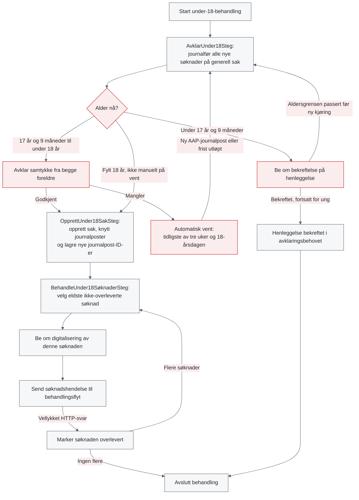
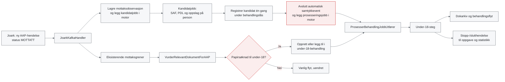

# Under-18-flyt: avklaringer før implementering

Avklart 12. november 2026, med oppdateringer 13. november. Dokumentet samler svarene fra kravavklaringen.
Det beskriver ønsket funksjonalitet, ikke dagens implementering.

Utgangspunktet er diagrammet i
[image-2026-11-11_8-30-51.png](image-2026-11-11_8-30-51.png).
Diagrammets siste steg korrigeres: søknaden skal først journalføres på generell sak
med tema AAP, og senere knyttes til Kelvin-saken. Tema skal ikke først endres til AAP til slutt.

## Omfang og inngang

- Vi lager en egen behandlingstype i postmottak.
- Flyten gjelder bare papirsøknader. Digitale søknader er sperret for personer under 18 år.
- Brevkode er tilstrekkelig for å identifisere en søknad.
- Alder vurderes på tidspunktet vi behandler dokumentet, ikke på søknadsdato eller mottaksdato.
- Manglende fødselsdato er en feilsituasjon. Kast exception og la jobben feile.
- Har søker allerede en Kelvin-sak ved mottak, følger søknaden vanlig flyt.
  Dette gjelder også søkere under 17 år og 9 måneder.
- Leveransen omfatter backend og nødvendige kontrakter. Frontend inngår ikke.

## Journalføring på generell sak

- Søknadene ferdigstilles automatisk på generell sak med tema AAP før manuell avklaring.
- Dette gjelder også søknader som skal henlegges fordi søker er for ung.
- Hvis automatisk journalføring feiler, skal jobben feile.
  Vi innfører ikke en egen manuell journalføringsoppgave for dette i første versjon.

## Alder og henleggelse

| Alder når steget kjører | Oppførsel |
| --- | --- |
| Under 17 år og 9 måneder | Informer saksbehandler om at søknaden henlegges fordi søker er for ung. Saksbehandler må bekrefte. |
| Fra og med 17 år og 9 måneder, men under 18 år | Avklar samtykke fra begge foreldre. |
| Fylt 18 år mens behandlingen pågår | Samtykkekravet faller bort. Opprett Kelvin-sak og knytt søknadene til saken, og fortsett med digitalisering og overlevering. |

Alder må sjekkes på nytt før henleggelsessteget kjører. Har søker nådd 17 år og
9 måneder, skal vi ikke lenger foreslå henleggelse, men gå til samtykkeavklaring.

Ved bekreftet henleggelse avsluttes hele under-18-behandlingen. Det opprettes ingen
Kelvin-sak, og søknadene overleveres ikke. Løsningen sender ikke brev eller oppretter
andre oppgaver i forbindelse med henleggelsen.

Nye søknader etter avsluttet behandling vurderes på nytt ut fra aktuell alder.

## Samtykke

- Begge foreldre må ha samtykket.
- Innhentingen skjer manuelt utenfor flyten. Løsningen skal be saksbehandler innhente samtykke.
- Ett avklaringsbehov kan dekke både innhenting og vurdering.
  Løsnings-DTO og tilstand skal kunne avgjøre hva frontend viser.
- Saksbehandler vurderer samtykke manuelt, også når det følger med søknaden.
- Det er tilstrekkelig at saksbehandler bekrefter at begge foreldrene har samtykket.
- Vi krever ingen begrunnelse, heller ikke når samtykke mangler.
- Vi lagrer en liste over journalpost-ID-er som dokumenterer samtykke.
  Listen kan være tom i første versjon. Det skal være mulig å gjøre den obligatorisk senere.
- Listen må støtte flere journalposter. Søknad og samtykke kan også ligge i samme journalpost.

## Vent

Når saksbehandler svarer at samtykke mangler, opprettes et eget ventebehov.
Standardfristen defineres i ventebehovet og er tre uker.
Fristen settes til det tidligste av tre uker og søkerens 18-årsdag.

Ved utløpt frist åpnes samtykkeoppgaven igjen, med mindre samtykkekravet har falt bort
fordi søker har fylt 18 år. Det trengs ingen annen særskilt funksjonalitet ved fristutløp.
Saksbehandler kan igjen svare at samtykke mangler og få en ny automatisk ventefrist,
eller bruke vanlig manuell vent. Det er ingen fast grense for antall runder.

Manuelt satt vent skal respekteres, også dersom fristen er etter 18-årsdagen.
Fødselsdagen skal ikke overstyre en slik vent.

## Nye journalposter og kandidater til samtykke

- En ny journalpost på samme søker med tema AAP og status `MOTTATT` skal ta
  under-18-behandlingen av vent mens samtykke avklares.
- Journalposten registreres som en kandidat til samtykke. Vi tolker den ikke automatisk som samtykke.
- Saksbehandler må vurdere om journalposten inneholder nødvendig samtykke.
  Hvis ikke, kan behandlingen settes på vent igjen.
- Det er tilstrekkelig å håndtere nye hendelser. Vi trenger ikke hente inn historiske dokumenter.
- Gjentatte hendelser for samme journalpost skal ikke vekke behandlingen på nytt.
- Hendelser om andre temaer eller bare status `JOURNALFOERT` trenger ikke vekke behandlingen.
- Andre dokumenttyper enn søknader følger vanlig flyt i tillegg til å registreres som kandidater
  og ta under-18-behandlingen av vent.

## Flere søknader i samme behandling

Flere papirsøknader fra samme søker samles i én åpen under-18-behandling frem til
Kelvin-saken er opprettet. Dette gjelder også når behandlingen ikke står på vent,
for eksempel mens en samtykke- eller henleggelsesoppgave er åpen.

De ekstra søknadene journalføres på generell sak og legges til behandlingen,
uten en separat ordinær behandling. Én samtykkevurdering dekker de innsamlede søknadene.

Etter at Kelvin-saken er opprettet, følger nye søknader vanlig flyt.

## Opprettelse av Kelvin-sak

Når samtykke er godkjent, eller samtykkekravet faller bort ved fylte 18 år:

1. Opprett Kelvin-sak.
2. Knytt alle søknadene i behandlingen til saken.
3. Knytt også journalpostene i den registrerte samtykkelisten til saken.
4. Fortsett med digitalisering og overlevering av søknadene.

Fagsaken på den ferdigstilte journalposten endres ikke direkte.
Som avklart 13. november brukes dokarkivs
`/rest/journalpostapi/v1/journalpost/{kildeJournalpostId}/knyttTilAnnenSak`,
som returnerer `nyJournalpostId`.
Vi må lagre koblingen fra kildejournalpost til den nye journalposten på Kelvin-saken.
Det er den nye journalpost-ID-en som skal brukes ved overlevering til behandlingsflyt.

Hvis en Kelvin-sak uventet har blitt opprettet mens behandlingen står på vent,
skal vi logge på `ERROR`-nivå og kaste exception slik at jobben feiler.
Vi skal ikke automatisk bruke den uventede saken og fortsette.

## Digitalisering, overlevering og rekkefølge

- Hver søknad må digitaliseres og overleveres separat.
- Søknadene behandles etter mottatt-tidspunkt i Joark, eldste først.
- Vi fullfører én søknad av gangen: digitaliser, overlever, og gå deretter til neste søknad.
- Vellykket HTTP-kall til behandlingsflyt er tilstrekkelig bekreftelse før neste søknad sendes.
  Vi trenger ikke vente på at behandlingsflyt har ferdigbehandlet hendelsen.
- Rekkefølgekravet gjelder bare søknadene i under-18-behandlingen.
  Senere søknader i vanlig flyt trenger ikke vente på disse.

Førstevalget er et eget digitaliseringssteg i under-18-behandlingen som gjenbruker
funksjonalitet fra eksisterende steg, slik at vi slipper en ny behandling.
Hvis dette blir for komplisert, er det akseptert å opprette vanlige
DokumentHåndtering-behandlinger. Dette tekniske valget er ikke låst, men løsningen
må fortsatt sikre rekkefølgen beskrevet over.

## Feature toggle og produksjon

Koden til den nye flyten kan legges i produksjon før rutingen aktiveres.
En feature toggle styrer bare om nye under-18-behandlinger opprettes.
Vi skal minimere hvor togglen brukes, ikke spre sjekker gjennom stegene.

Eksisterende under-18-behandlinger fortsetter selv om togglen slås av.
De mottar fortsatt kandidater og samler nye papirsøknader frem til Kelvin-saken
er opprettet.

## Løsningsforslag

Dette er et teknisk forslag basert på kravene over og dagens kode.
Nye klasse-, tabell- og enum-navn nedenfor er arbeidsnavn, ikke ferdige kontrakter.

### Anbefalt oppdeling

Behold én under-18-behandling som eier samtykkevurderingen og en kø av søknader.
Behandlingen lagres i eksisterende `BEHANDLING` med `type = Under18`, gjennom
`BehandlingRepository.opprettBehandling`. Vi trenger ingen egen behandlingstabell.
Behold den første søknaden som behandlingens faste hovedjournalpost.
Lagre de øvrige journalpostene i egne koblingstabeller.
Vi endrer ikke betydningen av `BEHANDLING.JOURNALPOST_ID` eller den generelle flytmotoren.

Flyten får tre egne forretningssteg:

1. `AvklarUnder18Steg` journalfører nye søknader på generell sak og håndterer
   alder, henleggelse, samtykke og automatisk vent.
2. `OpprettUnder18SakSteg` oppretter Kelvin-sak og knytter journalpostene til saken.
   Ved henleggelse gjør steget ingenting.
3. `BehandleUnder18SøknaderSteg` digitaliserer og overleverer én søknad av gangen.
   Ved henleggelse gjør også dette steget ingenting.

Legg `StartBehandlingSteg` først og `AvsluttBehandlingSteg` sist, som i
[Dokumentflyt.kt:11-17](flyt/src/main/kotlin/no/nav/aap/postmottak/forretningsflyt/behandlingstyper/Dokumentflyt.kt#L11-L17).
Bekreftet henleggelse registreres gjennom avklaringsbehovet.
De etterfølgende stegene leser bekreftelsen og aldersvurderingen og returnerer
`Fullført` ved henleggelse, slik at motoren avslutter behandlingen på vanlig måte.



Diagrammet viser forretningsforløpet. Motoren går ikke bakover mellom
digitaliserings- og overleveringssteg. Søknadskøen håndteres inne i det siste steget.
Manuell vent er en egen stopp som må respekteres før videreføring.

### Hvorfor ikke kalle dagens digitaliseringssteg direkte?

[DigitaliserDokumentSteg.kt:63-74](flyt/src/main/kotlin/no/nav/aap/postmottak/forretningsflyt/steg/dokumentflyt/DigitaliserDokumentSteg.kt#L63-L74)
leser både digitaliseringsvurdering og journalpost via behandling-ID.
[JournalpostRepositoryImpl.kt:98-111](repository/src/main/kotlin/no/nav/aap/postmottak/repository/journalpost/JournalpostRepositoryImpl.kt#L98-L111)
slår da opp den faste hovedjournalposten.
Å bytte bare `journalpostId` i `FlytKontekst` er derfor ikke nok til å behandle neste søknad.

Trekk i stedet ut den felles valideringen og byggingen av `Digitaliseringsvurdering`
fra [DigitaliserDokumentLøser.kt:25-52](flyt/src/main/kotlin/no/nav/aap/postmottak/avklaringsbehov/løser/DigitaliserDokumentLøser.kt#L25-L52).
La en ny under-18-løser bruke denne funksjonaliteten med den konkrete søknadens journalpost.
Gjenbruk `DokumentTilMeldingParser` og trekk ved behov ut felles bygging og sending av
søknadshendelsen fra
[OverleverTilFagsystemSteg.kt:124-136](flyt/src/main/kotlin/no/nav/aap/postmottak/forretningsflyt/steg/dokumentflyt/OverleverTilFagsystemSteg.kt#L124-L136).
Den ordinære flyten beholder eksisterende lagring og oppførsel.

Dette krever ikke at de ordinære vurderingstabellene gjøres om til flerdokumenttabeller.
Alternativet med separate DokumentHåndtering-behandlinger beholdes som reserve.
Da må en eksplisitt forelder–barn-kobling og sekvensiell oppstart sikre rekkefølgen.
Å opprette alle behandlingene samtidig er ikke tilstrekkelig.

### Mottak og ruting

Legg rutingen til `Under18MottakService`, som brukes fra
[VurderRelevantDokumentForAAPJobbUtfører.kt:136-138](flyt/src/main/kotlin/no/nav/aap/postmottak/mottak/VurderRelevantDokumentForAAPJobbUtfører.kt#L136-L138)
før en ny Fordeling-behandling opprettes.
Behold dagens håndtering av manglende ident, organisasjoner og ugyldige journalposter.

Service-metoden følger denne rekkefølgen for papirsøknader:

1. Finn personen med eksisterende `PersonService`, som håndterer identer fra PDL.
2. Sjekk om journalposten allerede tilhører en under-18-behandling.
   I så fall skal det ikke opprettes en ordinær behandling ved en gjentatt hendelse.
3. Finn en eksisterende under-18-behandling som fortsatt samler søknader.
   Legg søknaden til denne uten å sjekke togglen.
4. Hvis ingen slik behandling finnes: hent aktuell alder og Kelvin-saker.
   Har personen Kelvin-sak, eller er personen fylt 18 år, brukes vanlig flyt.
5. Bare når en ny under-18-behandling skal opprettes, sjekkes togglen
   `PostmottakUnder18`. Er den av, brukes dagens ruting uendret.
6. Lagre journalpostsnapshot og opprett en vanlig `BEHANDLING` med `type = Under18`.
   Knytt første søknad til behandlingen.
   Opprett `flyt.prosesserBehandling` med behandlingens faste hovedjournalpost som `sakId`.

Bruk eksisterende `Journalpost.erPapir()` og `Journalpost.erSøknad()` fremfor nye,
parallelle definisjoner av papirsøknader. Manglende fødselsdato skal gi exception,
ikke en antakelse om alder eller overgang til vanlig flyt.
Alderskontrollen i den nye flyten skal gjelde i alle miljøer.
Ikke la den arve dagens prod/dev-bryter på fordelingsregelen `Aldersregel`.

Nye kandidater må også fanges opp når journalposten har en åpen
Journalføring-behandling. Dagens
[KafkaStreams.kt:112-130](flyt/src/main/kotlin/no/nav/aap/postmottak/mottak/KafkaStreams.kt#L112-L130)
sender slike hendelser direkte til denne behandlingen, uten å kjøre vurderingsjobben.
Det er derfor ikke nok å legge all kandidatregistrering i vurderingsjobben.

Forslaget er å registrere en lett mottaksobservasjon i Kafka-transaksjonen og legge
til en ny `RegistrerUnder18JournalpostJobbUtfører` for første relevante observasjon.
Jobben henter SAF/PDL-data, finner en åpen samtykkeavklaring og registrerer kandidaten.
Den kjører ingen flytsteg. Dagens ordinære mottaksgrener fortsetter ved siden av.
Del registreringslogikk med rutingservicen, slik at de to jobbene tåler vilkårlig kjørerekkefølge.



Mottaksobservasjonen må bevare at hendelsen hadde status `MOTTATT`.
SAF kan vise `JOURNALFOERT` når kandidatjobben senere kjører, fordi vanlig flyt allerede
har journalført dokumentet. Dette skal ikke forveksles med å abonnere på hendelser
som bare har status `JOURNALFOERT`.

### Datamodell

Gjenbruk `BEHANDLING` for identitet, type, status og versjon, og `STEG_HISTORIKK` for
fremdrift. Person finnes gjennom behandlingens hovedjournalpost.
Det skal verken opprettes en `UNDER18_BEHANDLING`-tabell eller lagres en parallell fase.
Innsamling er åpen så lenge behandlingen er i avklaringsdelen og ingen Kelvin-sak
er opprettet. Dette utledes av eksisterende behandlings- og saksgrunnlag under lås.

Gjenbruk `SaksnummerRepository` for saksvurderingen og Kelvin-saksnummeret,
og avklaringsbehovene med historikk for henleggelsesbekreftelse og vent.
`Under18Grunnlag` er en samlet lesemodell, ikke en ny behandlingstabell.

Nye tabeller bak `Under18Repository` begrenses til søknadskoblinger, observasjoner
og vurderinger som ikke allerede dekkes. Alle får primærnøkkel og refererer til
eksisterende behandling der dataene er behandlingsspesifikke.
Eksisterende journalpostsnapshots gjenbrukes. Journalpost-ID-er peker på Joark-ID,
ikke den interne ID-en til en snapshotrad i `JOURNALPOST`.

| Foreslått tabell | Ansvar og sentrale felt |
| --- | --- |
| `UNDER18_SOKNAD` | Én rad per søknad: behandling-ID, journalpost-ID, mottatt-tidspunkt, status for journalføring/tilknytning og tidspunkt for vellykket overlevering. |
| `UNDER18_JOURNALPOST_TILKNYTNING` | Kobling fra behandling, `kildeJournalpostId` og Kelvin-saksnummer til returnert `nyJournalpostId`. Brukes for både søknader og registrerte samtykkejournalposter. |
| `UNDER18_JOURNALPOST_OBSERVASJON` | Første relevante mottaksobservasjon per journalpost, med observasjonstidspunkt og nødvendig hendelsesinformasjon. Dedupliserer kandidatjobber uavhengig av ordinær behandling. |
| `UNDER18_SAMTYKKEKANDIDAT` | Journalposter som er oppdaget mens samtykke avklares, med unik kombinasjon av behandling-ID og journalpost-ID. Kandidat betyr ikke godkjent samtykke. |
| `UNDER18_SAMTYKKEVURDERING` og `UNDER18_SAMTYKKE_GRUNNLAG` | Historiske vurderinger og aktiv vurdering etter repoets grunnlagsmønster. Registrer beslutning, listen over dokumenterende journalpost-ID-er og koblingen mellom vurderingen og dens automatiske venterunde. |
| `UNDER18_DIGITALISERINGSVURDERING` og `UNDER18_DIGITALISERING_GRUNNLAG` | Historiske digitaliseringsvurderinger og aktiv vurdering per søknad, ikke bare per behandling. Gjenbruk verditypen `Digitaliseringsvurdering`. |

Utvid `BehandlingRepository` med et målrettet oppslag på person, `type = Under18`
og gjeldende behandlingsstatus. Kontroller deretter steg og saksgrunnlag for å
avgjøre om behandlingen fortsatt samler søknader.
Det eksisterende `hentBehandlingerForPerson` krever et besøkt `AVKLARINGSPUNKT`
og er derfor ikke tilstrekkelig for å finne en nyopprettet behandling.

Serialiser opprettelse per person med en databaselås, og gjenta oppslaget under låsen
før behandling opprettes. Alle innganger som oppretter under-18-behandlinger må bruke
denne mekanismen. Vi kan ikke legge en partiell unik indeks på person og
innsamlingstilstand når disse opplysningene ligger i flere eksisterende tabeller.
En unik nøkkel i søknadskoblingen hindrer at samme søknad får to under-18-behandlinger.

Tilknytningskoblingen skal være unik per behandling, kildejournalpost og målsak.
Samme kildejournalpost kan inneholde både søknad og samtykke og skal da ikke tilknyttes to ganger.
Søknaden identifiseres fortsatt av kildejournalpost-ID-en i køen.
Behandlingens hovedjournalpost og kandidatenes referanser byttes ikke ut med den nye ID-en.

Første mottaksobservasjon og kandidatinnsetting må være idempotente.
Kjente, tidligere mottatte dokumenter skal ikke bli nye kandidater fordi de får en
ny Kafka-hendelse. Bruk eksisterende mottaksregistrering ved innføringen av observasjonene,
og skill observasjonstidspunkt fra tidspunktet kandidatjobben utføres.
Det skal ikke gjøres historisk dokumentinnhenting.

Ny migrasjon legges i `repository/src/main/resources/flyway/`.
Ved denne gjennomgangen er siste versjon `V1.80`, så `V1.81__under18_flyt.sql` er
et mulig navn. Kontroller neste ledige nummer ved implementering.
Bruk SQL som fungerer på Postgres 16.

### Samtykkerunder, vent og alder

Innfør to manuelle behov for avklaringssteget: `BEKREFT_UNDER18_HENLEGGELSE` og
`AVKLAR_UNDER18_SAMTYKKE`. De er aldri åpne samtidig.
Et eget ventebehov `VENT_PA_UNDER18_SAMTYKKE` får standardfrist på tre uker i
[Definisjon.kt](kontrakt/src/main/kotlin/no/nav/aap/postmottak/kontrakt/avklaringsbehov/Definisjon.kt#L15).
Nye behov får nye, ledige koder; historiske koder gjenbrukes ikke.

Løserne lagrer vurderinger, mens steget gjør eksterne kall og oppretter automatisk vent.
En negativ samtykkevurdering må utløse vent bare én gang. Lagre hvilken vurdering
venten ble opprettet for. Når denne venten er avsluttet, åpnes den manuelle oppgaven
igjen i stedet for at den samme negative vurderingen automatisk oppretter en ny vent.

Beregn standardfristen gjennom ventebehovets `utledFrist(null)`, og avkort den ved
18-årsdagen. Slik ligger treukersfristen ett sted.
Gjenbruk eksisterende
[GjenopptaBehandlingJobbUtfører.kt:17-29](flyt/src/main/kotlin/no/nav/aap/postmottak/prosessering/GjenopptaBehandlingJobbUtfører.kt#L17-L29)
og motorens avslutning av utløpte ventebehov.
Dette gir gjenopptak ved neste ordinære kjøring, normalt klokken 07 på fristdagen,
ikke nødvendigvis ved midnatt.

Ved ny kandidat avsluttes det automatiske samtykkeventebehovet uttrykkelig,
og behandlingen får en prosesseringsjobb.
Ikke stol på at `Fullført` automatisk fjerner vent: motorens regel gjør ikke dette
når behandlingen også har manuelle avklaringsbehov.

Steget sjekker alder og aktiv manuell vent før det lar behandlingen gå videre.
En ny aldersvurdering må kunne avbryte et utdatert henleggelses- eller samtykkebehov.
En gammel henleggelsesbekreftelse må ikke henlegge en søker som nå har passert grensen.

### Samtidighet og idempotens

- Bruk person-ID fra `PersonService`, ikke rå fødselsnummer som samlingsnøkkel.
  Serialiser opprettelse per person med databaselås og gjenta oppslaget på eksisterende behandling.
- Ved endring av en eksisterende behandling brukes
  [TaSkriveLåsRepository.kt:7-12](flyt/src/main/kotlin/no/nav/aap/postmottak/journalpostogbehandling/lås/TaSkriveLåsRepository.kt#L7-L12),
  inkludert versjonsoppdatering. En kandidat skal ikke kunne legges til uten at en åpen
  frontend-visning blir utdatert.
- Rutingservicen må kontrollere innsamlingstilstanden på nytt etter at behandlingslåsen
  er tatt. Samme lås beskytter saksopprettelsen og overgangen ut av innsamling.
  En samtidig ny søknad blir enten med i samlingen eller rutes ordinært etterpå, aldri begge deler.
- Ikke legg personlås inn i steg som allerede kjøres under behandlingslås.
  Låsrekkefølgen må være entydig mellom mottak og motor for å unngå deadlock.
- Behandlingens hovedjournalpost og motorens `sakId` skal være stabile.
  Vi skal ikke bytte dem når neste søknad digitaliseres.
- Hent aktuell status fra SAF før journalføring og tilknytning.
  Allerede utført operasjon skal kunne gjenkjennes ved retry.
- Lagre returnert `nyJournalpostId` og gjenbruk tilknytningen ved senere kjøringer.
  Ved avbrutt dokarkiv-kall eller manglende lokal kobling etter rollback verifiseres
  tilknytningen med et lesekall før operasjonen eventuelt forsøkes på nytt.
  En eksisterende tilknytning skal gjenbrukes, ikke opprette en ny journalpost.
- Lagre Kelvin-saksnummeret gjennom eksisterende `SaksnummerRepository` før senere
  steg bruker det. En annen sak oppdaget under vent skal gi `ERROR` og exception,
  men en allerede lagret sak fra denne flyten er forventet.
- Nye repositorier må også implementere repoets slettemekanisme for dataene de eier.

Unike nøkler alene gir ikke «exactly once» mot andre tjenester.
Motoren kan rulle tilbake lokale endringer etter at et HTTP-kall har lykkes.
Eksisterende
[BehandlingsflytKlient.kt:82-100](klienter/src/main/kotlin/no/nav/aap/postmottak/klient/behandlingsflyt/BehandlingsflytKlient.kt#L82-L100)
sender journalpost-ID som `InnsendingReferanse`.
Mottakerens deduplisering på denne referansen må verifiseres før vi bygger videre på den.

### Opprettelse av sak og tilknytning i Joark

Gjenbruk `BehandlingsflytGateway.finnSaker` ved inngang og for å oppdage en uventet
Kelvin-sak mens behandlingen står på vent. Bruk `finnEllerOpprettSak` i saksopprettelsessteget.
Ikke legg dette kallet i løsningen på samtykkebehovet.
Bruk den eldste innsamlede søknadens mottaksdato når saken opprettes.

`sak/finnEllerOpprett` er idempotent, som avklart 13. november.
Ved avbrutt kall eller lokal rollback kan steget gjenta kallet med samme input og
lagre saksnummeret fra svaret. Dette krever ingen egen operasjonsreferanse.
En sak returnert ved et slikt nytt forsøk er ikke en uventet sak opprettet under vent.

Gjenbruk
[JournalføringService.kt:141-159](flyt/src/main/kotlin/no/nav/aap/postmottak/gateway/JournalføringService.kt#L141-L159)
og maskinell ferdigstilling for generell sak.
Ikke bruk `førJournalpostPåFagsak` til å forsøke å endre fagsak på den ferdigstilte journalposten.

Etter brukerens avklaring 13. november legges en egen operasjon i `JournalføringService`
for dokarkiv-endepunktet:

```text
{baseUri}/rest/journalpostapi/v1/journalpost/{kildeJournalpostId}/knyttTilAnnenSak
```

Operasjonen returnerer `nyJournalpostId`. Lagre resultatet som en kobling fra
kildejournalpost og Kelvin-sak til den nye journalposten.
Dette gjelder både søknadene og journalpostene som dokumenterer samtykke.
Hent og lagre SAF-snapshot av den nye journalposten før videre dokumentbehandling.
Bruk den nye ID-en for dokumenthenting på Kelvin-saken og i søknadshendelsen til behandlingsflyt.
Behold den opprinnelige ID-en for mottaksdeduplisering, søknadsrekkefølge og behandlingens hovedjournalpost.
Mottatt-tidspunktet til kildesøknaden skal ikke erstattes av opprettelsestidspunktet til den nye journalposten.

Normalt forventer vi et vellykket svar med `nyJournalpostId`, som lagres lokalt.
Hvis kallet avbrytes, skal vi verifisere resultatet med et lesekall før et nytt
tilknytningsforsøk. Det samme gjelder hvis det eksterne kallet lykkes, men den lokale
transaksjonen rulles tilbake:

1. Kontroller om kildejournalposten allerede er tilknyttet den aktuelle Kelvin-saken.
2. Finnes tilknytningen, hent og lagre den nye journalpost-ID-en og fortsett.
3. Bekrefter lesekallet at tilknytningen ikke finnes, kan tilknytningskallet utføres.
4. Feiler lesekallet eller gir det et tvetydig resultat, skal jobben feile.
   Vi skal ikke tolke dette som at tilknytningen mangler.

Request-feltene og det konkrete leseoppslaget må kontrolleres mot dokarkivs kontrakt.
Oppslaget må identifisere tilknytningen fra riktig kildejournalpost til riktig målsak,
ikke bare finne en vilkårlig journalpost på Kelvin-saken.

Knytt bare de journalpostene saksbehandler faktisk har registrert som samtykke,
ikke alle kandidatene. Hvis en slik journalpost allerede ligger på en annen fagsak,
må løsningen kontrollere om det er riktig å tilknytte eller kopiere den, ikke overskrive
den ordinære flytens resultat uten videre.

### Digitalisering og overlevering i samme behandling

Opprett et eget behov `DIGITALISER_UNDER18_SOKNAD` i køsteget.
Det eksisterende `DIGITALISER_DOKUMENT` er bundet til et annet steg i `Definisjon`.
Gjenbruk derfor funksjonalitet og verdityper, ikke samme behovskode med ny betydning.

Grunnlaget viser både `kildeJournalpostId` og tilknyttet `nyJournalpostId` for gjeldende søknad.
Løsnings-DTO-en må identifisere søknaden med kildejournalpost-ID-en i tillegg til digitaliseringsdata.
Dagens API validerer behandlingens versjon. Løseren kontrollerer medlemskap og at
dette er den eldste ikke-overleverte søknaden.
Da kan et gammelt skjema ikke lagre data på neste søknad.

Etter lagret digitalisering kjører steget slik:

1. Les eldste ikke-overleverte søknad og dens aktive vurdering.
2. Mangler vurdering, returner `FantAvklaringsbehov(DIGITALISER_UNDER18_SOKNAD)`.
3. Send søknadshendelsen med tilknyttet `nyJournalpostId`, denne søknadens opprinnelige
   kanal og mottaksdatoer, og dens digitaliserte data.
   Behold eksisterende regler for søknadsdato og `digitalisertIPostmottak`.
4. Ved vellykket HTTP-svar lagres overleveringstidspunkt.
5. Finn neste søknad og åpne samme digitaliseringsbehov for denne.
   Når køen er tom, returneres `Fullført`.

Fordi neste søknad ikke har en digitaliseringsvurdering ennå, stopper behandlingen
på den neste manuelle oppgaven og transaksjonen kan fullføres.
Det skal ikke sendes en hel søknadsbunke i én løkke uten mellomliggende manuelle stopp.
Ved HTTP-feil blir gjeldende søknad stående først i køen.

Sorter på mottatt-tidspunkt i Joark.
Som teknisk forslag brukes `mottattDato.atStartOfDay()` når klokkeslett mangler og
journalpost-ID som stabil sekundærsortering. Dette er et forslag til håndtering av
like eller manglende tidspunkt, ikke et eget avklart forretningskrav.

### API, oppgaver og tilgang

Gjenbruk eksisterende `POST /api/behandling/løs-behov` for nye løsninger.
Legg til et lesepunkt, for eksempel
`GET /api/behandling/{referanse}/grunnlag/under18`, med:

- aktuell aldersvurdering og hvilke handlinger som er gyldige;
- aktiv samtykkevurdering, kandidater og registrerte samtykkejournalposter;
- søknadslisten med kildejournalpost-ID-er og nye journalpost-ID-er, gjeldende søknad
  og fremdrift for journalføring og overlevering;
- ventestatus, frist og eventuelt opprettet Kelvin-saksnummer.

GET beregner visningsdata, men endrer ikke behandlingen.
Mutasjoner bruker dagens lås, versjonskontroll og jobbinnlegging.
Løsninger legges i det eksisterende sealed-hierarkiet for `AvklaringsbehovLøsning`.
[utledSubtypes():34-36](flyt/src/main/kotlin/no/nav/aap/postmottak/avklaringsbehov/løsning/AvklaringsbehovLøsning.kt#L34-L36)
finner slike subtyper automatisk.

Behold tilgangskontrollen på behandlingen. Ved visning av andre journalposter må
tilgang kontrolleres også for den konkrete journalposten.
Gjenbruk dokumentendepunktet med `DokumentOboGateway` og kontroller at journalpost-ID-er
som sendes inn som samtykke, faktisk tilhører samme søker.
Tom samtykkeliste skal fortsatt være gyldig.

Gjenbruk vanlige stopp-/slutthendelser til aap-oppgave og aap-statistikk.
De kan fortsatt bruke behandlingens faste hovedjournalpost som referanse.
Søknadskøen eksponeres gjennom det nye grunnlaget, uten å endre den eksisterende
hendelseskontrakten til å representere flere hovedjournalposter.
Nye steggrupper må fungere i `/flyt`, selv om frontend-implementeringen ikke inngår.

### Filer som endres

Stiene viser eksisterende filer. Omfanget i hver fil avhenger av den endelige oppdelingen.

| Fil | Foreslått endring |
| --- | --- |
| [TypeBehandling.kt](kontrakt/src/main/kotlin/no/nav/aap/postmottak/kontrakt/behandling/TypeBehandling.kt) | Legg til `Under18` med egen identifikator. |
| [StegType.kt](kontrakt/src/main/kotlin/no/nav/aap/postmottak/kontrakt/steg/StegType.kt) og [StegGruppe.kt](kontrakt/src/main/kotlin/no/nav/aap/postmottak/kontrakt/steg/StegGruppe.kt) | Registrer de nye stegene og gruppene. Manuelle steg må ha status `UTREDES`. |
| [AvklaringsbehovKode.kt](kontrakt/src/main/kotlin/no/nav/aap/postmottak/kontrakt/avklaringsbehov/AvklaringsbehovKode.kt) og [Definisjon.kt](kontrakt/src/main/kotlin/no/nav/aap/postmottak/kontrakt/avklaringsbehov/Definisjon.kt) | Henleggelse, samtykke, automatisk samtykkevent og digitalisering per søknad. |
| [BehandlingType.kt](flyt/src/main/kotlin/no/nav/aap/postmottak/flyt/BehandlingType.kt) | Koble `Under18` til den nye flyten i `utledType`. |
| [BehandlingRepository.kt](flyt/src/main/kotlin/no/nav/aap/postmottak/journalpostogbehandling/behandling/BehandlingRepository.kt) og [BehandlingRepositoryImpl.kt](repository/src/main/kotlin/no/nav/aap/postmottak/repository/behandling/BehandlingRepositoryImpl.kt) | Gjenbruk opprettelse i `BEHANDLING`. Legg til oppslag på under-18-behandling for person som også finner nyopprettede behandlinger uten avklaringspunkthistorikk. |
| [KafkaStreams.kt](flyt/src/main/kotlin/no/nav/aap/postmottak/mottak/KafkaStreams.kt) | Registrer mottaksobservasjon og kandidatjobb for relevante AAP-hendelser, også i grenen med åpen Journalføring-behandling. |
| [VurderRelevantDokumentForAAPJobbUtfører.kt](flyt/src/main/kotlin/no/nav/aap/postmottak/mottak/VurderRelevantDokumentForAAPJobbUtfører.kt) | Bruk rutingservicen før Fordeling opprettes. Behold ordinær mottaksregistrering og øvrige grener. |
| [FeatureToggle.kt](flyt/src/main/kotlin/no/nav/aap/unleash/FeatureToggle.kt) | Definer togglen. Det eneste funksjonelle sjekkpunktet er opprettelse av en ny under-18-behandling. |
| [ProsesseringsJobber.kt](flyt/src/main/kotlin/no/nav/aap/postmottak/prosessering/ProsesseringsJobber.kt) | Registrer kandidatjobben med en ny, stabil jobbtype. |
| [JournalføringService.kt](flyt/src/main/kotlin/no/nav/aap/postmottak/gateway/JournalføringService.kt) | Legg til operasjon for `knyttTilAnnenSak` som returnerer `nyJournalpostId`. |
| [DigitaliserDokumentLøser.kt](flyt/src/main/kotlin/no/nav/aap/postmottak/avklaringsbehov/løser/DigitaliserDokumentLøser.kt) og [OverleverTilFagsystemSteg.kt](flyt/src/main/kotlin/no/nav/aap/postmottak/forretningsflyt/steg/dokumentflyt/OverleverTilFagsystemSteg.kt) | Trekk ut bare det som faktisk trengs av felles validering og overlevering. Behold ordinær oppførsel. |
| [PostgresRepositoryRegistry.kt](repository/src/main/kotlin/no/nav/aap/postmottak/repository/PostgresRepositoryRegistry.kt) | Registrer `Under18RepositoryImpl`. |
| [App.kt](app/src/main/kotlin/no/nav/aap/postmottak/App.kt) | Registrer det nye grunnlagsendepunktet. |
| [FakeServers.kt](lib-test/src/main/kotlin/no/nav/aap/postmottak/test/FakeServers.kt) og [BehandlingsflytFake.kt](lib-test/src/main/kotlin/no/nav/aap/postmottak/test/fakes/BehandlingsflytFake.kt) | Støtt tilknytning av ferdigstilte journalposter, kontrollerte HTTP-feil og observasjon av overleveringsrekkefølge. |

Foreslåtte nye filer, med pakker relativt til modulenes `no/nav/aap/postmottak/`:

```text
flyt/src/main/kotlin/no/nav/aap/postmottak/
  forretningsflyt/behandlingstyper/Under18Flyt.kt
  forretningsflyt/steg/under18/AvklarUnder18Steg.kt
  forretningsflyt/steg/under18/OpprettUnder18SakSteg.kt
  forretningsflyt/steg/under18/BehandleUnder18SøknaderSteg.kt
  under18/Under18Repository.kt
  under18/Under18Grunnlag.kt
  mottak/Under18MottakService.kt
  prosessering/RegistrerUnder18JournalpostJobbUtfører.kt
  avklaringsbehov/løsning/BekreftUnder18HenleggelseLøsning.kt
  avklaringsbehov/løsning/AvklarUnder18SamtykkeLøsning.kt
  avklaringsbehov/løsning/DigitaliserUnder18SøknadLøsning.kt
  avklaringsbehov/løser/BekreftUnder18HenleggelseLøser.kt
  avklaringsbehov/løser/AvklarUnder18SamtykkeLøser.kt
  avklaringsbehov/løser/DigitaliserUnder18SøknadLøser.kt
repository/src/main/kotlin/no/nav/aap/postmottak/
  repository/under18/Under18RepositoryImpl.kt
repository/src/main/resources/flyway/
  V1.<neste>__under18_flyt.sql
api/src/main/kotlin/no/nav/aap/postmottak/
  api/faktagrunnlag/under18/Under18Api.kt
  api/faktagrunnlag/under18/Under18GrunnlagDto.kt
```

Felles digitaliserings- og overleveringshjelpere plasseres ved dagens dokumentfunksjonalitet.
Nye synlige steggrupper får enten obligatorisk visning eller egne `StegGruppeVisningUtleder`-klasser
i `flyt/flate/visning/`. Dette må velges sammen med steggruppene, ikke utelates fordi frontend kommer senere.

### Tester som bør følge implementeringen

| Testnivå | Viktige tilfeller |
| --- | --- |
| Rene tester | Aldersgrensene, exception ved manglende fødselsdato, passering av grensen mens oppgaven er åpen, ventefrist før 18-årsdagen og stabil søknadssortering. |
| Repository | Flere søknader per behandling, historiske vurderinger, én aktiv samling per person, kandidatdeduplisering, kobling mellom kildejournalpost og ny journalpost, og lagring av overleveringsstatus. |
| Mottak og Kafka | Toggle av/på, eksisterende sak, gjentatte hendelser, kandidat med åpen Journalføring-behandling, og vilkårlig rekkefølge mellom kandidatjobb og vurderingsjobb. |
| Steg og løsere | Godkjent/tomt dokumentert samtykke, manglende samtykke over flere runder, henleggelse, manuell vent, ugyldig medlemskap og utdatert digitaliseringsløsning. |
| Integrasjoner | Journalføring på generell sak, `knyttTilAnnenSak` med ny journalpost-ID, samme dokument som søknad og samtykke, overlevering med ny ID og opprinnelige mottaksdatoer, og gjenfinning med lesekall etter avbrutt kall eller lokal rollback. Lesefeil skal ikke utløse ny tilknytning. |
| Flyttest | To søknader i én behandling: vent, kandidat, godkjenning, én sak, digitalisering og overlevering i riktig rekkefølge. Eget scenario for henleggelse og for fylte 18 år. |

Utvid eksisterende mottaks- og løsertester der de har registreringskontroller.
Bruk `@Fakes`, `TestDataSource` og nye testpersoner/journalposter.
Kjør målrettede tester med repoets testskript, ikke hele `test` eller `build`.
Behold relevante regresjonstester for vanlig Journalføring og DokumentHåndtering.

### Avklaringer og verifikasjoner før implementering

- Kontroller request-feltene for dokarkivs `knyttTilAnnenSak`, det konkrete leseoppslaget
  for tilknytningen og håndtering av dokumenter som allerede er knyttet til en annen fagsak.
  Valg av operasjon, ny journalpost-ID i responsen og lesekontroll ved avbrutt kall er avklart.
- Verifiser deduplisering av søknadshendelser i behandlingsflyt.
  Dette gjelder overlevering av søknader, ikke saksopprettelse:
  `sak/finnEllerOpprett` er avklart som idempotent.
- Nye journalposter skal vekke automatisk samtykkevent. Det er bare uttrykkelig avklart
  at 18-årsdagen ikke skal overstyre manuell vent. Avklar om en ny journalpost skal
  kunne avslutte også manuelt satt vent.
- Bekreft sekundærsortering ved like eller manglende mottatt-tidspunkt.
  Manglende fødselsdato er avklart som en feilsituasjon som skal gi exception.
- Kontroller at aap-oppgave og aap-statistikk godtar ny behandlingstype og behovskoder
  før rutingen aktiveres. Frontend må støtte de manuelle oppgavene før reelle
  søknader sendes inn i flyten, selv om frontend ikke inngår i denne leveransen.

### Foreslått implementeringsrekkefølge

1. Verifiser dokarkivs leseoppslag og deduplisering av søknadshendelser i behandlingsflyt.
2. Legg til kontrakter, migrasjon, repository og målrettede tester.
3. Implementer stegene og løserne, uten aktiv ruting fra mottaket.
4. Legg til grunnlag, visningsstøtte, kandidatjobb og idempotent mottak.
5. Koble rutingen til det ene toggle-sjekkpunktet og test hele forløpet.
6. Deploy med togglen av. Aktiver først når nødvendige konsumenter og frontend er klare.
