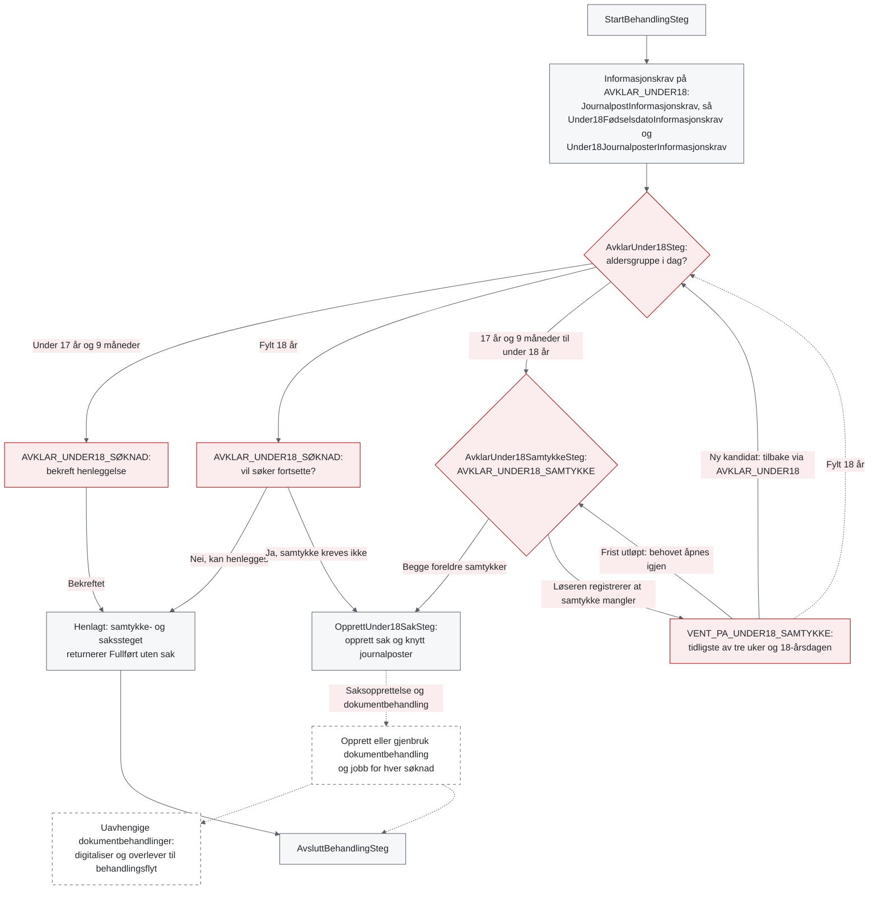
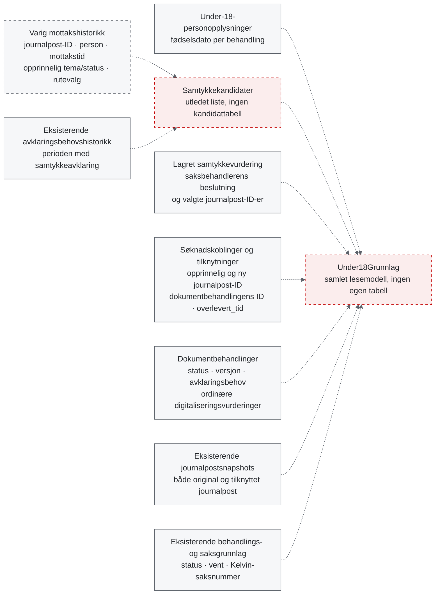

# Under-18-flyt: avklaringer og implementeringsplan

Avklart 12. november 2026, med oppdateringer til og med 24. november.
Dokumentet samler kravavklaringene og viser ønsket funksjonalitet, status og planen videre.

Den 18. november ble løsningen endret til å gjenbruke vanlige
`DokumentHåndtering`-behandlinger for digitalisering og overlevering.
Under-18-behandlingen oppretter én dokumentbehandling per søknad.
Dette erstatter forslaget om digitalisering inne i under-18-behandlingen.

Den 19. november ble kravet om sekvensiell fullføring fjernet.
Alle dokumentbehandlingene og jobbene opprettes uten å vente på digitalisering
eller overlevering. Flere søknader kan vente på digitalisering samtidig og
overleveres i ulik rekkefølge. Under-18-behandlingen avsluttes når alle
dokumentbehandlingene og jobbene er opprettet. Eget koordineringssteg,
dokumentbehandlingsvent og gjenopptaksjobber fra dokumentbehandlingene utgår.
Samtykkevent og den daglige aldersjobben beholdes.

Den 24. november ble journalføringen flyttet ut av under-18-behandlingen.
Aktuelle papirsøknader går først gjennom Journalføring. Saksbehandler avklarer
temaet. Ved tema AAP journalfører Journalføring søknaden på generell sak og
ferdigstiller den. Først etterpå oppretter eller oppdaterer løsningen
under-18-behandlingen. Den samler fortsatt søknader, avklarer samtykke og
oppretter Kelvin-sak og dokumentbehandlinger.
Planen erstatter dermed direkte journalføring i `Under18SøknadsJournalfører`,
som er fjernet på branchen `under18-mottakshistorikk`.

Utgangspunktet er diagrammet i
[image-2026-11-11_8-30-51.png](image-2026-11-11_8-30-51.png).
Diagrammet må vise at saksbehandler først bekrefter tema AAP i Journalføring.
Journalføring setter deretter søknaden på generell sak og ferdigstiller den.
Under-18-behandlingen knytter den ferdigstilte journalposten til Kelvin-saken senere.

## Omfang og inngang

- Vi lager en egen behandlingstype i postmottak.
- Flyten gjelder bare papirsøknader. Digitale søknader er sperret for personer under 18 år.
- Brevkode er tilstrekkelig for å identifisere en søknad.
- Alder vurderes på tidspunktet vi behandler dokumentet, ikke på søknadsdato eller mottaksdato.
- Manglende fødselsdato er en feilsituasjon. Kast exception og la jobben feile.
- Har søker allerede en Kelvin-sak ved mottak, følger søknaden vanlig flyt.
  Dette gjelder også søkere under 17 år og 9 måneder.
- Leveransen omfatter backend og nødvendige kontrakter. Frontend inngår ikke.

## Journalføring på generell sak

- En papirsøknad som kan gå til under-18-flyten, starter i en vanlig
  Journalføring-behandling, ikke i en under-18-behandling.
- Saksbehandler bekrefter at temaet er AAP. Først da velger Journalføring
  automatisk generell sak og ferdigstiller søknaden på tema AAP.
- Etter vellykket ferdigstilling oppretter eller oppdaterer løsningen
  under-18-behandlingen. En journalpost med annet tema starter ikke en
  under-18-behandling.
- Journalføring bruker dagens retry-regler. Den skal ikke opprette en
  under-18-behandling hvis ferdigstillingen feiler. Et retry etter vellykket
  ferdigstilling skal kunne opprette behandlingen uten å journalføre på nytt.
- Dette gjelder også søknader som senere skal henlegges fordi søker er for ung.

## Alder og henleggelse

| Alder når steget kjører | Oppførsel |
| --- | --- |
| Under 17 år og 9 måneder | Informer saksbehandler om at søknaden henlegges fordi søker er for ung. Saksbehandler må bekrefte. |
| Fra og med 17 år og 9 måneder, men under 18 år | Avklar samtykke fra begge foreldre. |
| Fylt 18 år før Kelvin-saken er opprettet | Samtykkekravet faller bort. Ta behandlingen automatisk av samtykkevent, også hvis saksbehandler har satt den manuelt på vent i denne delen av flyten. Saksbehandler må spørre søker om hen fortsatt ønsker å søke AAP og registrere svaret i det felles avklaringsbehovet `AVKLAR_UNDER18_SØKNAD`. Ikke opprett Kelvin-sak før søker har bekreftet at hen vil fortsette. Vil søker ikke fortsette, svarer saksbehandler at behandlingen kan henlegges, og den avsluttes som ved annen henleggelse. Fødselsdagen avslutter ikke behandlingen. |

Alder må sjekkes på nytt før henleggelsessteget kjører. Har søker nådd 17 år og
9 måneder, skal vi ikke lenger foreslå henleggelse, men gå til samtykkeavklaring.

Ved bekreftet henleggelse avsluttes hele under-18-behandlingen. Dette gjelder både
når søker er for ung, og når søker etter fylte 18 år ikke vil fortsette. Det opprettes ingen
Kelvin-sak, og søknadene overleveres ikke. Løsningen sender ikke brev eller oppretter
andre oppgaver i forbindelse med henleggelsen.

Nye søknader etter avsluttet behandling vurderes på nytt ut fra aktuell alder.

## Samtykke

- Begge foreldre må ha samtykket.
- Innhentingen skjer manuelt utenfor flyten. Løsningen skal be saksbehandler innhente samtykke.
- Ett avklaringsbehov kan dekke både innhenting og vurdering.
  Frontend skal kunne skille mellom disse oppgavene ut fra løsnings-DTO-en og behandlingens tilstand.
- Saksbehandler vurderer samtykke manuelt, også når det følger med søknaden.
- Det er tilstrekkelig at saksbehandler bekrefter at begge foreldrene har samtykket.
- Vi krever ingen begrunnelse, heller ikke når samtykke mangler.
- Vi lagrer en liste over journalpost-ID-er som dokumenterer samtykke.
  Listen kan være tom i første versjon. Det skal være mulig å gjøre den obligatorisk senere.
- Listen må støtte flere journalposter. Søknad og samtykke kan også ligge i samme journalpost.

## Vent

Når saksbehandler svarer at samtykke mangler, opprettes et eget ventebehov.
Standardfristen defineres i ventebehovet og er tre uker.
Fristen settes til det tidligste av tre uker og søkerens 18-årsdag.

Ved utløpt frist åpnes samtykkeoppgaven igjen, med mindre samtykkekravet har falt bort
fordi søker har fylt 18 år. Da oppheves venten, men behandlingen går ikke automatisk videre
til saksopprettelse. Saksbehandler må spørre søker om hen fortsatt vil søke AAP og registrere svaret.
Saksbehandler kan igjen svare at samtykke mangler og få en ny automatisk ventefrist,
eller bruke vanlig manuell vent. Det er ingen fast grense for antall runder.

Manuelt satt vent beholdes ved nye journalposter. Når søker fyller 18 år før
Kelvin-saken er opprettet, oppheves også en aktiv manuell vent automatisk,
selv om fristen er senere. Dette gjelder vent mens saksbehandler avklarer henleggelse
eller samtykke. Fødselsdagen opphever ikke vent på en dokumentbehandling etter
saksopprettelse, og løser ikke et manuelt avklaringsbehov eller oppretter en Kelvin-sak.
Saksbehandler må først spørre søker om hen fortsatt vil søke AAP og registrere svaret.
Nye journalposter kan fortsatt vises som kandidater mens behandlingen står på vent.

## Nye journalposter og kandidater til samtykke

- En ny journalpost på samme søker med tema AAP og status `MOTTATT` skal ta
  under-18-behandlingen av automatisk samtykkevent. Manuelt satt vent beholdes,
  med mindre søker har fylt 18 år før Kelvin-saken er opprettet. Fødselsdagen
  opphever da samtykkevent og manuell vent i denne delen av flyten.
- Journalposten vises som en kandidat til samtykke. Kandidatlisten utledes fra
  mottakshistorikken, uten en egen kandidattabell. Vi tolker ikke kandidaten automatisk som samtykke.
- Saksbehandler må vurdere om journalposten inneholder nødvendig samtykke.
  Hvis ikke, kan behandlingen settes på vent igjen.
- Det er tilstrekkelig å håndtere nye hendelser. Vi trenger ikke hente inn historiske dokumenter.
- Gjentatte hendelser for samme journalpost skal ikke ta behandlingen av vent på nytt.
- Hendelser om andre temaer eller bare status `JOURNALFOERT` trenger ikke ta behandlingen av vent.
- Andre dokumenttyper enn søknader følger vanlig flyt i tillegg til å vises som kandidater
  og ta under-18-behandlingen av automatisk samtykkevent.

## Flere søknader i samme under-18-behandling

Flere papirsøknader fra samme søker samles i én åpen under-18-behandling frem til
Kelvin-saken er opprettet. Dette gjelder også når behandlingen ikke står på vent,
for eksempel mens en samtykke- eller henleggelsesoppgave er åpen.

Hver søknad går gjennom Journalføring og må få tema AAP før den ferdigstilles på
generell sak og legges til under-18-behandlingen. Søknader fra samme søker skal
samles i én åpen under-18-behandling. Én samtykkevurdering dekker de innsamlede
søknadene. Etter saksopprettelse og tilknytning får hver søknad sin egen
`DokumentHåndtering`-behandling, som beskrevet nedenfor.

Når Kelvin-saksnummeret foreligger, stenges innsamlingen, og nye søknader følger vanlig flyt.
En søknad som allerede er i Journalføring når innsamlingen stenges, må likevel
fullføres trygt. Hvis den allerede er ferdigstilt på generell sak, må løsningen
enten knytte den til den eksisterende under-18-saken eller sende den gjennom en
definert ordinær behandling. Den skal ikke bli stående ferdig på generell sak
uten videre behandling.
Under-18-behandlingen avsluttes ikke da. Den fullfører tilknytning av de innsamlede
dokumentene og oppretter dokumentbehandlingene med prosesseringsjobber før den avsluttes.
Digitalisering og overlevering fortsetter uavhengig i dokumentbehandlingene.

## Opprettelse av Kelvin-sak

Når samtykke er godkjent, eller søker har fylt 18 år og saksbehandler har registrert
at søker fortsatt ønsker å søke AAP:

1. Opprett Kelvin-sak.
2. Knytt journalpostene med søknadene i behandlingen til saken.
3. Knytt også journalpostene i den registrerte samtykkelisten til saken.
4. Fortsett med digitalisering og overlevering av søknadene.

Fagsaken på den ferdigstilte journalposten endres ikke direkte.
Som avklart 13. november brukes dokarkivs
`/rest/journalpostapi/v1/journalpost/{kildeJournalpostId}/knyttTilAnnenSak`,
som returnerer `nyJournalpostId`.
Vi må lagre koblingen fra kildejournalpost til den nye journalposten på Kelvin-saken.
Det er den nye journalpost-ID-en som skal brukes ved overlevering til behandlingsflyt.

Hvis en Kelvin-sak uventet har blitt opprettet mens behandlingen står på vent,
skal vi logge på `ERROR`-nivå og kaste exception slik at jobben feiler.
Vi skal ikke automatisk bruke den uventede saken og fortsette.

## Digitalisering, overlevering og rekkefølge

- Hver søknad må digitaliseres og overleveres separat.
- Dokumentbehandlingene opprettes etter mottatt-tidspunkt i Joark, eldste først.
- Når klokkeslett mangler, brukes mottaksdato klokken 00:00.
  Ved like tidspunkt avgjør kildejournalpost-ID-en rekkefølgen.
- Flere søknader kan vente på digitalisering samtidig og overleveres i ulik rekkefølge.
- Vellykket HTTP-kall til behandlingsflyt bekrefter overleveringen for den enkelte søknaden.
  Vi trenger ikke vente på at behandlingsflyt har ferdigbehandlet hendelsen.
- Sorteringen ved opprettelse garanterer ikke kjøre- eller fullføringsrekkefølge.
  Senere søknader i vanlig flyt trenger heller ikke vente på disse.

Vi bruker eksisterende `DokumentHåndtering` med `DigitaliserDokumentSteg`,
`DigitaliserDokumentLøser` og `OverleverTilFagsystemSteg`.
Hver søknad får en egen dokumentbehandling med referanse, versjon, vurderinger og avklaringsbehov.
Under-18-behandlingen lagrer samtykkevurderingen og koblingen til søknadene og dokumentbehandlingene.
Samtykkedokumenter får ikke egne dokumentbehandlinger, med mindre journalposten også inneholder
en innsamlet søknad.

Under-18-behandlingen avsluttes når alle innsamlede søknader har fått
dokumentbehandling og prosesseringsjobb. Den venter ikke på dokumentbehandlingenes
status eller overlevering. Hver dokumentbehandling håndterer egne oppgaver, vent og feil.

## Feature toggle og produksjon

Koden til den nye flyten kan legges i produksjon før rutingen aktiveres.
En feature toggle styrer om nye mottakshendelser kan velge den spesielle
Journalføringsruten. Et allerede lagret rutevalg fullføres selv om togglen slås av.
Sjekk togglen bare når rutingen velges.

Eksisterende under-18-behandlinger fortsetter selv om togglen slås av.
De mottar fortsatt kandidater og samler nye papirsøknader frem til Kelvin-saken
er opprettet.

## Diagrammer

Diagrammene viser målbildet for flyten og datamodellen.

### Under-18-behandlingen

Under-18-behandlingen starter etter at Journalføring har ferdigstilt søknaden.



### Mottak og journalføring

Mottak, Journalføring og Under18 er separate forløp.

```mermaid
%%{init: {"theme":"base","themeVariables":{"primaryColor":"#F6F7F9","primaryTextColor":"#23262A","primaryBorderColor":"#5B6169","lineColor":"#5B6169","secondaryColor":"#FBEDED","tertiaryColor":"#F6F7F9","background":"#FFFFFF"}}}%%
flowchart LR
    joark["Joark: relevant hendelse<br/>status MOTTATT"] --> kafka["JoarkKafkaHandler"]
    kafka --> mottak["Lagre første mottakstid<br/>uavhengig av åpen behandling"]
    mottak --> kandidat["Aktiv Under18-behandling?<br/>Varsle om ny kandidat"]
    mottak --> rute{"Toggle på og mulig<br/>under-18-papirsøknad?"}
    rute -->|"Ja"| journalføring["Opprett Journalføring"]
    rute -->|"Nei"| ordinær["Eksisterende mottaksrute"]
    journalføring --> tema{"AVKLAR_TEMA"}
    tema -->|"Ikke AAP"| ordinærJournalføring["Fortsett vanlig Journalføring"]
    tema -->|"AAP"| generell["Velg generell sak<br/>ferdigstill i Dokarkiv"]
    generell --> fullført{"Journalført?"}
    fullført -->|"Nei"| retry["Retry Journalføring<br/>ingen Under18-behandling ennå"]
    fullført -->|"Ja"| handoff["VideresendSteg legger<br/>handoff-jobb i kø"]
    handoff --> handoffjobb["Handoff-jobb etter<br/>Journalføring er avsluttet"]
    handoffjobb --> under18{"Samlingen åpen<br/>under personlås?"}
    under18 -->|"Ja"| koble["Opprett/finn Under18,<br/>koble søknad og jobb i kø"]
    under18 -->|"Nei"| sen["Sen handoff:<br/>alternativ må avklares"]
    koble --> prosesser["ProsesserBehandlingJobbUtfører"]
    kandidat -->|"Aktiv behandling finnes"| prosesser
    prosesser --> krav["Under18JournalposterInformasjonskrav<br/>og alder-/samtykkeavklaring"]
    krav --> sak["Opprett Kelvin-sak,<br/>tilknytninger og dokumentbehandlinger"]
    sak --> dokument["Uavhengige DokumentHåndtering-behandlinger"]
    dokument --> ferdig["Digitaliser og overlever"]
    classDef default fill:#F6F7F9,stroke:#5B6169,color:#23262A
    classDef valg fill:#FBEDED,stroke:#C30000,color:#23262A
    classDef uavklart fill:#FFFFFF,stroke:#5B6169,stroke-dasharray:5 5,color:#23262A
    class rute,tema,fullført valg
    class mottak,kandidat,sen uavklart
```



### Datamodellen

Kolonner og tabeller er forslag. PK er primærnøkkel, FK fremmednøkkel og UK unik nøkkel.

```mermaid
%%{init: {"theme":"base","themeVariables":{"primaryColor":"#FBEDED","primaryTextColor":"#23262A","primaryBorderColor":"#C30000","lineColor":"#5B6169","tertiaryColor":"#F6F7F9","attributeBackgroundColorOdd":"#F6F7F9","attributeBackgroundColorEven":"#FFFFFF","background":"#FFFFFF"}}}%%
erDiagram
    BEHANDLING {
        bigint id PK
        varchar type "Journalføring, Under18 eller DokumentHåndtering"
        bigint journalpost_id "Fast Joark-ID for hver behandling"
        varchar status
    }
    PERSON {
        bigint id PK
    }
    UNDER18_PERSONOPPLYSNING {
        bigint id PK
        bigint behandling_id FK,UK "Én rad per under-18-behandling"
        date fødselsdato
        timestamp opprettet_tid
    }
    UNDER18_SOKNAD {
        bigint id PK
        bigint behandling_id FK "Under-18-behandlingens ID"
        bigint kilde_journalpost_id UK "Joark-ID"
        bigint dokumentbehandling_id FK,UK "ID til dokumentbehandlingen, kan være NULL"
        timestamp overlevert_tid "Settes etter vellykket overlevering"
    }
    UNDER18_JOURNALPOST_TILKNYTNING {
        bigint id PK
        bigint behandling_id FK "Unik sammen med kilde_journalpost_id"
        bigint kilde_journalpost_id "Joark-ID"
        varchar kelvin_saksnummer "Uforanderlig, ikke FK til en saksvurderingsrad"
        bigint ny_journalpost_id "Uforanderlig, returnert Joark-ID"
        timestamp opprettet_tid
    }
    JOURNALPOST_MOTTAK {
        bigint id PK
        bigint journalpost_id UK "Joark-ID, én rad per journalpost"
        bigint lopenummer UK "Stigende, rekkefølge mellom mottak og vent"
        bigint person_id FK "NULL til personen er registrert"
        timestamp mottatt_tid "Første mottak ved Kafka"
        varchar tema_ved_mottak
        varchar journalstatus_ved_mottak
        varchar under18_rute "Valgt rute, kan være NULL"
    }
    UNDER18_VENTERUNDE {
        bigint id PK
        bigint behandling_id FK
        bigint siste_mottak_lopenummer "Siste mottak da venten ble opprettet"
        timestamp opprettet_tid
    }
    UNDER18_SAMTYKKEVURDERING {
        bigint id PK
        boolean begge_foreldre_samtykket
        bigint[] samtykke_journalpost_ider "Joark-ID-er, tom liste tillatt"
        timestamp opprettet_tid
    }
    UNDER18_SAMTYKKE_GRUNNLAG {
        bigint id PK
        bigint behandling_id FK
        bigint samtykkevurdering_id FK
        boolean aktiv
        timestamp opprettet_tid
    }
    DIGITALISERINGSAVKLARING {
        bigint id PK "Eksisterende vurderingstabell"
    }
    DIGITALISERINGSVURDERING_GRUNNLAG {
        bigint id PK "Eksisterende koblingstabell"
        bigint behandling_id FK "Dokumentbehandlingens ID"
        bigint digitaliseringsavklaring_id FK
        boolean aktiv
    }

    BEHANDLING ||--|| UNDER18_PERSONOPPLYSNING : "har fødselsdato"
    BEHANDLING ||..o{ UNDER18_SOKNAD : "under-18 via behandling_id"
    BEHANDLING |o..o| UNDER18_SOKNAD : "dokumentbehandling via dokumentbehandling_id"
    BEHANDLING ||..o{ UNDER18_JOURNALPOST_TILKNYTNING : "har tilknytninger"
    BEHANDLING ||..o{ UNDER18_SAMTYKKE_GRUNNLAG : "har samtykkehistorikk"
    UNDER18_SAMTYKKEVURDERING ||..o{ UNDER18_SAMTYKKE_GRUNNLAG : "pekes på av"
    PERSON |o..o{ JOURNALPOST_MOTTAK : "mottak for person"
    BEHANDLING ||..o{ UNDER18_VENTERUNDE : "har venterunder"
    BEHANDLING ||..o{ DIGITALISERINGSVURDERING_GRUNNLAG : "dokumentbehandlingens vurderingshistorikk"
    DIGITALISERINGSAVKLARING ||..o{ DIGITALISERINGSVURDERING_GRUNNLAG : "pekes på av"
```



### Kandidater og lesemodell

Diagrammet skiller lagrede opplysninger, utledede kandidater og lesemodellen.



### Dokumentbehandlingene

Hver dokumentbehandling kjører uavhengig etter at under-18-behandlingen er avsluttet.

```mermaid
%%{init: {"theme":"base","themeVariables":{"primaryColor":"#F6F7F9","primaryTextColor":"#23262A","primaryBorderColor":"#5B6169","lineColor":"#5B6169","secondaryColor":"#FBEDED","tertiaryColor":"#F6F7F9","background":"#FFFFFF"}}}%%
sequenceDiagram
    participant F as Under-18-behandling
    participant DB as Postmottak-database
    participant B as Dokumentbehandling
    participant S as Saksbehandler
    participant K as Behandlingsflyt
    loop Hver søknad i sortert rekkefølge
        F->>DB: Opprett eller gjenbruk dokumentbehandling, kobling, saksgrunnlag og jobb
    end
    F->>DB: Avslutt under-18-behandlingen
    Note over DB,B: Hver dokumentbehandling kjører uavhengig; fullføringsrekkefølgen er fri
    DB->>B: Motoren kjører den enkelte dokumentbehandlingens jobb
    B-->>S: Be om digitalisering med dokumentbehandlingens referanse
    S->>DB: Dagens løs-behov lagrer vurderingen på dokumentbehandlingen
    DB->>B: Motoren gjenopptar dokumentbehandlingen
    B->>K: Send søknad med ny journalpost-ID og opplysninger fra originalen
    K-->>B: Vellykket HTTP-svar
    B->>DB: Lagre overlevert_tid
    B->>DB: Avslutt dokumentbehandlingen uten jobb for under-18-behandlingen
```

## Implementert

✅ betyr implementert. Statuskolonnen skiller arbeid på `main` fra dagens åpne PR.

| Status | Arbeid | PR eller kode |
| --- | --- | --- |
| ✅ Merget | Gjenbrukbare rutiner for manuell digitalisering og overlevering. | #967 |
| ✅ Merget | SAF-oppslag av tilknyttede journalposter med `GJENBRUK`, inkludert testendepunkt. | #968 |
| ✅ Merget | Dokarkiv-klient for `knyttTilAnnenSak`, med returnert ny journalpost-ID og testendepunkt. | #969 |
| ✅ Merget | Behandlingstype Under18 med steg, avklaringsbehov og registreringer. | #974 |
| ✅ Merget | In-memory-basert alders-, søknads- og samtykkeavklaring med løsere og automatisk samtykkevent, inkludert evaluering av samtykkevurdering. | #975 |
| ✅ Merget | Tilbakeføring til tidligste steg med endret informasjonskrav. | #976 |
| ✅ Merget | Styrbar klokke og tilbakeføring når aldersgruppen endres ved gjenopptak. | #978 |
| ✅ Merget | Ventebehovsevaluatorer for frist og definisjon. | #980 |
| ✅ Merget | Journalpostmetadata i digitaliseringsgrunnlaget, inkludert brevkode og papir/digital. | #983 |
| ✅ Merget | Lagring av siste vellykkede kjøring og input for informasjonskrav. | #984 |
| ✅ Implementert, PR åpen | Kandidatoppdatering på søknadssteget, tilbakeføring ved nye kandidater og samtykkevent som vekkes av vurderingsjobben. | #979 |
| ✅ Implementert, PR åpen | Styrbare, stabile mottaksdatoer i SAF-fakes og tester av kandidatforløpet. | #979 |

I #979 utledes mottakshistorikken fra vurderingsjobbens registrering.
M1 erstatter dette tidspunktet med første Kafka-mottak og starter kandidatvinduet der.
M2 bruker mottaksrekkefølge ved avslutning av vent.

## Lagring og testing

| Repository | Data og bruk |
| --- | --- |
| Eksisterende repositorier | Behandlinger, personer, journalpostsnapshots, saksgrunnlag, avklaringsbehov, digitalisering og jobber. |
| `JournalpostMottakRepository` | Første mottakstid, opprinnelig tema/status, mottaksrekkefølge, personkobling og rutemarkør. Brukes av mottak, kandidatoppslag, vent og ruting. |
| `Under18Repository` | Person- og aldersopplysninger, søknadsavklaring, søknader, samtykkevurderinger, venterunder, tilknytninger, dokumentbehandlingskoblinger og bekreftet overlevering. |

Hvert repository eier sine egne tabeller. Nye data får in-memory-implementasjoner i
`lib-test` sammen med koden som skriver og bruker dem. Eksisterende Postgres-tabeller
gjenbrukes gjennom sine repositorier. Nye oppslag innføres sammen med forløpet som trenger dem.

Informasjonskravene ligger på `AvklarUnder18Steg`. Nye kandidater gir `ENDRET`;
endrede, kjente journalposter oppdaterer snapshotet. Forrige kandidatliste ligger i
input som allerede lagres av `InformasjonskravRepository`.

Hver PR testes gjennom den aktuelle Kafka-topologien, motoren, løseren eller API-et,
med ekte registreringer og fakes. Et eksisterende manuelt avklaringsbehov kan være
leveransens stoppunkt. Tilknytninger og dokumentkoblinger gjenbrukes ved retry.
Ukjent utfall fra Dokarkiv gir en eksplisitt feil som må avklares.
In-memory-repositoriene gir kjørbare forløp med fakes, men følger ikke
databasetransaksjoner og overlever ikke restart. PG sikrer varig lagring og
verifiserer transaksjoner, rollback og samtidighet i Postgres før aktivering.

## Neste PR-er

ID-ene er arbeidsnavn. Avhengighetene angir hva som må være merget først.
M1 er neste PR; V1, V2 og A1 kan utvikles uavhengig av resten av journalføringsløpet.

| PR | Funksjonell leveranse | Avhenger av | Kontroll |
| --- | --- | --- | --- |
| M1 | Innfør `JournalpostMottakRepository` med in-memory-lagring fra `KafkaStreams` og bruk første mottak i `Under18Samtykkekandidater`. Kandidatvinduet starter ved hovedsøknadens første mottak. | #979 | Kandidat mottatt før Under18 opprettes, forsinket vurderingsjobb og duplikater med uendret første mottakstid. |
| M2 | Legg til mottaksrekkefølge og venterunde. Samtykkeløseren lagrer grensen; evaluereren avslutter vent ved et senere mottak. | M1 | Flere samtykkerunder, forsinket varsling, retry og bevart manuell vent. |
| M3 | Koble mottak til person og varsle Under18 via `RegistrerMottakPersonJobbUtfører` og `VarsleUnder18OmMottakJobbUtfører`. Kandidatoppslaget bruker den nye personkoblingen. | M1, M2 | Åpen Journalføring, Under18 før første avklaringspunkt, historisk ident og SAF-/PDL-feil med retry mens vanlig Journalføring fortsetter. |
| V1 | Kontroller at en hentet kandidat fortsatt tilhører søkeren før informasjonskravet lagrer snapshotet. | #979 | Endret person gir eksplisitt feil; samme søker med historisk ident godtas. |
| V2 | Valider samtykkereferansene i løseren før vurderingen lagres. Ugyldige referanser gir `UgyldigForespørselException`. | #979 | Gyldige, ukjente og andre personers journalposter, historisk ident og tom liste. Aktiv vurdering bevares ved avvisning. |
| R1 | Rut aktuelle papirsøknader til Journalføring og lagre rutemarkøren som vurderingsjobben bruker ved retry. | M3 | Kvalifisert søknad stopper ved `AVKLAR_TEMA`; øvrige dokumenter følger dagens løp. Retry bruker lagret rute ved endret alder. Rutingsfeil gir retry. |
| J1 | Velg generell sak for markerte søknader. `VideresendSteg` legger handoff-jobben i kø; jobben krever `AVSLUTTET`, finner eller oppretter Under18, kobler søknaden og starter prosessering. | R1, V1, V2 og avklaringene nedenfor | AAP til generell sak og deretter Under18, annet tema, flere søknader i samme samling og retry med samme kobling. |
| S1 | Fullfør `OpprettUnder18SakSteg`: Kelvin-sak, journalposttilknytninger og én vanlig dokumentbehandling med saksgrunnlag, snapshot og jobb per søknad. | J1 | Digitalisering og overlevering med ny journalpost-ID og originalens opplysninger; gjenbruk av sak, bekreftede tilknytninger og dokumentbehandlinger ved retry. |
| L1 | Koble Under18-lesemodellen til et GET-API som viser søknader, nye journalposter, dokumentbehandlinger, status, behov, vent og feil. | S1 | Riktige koblinger og fremdrift etter handoff og digitalisering; stabil historikk og behandlingsversjon ved GET. |
| O1 | Lagre bekreftet overlevering etter vellykket kall og vis tidspunktet i API-et fra L1. | L1 | Vellykket sending vises som bekreftet; overleveringsvurdering og feilet sending vises med sine faktiske tilstander. |
| A1 | Registrer en daglig aldersjobb med oppslag og ventelogikk som gjenopptar aktive Under18-behandlinger ved fylte 18 år før saksopprettelse. | #978, M2 | Styrbar klokke, idempotent jobbinnlegging, opphevet automatisk/manuell vent og nytt søknadssvar før saksopprettelse. |
| PG | Implementer Postgres-repositoriene og samle alle nye tabeller i én migrering. Videreutvikle #972 med datamodellen fra forløpene over. | Alle PR-ene over | Samme forløp mot Postgres, restart, rollback, savepoints, personlås, samtidighet og videreføring med togglen av. |

M1 bruker dagens personkobling og varsling fra vurderingsjobben. M3 flytter dette til
det uavhengige mottaksforløpet og håndterer også dokumenter med allerede åpen Journalføring.
Feltene for mottaksrekkefølge, personkobling og rutemarkør innføres når henholdsvis
M2, M3 og R1 bruker dem.

S1 holder saksopprettelse, tilknytning og dokumentbehandling samlet, slik at sakssteget
fullføres med en fungerende videre behandling for hver søknad.

## Detaljer og tester for kommende PR-er

### Mottak og rutevalg: M1–R1

Registrer første relevante Kafka-mottak før jobber legges i kø, også når en
Journalføring allerede er åpen. Behold første tidspunkt, tema og status ved duplikater.
Kandidatvurderingen bruker mottakshendelsen selv om SAF senere viser `JOURNALFOERT`.
M3 varsler Under18 uavhengig av ordinær Journalføring. R1 gjenbruker lagret rute ved
retry og toggle-endring; PG sikrer at rutevalg, behandling og jobb lagres atomisk.

Test forsinket vurderingsjobb, dupliserte hendelser og SAF-/PDL-feil i kandidatsporet
mens vanlig Journalføring fortsetter.

### Handoff og dataintegritet: J1, S1 og PG

Handoff og saksopprettelse bruker samme lås for intern person-ID og slår opp
samlingen på nytt under låsen. Handoff tar personlåsen uten Journalføring- eller
Under18-behandlingslås. Under18-sakssteget kan ta personlåsen mens det holder
behandlingslåsen. Ingen kodevei tar behandlingslås mens den holder personlåsen.

En Under18-behandling kan samle flere søknader, men hver kildejournalpost registreres
bare én gang og tilhører én slik behandling. Hver søknad har høyst én dokumentbehandling,
som tilhører denne søknaden og gjenbrukes ved retry. Samtykkegrunnlaget har høyst én
aktiv vurdering. En tilknytning er unik per behandling og kildejournalpost; lagring
med annen målsak eller ny journalpost-ID gir feil. En journalpost som er både søknad
og samtykke, tilknyttes én gang.
Kontroller at dokumentbehandlingen har type `DokumentHåndtering` og den nye
journalposten som hovedjournalpost.

S1 oppretter dokumentbehandlingen med søknadskobling, Kelvin-saksgrunnlag,
SAF-snapshot av den nye journalposten og første jobb. Dokumentflyten har ingen
informasjonskrav som henter snapshotet. PG sikrer at disse lagres i én transaksjon,
og at rollback ikke etterlater en delvis opprettet dokumentbehandling. PG lagrer
også handoffens behandling, søknadskobling og prosesseringsjobb i én transaksjon.
Bruk lagret Kelvin-sak ved retry. Et gjentatt `finnEllerOpprettSak`-kall med samme
input skal kunne gjenfinne flytens egen sak uten å regne den som en uventet ekstern sak.

Test parallelle handoffs, handoff samtidig med saksopprettelse og retry av
saksopprettelse. Test rollback og låserekkefølgen mot Postgres i PG.

### Dokarkiv og ukjent utfall: S1 og PG

Et tilknytningsforsøk inneholder behandling, kildejournalpost, målsak og
dokument-ID-er. Bare én aktør kan sende det første kallet. Før et virkelig
skrivekall må PG lagre og committe forsøket slik at det overlever krasj og
rollback. En markering i transaksjonen som kan rulles tilbake etter kallet,
gir ikke denne garantien.

Ved ukjent utfall brukes SAF-oppslaget `tilknyttedeJournalposter(..., GJENBRUK)`.
En entydig match må være en annen journalpost med riktig fagsak-ID,
`fagsaksystem = KELVIN`, `sakstype = FAGSAK` og hele dokumentsettet.
Lagre den nye journalpost-ID-en og fortsett. Ved feil, ufullstendig svar,
flere treff eller tomt resultat stopper jobben for avklaring før et nytt skrivekall.
Et tomt resultat beviser ikke at kallet feilet: resultatet kan være forsinket,
eller kallet kan fortsatt fullføre.

Test avbrudd før og etter kallet, samtidige forsøk, én match, flere treff og tomt
resultat. Test også samme journalpost som søknad og samtykke. PG tester restart
og rollback etter at Dokarkiv har svart.

### Dokumentbehandling og tilgang: S1, L1 og O1

Dokumentbehandlingen viser og overleverer den nye journalpost-ID-en. Sortering,
datovalidering og overlevering bruker opplysninger fra den opprinnelige
journalposten. `DigitaliserDokumentLøser` og digitaliseringsgrunnlaget bruker
originalens mottaksdato. Overlevering bruker originalens kanal og velger dato i
denne rekkefølgen: vurdert søknadsdato, originalens mottatt-tidspunkt, originalens
mottaksdato ved midnatt. Snapshotene skal beskrive hver sin journalpost.
Mangler original eller tilknytning for en Under18-kobling, gir det feil.
Ordinære dokumentbehandlinger bruker fortsatt sitt eksisterende grunnlag.

Kontroller tilgang til hver journalpost og dokumentbehandling som vises.
Digitalisering bruker dokumentbehandlingens egen referanse og versjon. Tilgang til
Under18-behandlingen alene gir ikke tilgang til de andre dokumentene eller behandlingene.
O1 viser overleveringen som bekreftet etter et vellykket HTTP-kall, ikke bare fordi
dokumentbehandlingen er avsluttet.

Test ulike datoer og kanaler på original og ny journalpost, manglende kobling og
tilgang til den konkrete journalposten, og avvis en utdatert behandlingsversjon.
Test to dokumentbehandlinger som fullføres i motsatt rekkefølge, en feilet
dokumentbehandling som ikke blokkerer den andre og avslutning uten bekreftet overlevering.

### Aldersovergang: A1

Ved fylte 18 år før saksopprettelse avbrytes det utdaterte samtykkebehovet, og
søknadsbehovet opprettes eller gjenåpnes for spørsmålet om søker vil fortsette.
En tidligere henleggelsesbekreftelse er ikke et svar på dette spørsmålet.
Oppryddingen skjer før søknadssteget stopper og bevarer at hvert steg bare
oppdaterer sitt eget manuelle avklaringsbehov.

Test aldersjobben både med automatisk vent, manuell vent og uten aktiv vent.
Kontroller at tidligere svar ikke fører til henleggelse eller saksopprettelse,
og at vent på dokumentbehandlinger etter saksopprettelse er uendret.

### Sletting: PG

Nye repositorier støtter idempotent sletting eller nulling av personopplysningene
de eier. Koble dette til et faktisk sletteløp, og avklar levetiden for
mottakshistorikk som deles mellom behandlinger. Test gjentatt sletting og at
personopplysningene faktisk er fjernet.

## Avklaringer før J1 og S1

| Situasjon | Avklaring |
| --- | --- |
| Kelvin-sak oppstår etter rutingsvalget | Avklar videre håndtering før `AvklarSakSteg` eller ferdigstilt Journalføring. Rutevalget er varig. |
| Ferdig journalført søknad etter at samlingen stenges | Bestem videre behandling eller varsling før handoff-jobben ferdigstilles. |
| Gjenfinning etter avbrutt tilknytning | Bekreft gjenbruk av dokument-ID-er, når resultatet er synlig i SAF og hvordan et kall som fortsatt kan fullføre, håndteres. Lagre forsøket før kallet. |
| Forutsetninger for tilknytning | Avklar obligatoriske felt, tillatte kildestatuser og håndtering av samtykkedokumenter som behandles ordinært eller ligger på en annen fagsak. |

En uventet ekstern Kelvin-sak mens samlingen er åpen gir `ERROR` og jobbfeil.
Ved uklart utfall fra tilknytningen feiler jobben og utfallet avklares før nytt skrivekall.

## Postgres og aktivering

PG oppretter alle nye tabeller med primærnøkler og SQL for Postgres 16 i én Flyway-migrering.
Produksjonsimplementasjonene registreres i `PostgresRepositoryRegistry`, og
integrasjonstestene bruker dem. Enhetstestene beholder in-memory-repositoriene.
Personlås og fast låserekkefølge sikrer handoff og saksopprettelse.
Test parallelle handoffs, handoff mot saksopprettelse og mottak mot ny samtykkevent.

Under utviklingen er `PostmottakUnder18` på i testoppsettet og av i dev og prod.
Inngangene kontrollerer togglen før bruk av produksjonsstubene.
PG tilpasser videreføringen av lagrede ruter og eksisterende behandlinger ved avslått toggle.

Etter PG prøves hele forløpet med syntetiske dokumenter i dev.
Prod aktiveres når forretningsavklaringene, konsumentstøtten, tilgangene og driftsrutinene
er på plass. Etter aktivering styrer togglen nye rutevalg, mens eksisterende Under18-behandlinger
fortsetter å motta kandidater og fullføres gjennom Journalføring, handoff og overlevering.
